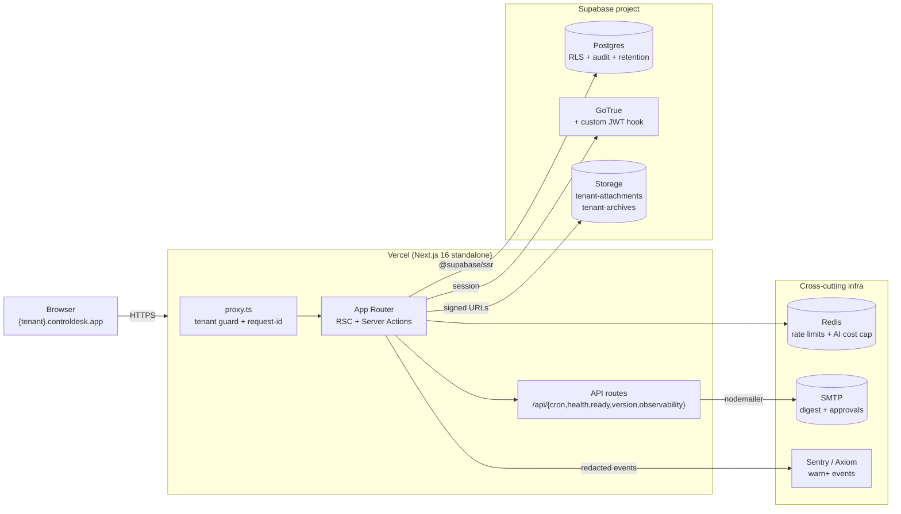
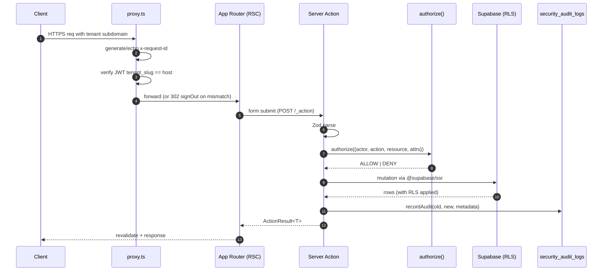
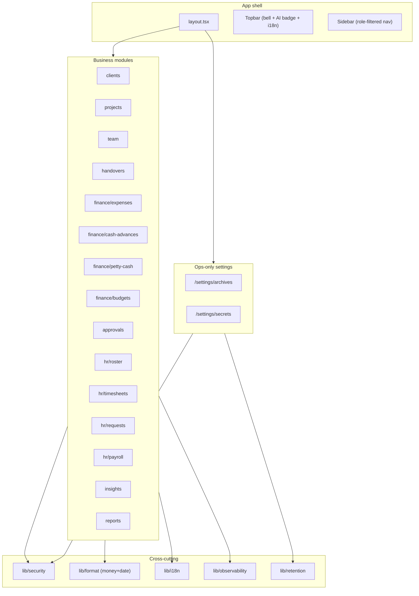

# Architecture

A single-repo, tenant-per-subdomain SaaS. Next.js 16 App Router serves
every route (RSC-first); Supabase provides Postgres + Auth + Storage.

## High-level layout



## Request lifecycle



## Key architectural decisions

### 1. Subdomain-based multi-tenancy

- Every URL is `{tenant_slug}.controldesk.app`. `proxy.ts` resolves the
  slug from the host header, looks up `tenants.id`, and stashes it on
  the request.
- The Supabase JWT carries `tenant_id`, `tenant_slug`, `role`,
  `employee_id` claims via a custom access-token hook
  (`supabase/migrations/0003_rls_helpers.sql`).
- RLS policies reference `public.current_tenant_id()` which pulls
  `tenant_id` out of the JWT — cross-tenant reads are literally
  impossible even for a compromised anon client.

### 2. RSC-first with Server Actions

- All pages under `src/app/(app)/**` are React Server Components by
  default. Client components are `'use client'` and stay small.
- Every mutation is a Server Action wrapped in
  `withSecureAction()` — auth → Zod → PDP → mutation → audit in one
  call site. See [`security-model.md`](security-model.md).
- Return type is always `ActionResult<T>`. Never throw errors to the
  client.

### 3. Two Supabase clients

- `createClient()` (`src/lib/supabase/server.ts`) — anon key + cookie
  session, RLS enforced. Used by RSC + Server Actions + user-facing
  API routes.
- `createServiceRoleClient()` — service_role key, bypasses RLS.
  Reserved for cron endpoints, storage listings on admin surfaces,
  and the audit-log purge helper. Never exposed to client code.

### 4. Feature-folder convention

Every business module is a self-contained tree — see rules §17. This
keeps blast radius small and makes ownership routing via CODEOWNERS
easy. Cross-module helpers live under `src/lib/*`.

### 5. Realtime + notifications

- `notifications` table + `enqueue_notification` RPC (`0006_...sql`).
- Bell in-app subscribes via Supabase Realtime
  `postgres_changes`. AI insights badge subscribes to `ai_insights`
  INSERTs. Approvals inbox subscribes to state-change updates.
- Approval emails go through `email_outbox` (rules §20) so every
  attempt is auditable, even when SMTP is degraded.

### 6. Observability

Three pieces (rules §21):

- `src/lib/observability/log.ts` — structured JSON on stdout, with
  `tenant_id`, `user_id`, `request_id`, `level`.
- `src/lib/observability/sink.ts` — pluggable adapter (Sentry, Axiom,
  Console, NoOp) for `warn`/`error`/`fatal`. PII redacted before
  dispatch.
- `/api/observability/report` — client crash sink, unauthenticated,
  same-origin + rate-limited via Redis.

### 7. Retention + cold archive

Rules §22 requires 10-year retention for financial data + 7-year for
audit logs. Design:

- `/api/cron/archive` exports rows past `archive_after_days` into
  gzip'd NDJSON on the `tenant-archives` bucket, recording each batch
  in `data_archives` with a SHA-256 checksum.
- `/api/cron/retention` purges source rows only when a matching
  ARCHIVED batch exists.
- `/settings/archives` UI lets admins verify checksums + regenerate
  short-TTL signed URLs for compliance restore.

See [`ops/data-retention.md`](ops/data-retention.md).

## Module boundaries



## Directory anchors

```text
controldesk/
├── proxy.ts                            # tenant guard + request-id
├── src/app/
│   ├── (auth)/                         # login + register
│   ├── (app)/                          # signed-in shell
│   │   ├── layout.tsx                  # topbar + sidebar
│   │   ├── {module}/{page,actions,…}
│   │   └── settings/{archives,secrets}
│   └── api/
│       ├── cron/{digest,retention,archive,rotation-check,insights}
│       ├── health, ready, version
│       ├── auth/callback
│       └── observability/report
├── src/lib/
│   ├── security/            # pdp, action-wrapper, audit, rate-limit, crypto, rotation
│   ├── observability/       # log, sink, client-report
│   ├── retention/           # config, archive, verify
│   ├── format/              # money, date
│   ├── i18n/                # config, request, actions
│   ├── ai/                  # schemas, generators, cost-cap, last-seen
│   └── validation/          # module-specific Zod
├── supabase/
│   ├── migrations/          # 0001..0018 — landed. Never edit in place.
│   └── seed.sql             # demo tenant + one user per role
├── messages/{id,en}.json    # locale dictionaries
├── e2e/*.spec.ts            # Playwright chain suites
└── docs/                    # you are here
```

## Deployment topology

- **Frontend + API** — Vercel (Next.js 16 standalone). Region set to
  Singapore (`sin1`) for Indonesia latency.
- **Database + Auth + Storage** — Supabase project in the same region.
- **Redis** — provider of choice (Upstash, ElastiCache) — used for
  rate limits, AI cost cap, and observability rate-limit counter.
- **SMTP** — dev: mailpit (Docker Compose). Prod: Resend / Postmark.
- **Observability** — Sentry OR Axiom (pick one via `OBSERVABILITY_SINK`).

See [`deployment.md`](deployment.md) for the step-by-step.
