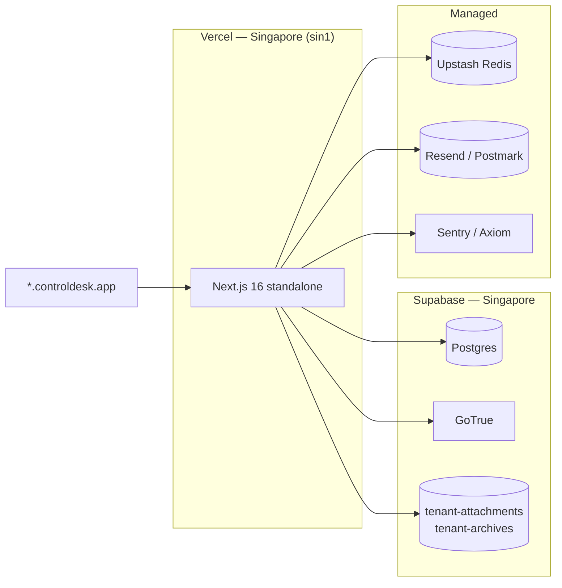

# Deployment

ControlDesk targets three environments:

| Env         | URL                              | Purpose                    |
| ----------- | -------------------------------- | -------------------------- |
| Local dev   | `demo.localhost:3000`            | Individual dev machine.    |
| Staging     | `staging.controldesk.app`        | Pre-prod verification.     |
| Production  | `controldesk.app`                | Tenant subdomains.         |

## Deployment model

- **Frontend + API** — Vercel (Next.js 16 standalone build).
- **Database + Auth + Storage** — Supabase managed project.
- **Redis** — Upstash (recommended) or self-hosted.
- **SMTP** — Resend / Postmark (production), mailpit (local dev).
- **Observability** — Sentry OR Axiom via `OBSERVABILITY_SINK` env var.



## Vercel setup

### First-time provisioning

1. `vercel link` inside the repo. Assign it to the `controldesk` team.
2. Set the region to `sin1` (Singapore) in Vercel project settings for
   Indonesia latency.
3. Set the Node.js version to **20.x** in Settings → General.
4. Set the build command to `pnpm build`.
5. Enable **Automatic HTTPS** for `*.controldesk.app` in Domains.
   Configure a wildcard domain if your registrar supports it; otherwise
   add subdomains as tenants sign up.

### Environment variables

Push these via `vercel env` OR paste into Settings → Environment
Variables. See [`env-reference.md`](env-reference.md) for the full
list. Minimum required for a working prod deploy:

| Key                                | Environment          |
| ---------------------------------- | -------------------- |
| `NEXT_PUBLIC_SUPABASE_URL`         | prod / staging       |
| `NEXT_PUBLIC_SUPABASE_ANON_KEY`    | prod / staging       |
| `SUPABASE_SERVICE_ROLE_KEY`        | prod / staging       |
| `APP_ENCRYPTION_KEY`               | prod / staging       |
| `CRON_SECRET`                      | prod / staging       |
| `NEXT_PUBLIC_APP_URL`              | prod / staging       |
| `REDIS_URL`                        | prod / staging       |
| `SMTP_HOST` `SMTP_PORT` `SMTP_USER` `SMTP_PASSWORD` `SMTP_FROM` | prod / staging |
| `OBSERVABILITY_SINK`               | prod / staging       |
| `SENTRY_DSN` OR `AXIOM_TOKEN` + `AXIOM_DATASET` | prod / staging |
| `OPENAI_API_KEY`                   | prod / staging (optional; falls back to mock) |
| `BUILD_SHA`                        | injected by Vercel automatically |

Rotate `APP_ENCRYPTION_KEY`, `SUPABASE_SERVICE_ROLE_KEY`,
`CRON_SECRET`, and SMTP creds every 90 days per rules §22 — the
`/settings/secrets` UI + rotation-check cron surface this.

### Deploy flow

- **Preview** — every PR gets a Vercel preview URL. Preview deploys
  use the `staging.controldesk.app` env values.
- **Staging** — `main` branch auto-deploys to
  `staging.controldesk.app`.
- **Production** — tag a semver (`v0.2.0`) and Vercel promotes the
  matching commit to `controldesk.app`. This is a manual promotion in
  Vercel UI for safety.

### Cron endpoints

Vercel Cron is configured via [`vercel.json`](../vercel.json). Current
schedule:

| Endpoint                      | Cron (UTC)        | Local (WIB, UTC+7)             |
| ----------------------------- | ----------------- | ------------------------------ |
| `/api/cron/digest`            | `0 1 * * *`       | Daily 08:00 WIB                |
| `/api/cron/retention`         | `0 20 * * *`      | Daily 03:00 WIB                |
| `/api/cron/archive`           | `0 19 * * 0`      | Weekly Mon 02:00 WIB           |
| `/api/cron/rotation-check`    | `0 2 * * 1`       | Weekly Mon 09:00 WIB           |

Each cron endpoint authenticates via `Authorization: Bearer $CRON_SECRET`
and writes to `cron_run_log` for observability.

## Supabase setup

### First-time project setup

1. Create a new Supabase project in Singapore.
2. In SQL editor → paste the entire `supabase/migrations/*.sql` in
   order OR use the Supabase CLI:

   ```bash
   supabase link --project-ref <ref>
   supabase db push
   ```

3. In Auth → URL Configuration:
   - Site URL: `https://controldesk.app`
   - Redirect URLs: `https://*.controldesk.app/**`,
     `https://staging.controldesk.app/**`
4. In Auth → Providers, enable Email. Configure Magic Link, disable
   any providers you don't use.
5. In Auth → JWT Hooks, register the `custom_access_token_hook`
   function (installed by migration `0003`).
6. In Storage → create the private buckets `tenant-attachments` +
   `tenant-archives` (or verify migration `0007` created them).

### Backups

- Supabase Pro takes daily backups automatically.
- For compliance-grade retention, also run the archive cron
  (`/api/cron/archive`) — writes gzipped NDJSON with SHA-256
  checksums to `tenant-archives`.

## Redis setup

- Upstash (recommended). Create a Regional-Global database in
  Singapore.
- Copy the REST URL and paste as `REDIS_URL`.
- No schema — the app uses simple `SET`/`GET`/`EXPIRE` for rate limits
  + AI cost cap.

## SMTP setup

### Production

Resend or Postmark, both work:

```
SMTP_HOST=smtp.resend.com
SMTP_PORT=465
SMTP_USER=resend
SMTP_PASSWORD=<your API key>
SMTP_FROM=ControlDesk <noreply@controldesk.app>
```

Approval + digest emails all flow through `nodemailer`. Every
attempt is recorded in `public.email_outbox` for audit + retry.

### Local dev

Docker Compose brings up mailpit on port 1025 + web UI on 8025.
Automatic — no env vars needed if you're using `docker compose up`.

## Observability setup

Pick one of Sentry or Axiom via `OBSERVABILITY_SINK=sentry` or
`OBSERVABILITY_SINK=axiom`.

### Sentry

```
OBSERVABILITY_SINK=sentry
SENTRY_DSN=https://<key>@<org>.ingest.sentry.io/<project>
SENTRY_ENV=production        # or "staging"
```

The sink uses Sentry's raw envelope API — no `@sentry/nextjs` needed.
PII redaction happens before dispatch (`src/lib/observability/sink.ts`).

### Axiom

```
OBSERVABILITY_SINK=axiom
AXIOM_TOKEN=xaat-...
AXIOM_DATASET=controldesk-prod
```

The sink POSTs to `ingest.axiom.co`. Same redaction guarantees.

### Client-side error reporter

Rendered errors + unhandled promise rejections POST to
`/api/observability/report` via `navigator.sendBeacon`. The route is:

- Same-origin only.
- Rate-limited via Redis (5 req / 5 min per IP).
- Redacted server-side before dispatch to the sink.

## Docker

For self-hosting or a compliance sandbox, the multi-stage image is
production-shape:

```bash
docker build -t controldesk:latest .
docker run -p 3000:3000 --env-file .env.production controldesk:latest
```

For a full stack (`app` + `redis` + `mailpit`):

```bash
docker compose up -d --build
```

The container:

- Runs as non-root user `nextjs:nodejs` (UID 1001), no shell.
- Exposes `/api/health` for the Docker healthcheck.
- Talks to Supabase via `host.docker.internal:54321` (local dev) OR
  the configured `NEXT_PUBLIC_SUPABASE_URL` (prod).

## Rollback

### App-only rollback

Vercel keeps a promotable history of previous deployments. In the
Vercel UI → Deployments → "..." → "Promote to production" on the
previous stable deploy.

### Database rollback

Every migration includes a rollback SQL block in its header comment.
Apply that block manually via `psql` or Supabase SQL editor. Then
delete the migration file from `main` (via a PR) so
`supabase db push` won't reapply it.

**Never** roll back a migration that has already been applied to
production without also reverting the app code that depends on the
new schema — the previous deploy will silently accept writes with
missing columns.

### Data restore from archive

See [`ops/data-retention.md`](ops/data-retention.md#restore-procedure).
The fast path is the `/settings/archives` UI — one click per archive,
signed URL valid for 5 minutes.

## Post-deploy checks

Run these against a fresh deploy before flipping traffic:

```bash
BASE=https://<subdomain>.controldesk.app

# Liveness — always 200
curl -fsS $BASE/api/health

# Readiness — 200 only if DB + Redis reachable
curl -fsS $BASE/api/ready

# Deploy identity
curl -fsS $BASE/api/version | jq .

# Auth flow (headless — should redirect to /login)
curl -o /dev/null -w "%{http_code}\n" $BASE/dashboard
```

Then in the UI:

1. Sign in as the tenant admin.
2. Open `/settings/archives` — verify the registry loads.
3. Open `/settings/secrets` — check the rotation summary badges.
4. Trigger a test cron:

   ```bash
   curl -X POST -H "Authorization: Bearer $CRON_SECRET" \
     $BASE/api/cron/retention?dry_run=true
   ```

If any of these fail, [rollback](#rollback).
