# Development

How to add a feature to ControlDesk without breaking the rulebook.

## Golden path

```mermaid
flowchart LR
    Idea["Idea / issue"] --> Rules["Read .cursorrules §"]
    Rules --> Schema["1. Zod schema<br/>src/lib/validation/[m].ts"]
    Schema --> Migration["2. Migration<br/>supabase/migrations/NNNN_[m].sql"]
    Migration --> PDP["3. PDP resource + decide()<br/>src/lib/security/pdp.ts"]
    PDP --> Data["4. Data helpers<br/>src/lib/data/[m].ts (cached)"]
    Data --> Action["5. Server Actions<br/>src/app/(app)/[m]/actions.ts"]
    Action --> UI["6. RSC page + client components<br/>src/app/(app)/[m]/"]
    UI --> Nav["7. Nav entry (if user-visible)<br/>src/lib/nav/config.ts"]
    Nav --> I18n["8. i18n keys<br/>messages/{id,en}.json"]
    I18n --> Test["9. Unit tests + Playwright"]
    Test --> Runbook["10. Runbook (if ops-facing)"]
```



## Step-by-step (concrete example: add a `foo` module)

Fictional module for illustration. Substitute your actual domain.

### 1. Zod schema

```ts
// src/lib/validation/foo.ts
import { z } from "zod";

export const createFooSchema = z.object({
  project_id: z.string().uuid(),
  amount: z.string().regex(/^\d+$/), // string cents to avoid float
  note: z.string().max(500).optional(),
});

export type CreateFooInput = z.infer<typeof createFooSchema>;
```

Add unit tests immediately at `src/lib/validation/foo.test.ts`. Cover
happy path, boundary values, and invalid input.

### 2. Migration

```bash
pnpm db:diff -f foo_table
```

Edit the generated file:

```sql
-- 0019_foo_table.sql
-- Rollback:
--   drop policy foo_tenant_isolation on public.foos;
--   drop table public.foos;

create table public.foos (
  id uuid primary key default gen_random_uuid(),
  tenant_id uuid not null references public.tenants(id) on delete cascade,
  project_id uuid not null references public.projects(id),
  amount numeric(18,2) not null,
  note text,
  created_by uuid not null references public.employees(id),
  created_at timestamptz not null default now()
);

create index foos_tenant_project_idx on public.foos (tenant_id, project_id);

alter table public.foos enable row level security;

create policy foos_tenant_isolation
  on public.foos
  for all
  using  (tenant_id = public.current_tenant_id())
  with check (tenant_id = public.current_tenant_id());

comment on table public.foos is
  'Rules §17 — feature-folder-scoped module. Retention: 10 years.';
```

Then:

```bash
pnpm db:reset      # apply cleanly
pnpm db:types      # regenerate src/types/database.ts
```

### 3. PDP resource

`src/lib/security/pdp.ts`:

```ts
export type ResourceType =
  | ...existing...
  | "foo";

function decideFoo(
  actor: Actor,
  action: ActionVerb,
  attrs: FooAttributes,
): Decision {
  if (action === "read") {
    return { effect: "ALLOW" };
  }
  if (action === "create" && attrs.projectId != null) {
    if ([ROLES.PROJECT_MANAGER, ROLES.LEAD_FINANCE].includes(actor.role)) {
      return { effect: "ALLOW" };
    }
  }
  return { effect: "DENY", reason: "insufficient_role" };
}
```

And wire it into the main `authorize()` switch. Add tests to
`pdp.test.ts` immediately — one row per actor × action × outcome.

### 4. Data helpers (optional)

If the page reads foos in multiple places within one request, wrap
the query in `React.cache()` to dedupe:

```ts
// src/lib/data/foo.ts
import "server-only";
import { cache } from "react";
import { createClient } from "@/lib/supabase/server";

export const listFoosForProject = cache(async (projectId: string) => {
  const supabase = await createClient();
  const { data, error } = await supabase
    .from("foos")
    .select("id, amount, note, created_at, employees!created_by(name)")
    .eq("project_id", projectId)
    .order("created_at", { ascending: false });
  if (error) throw error;
  return data;
});
```

### 5. Server Actions

`src/app/(app)/foos/actions.ts`:

```ts
"use server";

import { revalidatePath } from "next/cache";
import { withSecureAction } from "@/lib/security/action-wrapper";
import { createFooSchema } from "@/lib/validation/foo";
import { createClient } from "@/lib/supabase/server";

export const createFooAction = withSecureAction({
  schema: createFooSchema,
  resource: "foo",
  action: "create",
  auditAction: "CREATE",
  auditResourceName: "foos",
  resolveAttributes: async (input, ctx) => ({
    tenantId: ctx.actor.tenantId,
    projectId: input.project_id,
  }),
  handler: async (input, ctx) => {
    const supabase = await createClient();
    const { data, error } = await supabase
      .from("foos")
      .insert({
        tenant_id: ctx.actor.tenantId,
        project_id: input.project_id,
        amount: input.amount,
        note: input.note ?? null,
        created_by: ctx.actor.employeeId,
      })
      .select("id, amount, note, project_id, created_at")
      .single();

    if (error) throw error;

    revalidatePath(`/projects/${input.project_id}`);
    revalidatePath("/foos");

    return {
      result: data,
      auditResourceId: data.id,
      auditNewValues: {
        project_id: data.project_id,
        amount: data.amount,
      },
    };
  },
});
```

### 6. RSC page + client components

```
src/app/(app)/foos/
├── page.tsx                  # RSC list, uses listFoosForProject
├── new-foo-sheet.tsx         # 'use client' — form + createFooAction call
├── foo-action-buttons.tsx    # 'use client' — approve/reject buttons
└── [id]/page.tsx             # RSC detail
```

- Page components are Server Components. No hooks.
- Client components import Shadcn primitives from `src/components/ui`.
- Forms use React Hook Form + `@hookform/resolvers/zod` with the
  schema from step 1 as the single source of truth.

### 7. Nav entry

If this is a user-visible module, wire an entry into
`src/lib/nav/config.ts`:

```ts
{
  key: "foos",
  labelKey: "nav.foos.label",
  href: "/foos",
  icon: "Folder",
  roles: [ROLES.PROJECT_MANAGER, ROLES.LEAD_FINANCE, ROLES.TENANT_ADMIN],
},
```

Nav filters run in `AppSidebar` — no additional plumbing needed.

### 8. i18n keys

Add matching entries to BOTH `messages/id.json` and `messages/en.json`.
Key parity is enforced by `src/lib/i18n/config.test.ts` — if you miss
one, tests fail.

```json
{
  "nav": {
    "foos": {
      "label": "Foo"
    }
  },
  "foos": {
    "title": "Foo",
    "actions": {
      "create": "Buat Foo"
    }
  }
}
```

Never hardcode a user-facing string in JSX.

### 9. Tests

Unit (Vitest) — mandatory for:

- Zod schema edge cases.
- PDP decisions for the new resource.
- Any state-machine / validation helper under `src/lib/**`.

Playwright — mandatory when the feature ships a critical flow. Copy
one of the existing chain suites in `e2e/` and adapt.

```bash
pnpm test src/lib/validation/foo.test.ts src/lib/security/pdp.test.ts
pnpm test:coverage       # coverage floor on src/lib/security/**
pnpm test:e2e -g "foo"   # narrow Playwright to just your suite
```

### 10. Runbook (if ops-facing)

If your feature exposes a new cron, batch, or admin-only settings page,
add a runbook under `docs/ops/`. Include:

- What the surface does (one paragraph).
- On-call symptoms (what an operator sees when it breaks).
- Required env vars.
- Step-by-step recovery / rollback.

## Coding conventions

### Money

- DB columns: `numeric(18,2)`.
- Runtime: `bigint` cents OR `decimal.js` — never `number`.
- Format for display: `formatIDR()` from `src/lib/format/money.ts`.

### Dates

- DB columns: `timestamptz` (UTC).
- Runtime: pass through `formatInTz()` / `formatIsoDateInTz()` in
  `src/lib/format/date.ts`. The tenant timezone lives on
  `tenants.timezone`.

### Strings

- User-facing: `useTranslations()` (client) or `getTranslations()`
  (RSC). Keys in `messages/{id,en}.json`.
- Ops-facing (logs, audit reasons, cron messages): English is fine.

### RSC vs client components

- Default to RSC.
- `'use client'` ONLY when you need: state, effects, event handlers,
  motion, browser APIs, or a hook from a third-party client library.
- Never put a Server Action call inside `useEffect`. Use form actions
  or `startTransition()`.

### `console.log`

- Forbidden in production paths. Use `log.info()` / `log.warn()` /
  `log.error()` from `src/lib/observability/log.ts`.
- OK in `*.test.ts` files.

### Comments

- Explain WHY, not WHAT.
- Non-obvious business rules, trade-offs, and rulebook cross-refs get
  a comment. Boilerplate does not.

## Adding a new locale

1. Create `messages/xx.json` with the same keys as `id.json`.
2. Register the locale in `src/lib/i18n/config.ts`.
3. Add the display label to `LanguageToggle`.
4. Run `pnpm test` — the parity test will fail if any key is missing.

## Debugging tips

### RLS silently drops a row

Sign in to Supabase Studio (`http://127.0.0.1:54323`) → SQL → run:

```sql
select * from public.foos where id = '...';
```

Studio uses the `service_role` so it bypasses RLS. If the row is there,
you have a policy problem. Check `pg_policies` and confirm your JWT
carries the right `tenant_id`.

### Server Action returns `{ ok: false, code: "FORBIDDEN" }`

Set `LOG_LEVEL=debug` and re-run. The wrapper logs the PDP decision
+ reason at debug level. Common causes:

- `resolveAttributes` returned the wrong `tenantId`.
- A new resource type was added to `pdp.ts` but not to `authorize()`
  switch → falls through to the `unknown-resource` deny branch.

### Playwright test flakes because of stale seed

`pnpm db:reset` before running the E2E suite. The chain suites mutate
the seed and rely on `PENDING_L1` starting state.

## Non-negotiables

- No mutation without `withSecureAction()`.
- No new tenant-scoped table without RLS + `tenant_id` + `(tenant_id, …)` index.
- No hardcoded user-facing strings.
- No `number` for money.
- No `console.log` in production paths.
- No editing a migration that has landed on `main`.
- No skipping the coverage floor on `src/lib/security/**`.
