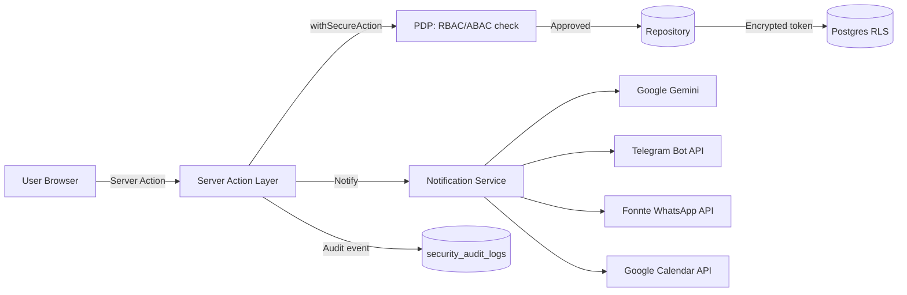

# External Integrations

Panduan lengkap semua integrasi pihak ketiga di ControlDesk — apa yang
disediakan, kapan dipakai, cara setup, cara test, dan pitfall umum.
Bilingual (Bahasa Indonesia adalah bahasa utama; istilah teknis tetap
English).

Semua integrasi mengikuti prinsip yang sama:

1. **Tenant-scoped** — setiap tenant punya konfigurasi/kredensial sendiri.
   Tidak ada shared bot / shared API key lintas tenant (rules §5, §15).
2. **Encrypted at rest** — semua token/secret disimpan encrypted
   (`APP_ENCRYPTION_KEY`, AES-256-GCM) via
   `src/lib/security/token-crypto.ts`.
3. **Verify before persist** — kredensial di-hit ke provider dulu; kalau
   ditolak, tidak disimpan. Mencegah token cacat lolos ke DB.
4. **Audit trail** — setiap `INSERT/UPDATE/DELETE` di tabel konfigurasi
   integrasi otomatis masuk `security_audit_logs` (rules §3) tanpa
   membocorkan nilai secret.
5. **Fail-open UX** — kalau provider mati / rate limit, aplikasi tetap
   jalan (mock output / degraded state); user tetap bisa kerja.

## Katalog integrasi

| Integrasi                                                    | Provider                    | Untuk apa                                                                 | Skala free                        | Status di 8 Aug 2026 |
| ------------------------------------------------------------ | --------------------------- | ------------------------------------------------------------------------- | --------------------------------- | -------------------- |
| [AI Insights (Gemini)](./ai-insights-gemini.md)              | Google Gemini (AI Studio)   | Insight naratif per proyek/klien/karyawan (4 generators)                  | 1,500 req/hari, 10 RPM            | ✅ Production        |
| [Telegram Bot](./telegram-bot.md)                            | Telegram Bot API            | Notifikasi push per-user via chat bot per-tenant                          | Unlimited (Telegram gratis)       | ✅ Production        |
| [WhatsApp (Fonnte)](./whatsapp-fonnte.md)                    | Fonnte (unofficial gateway) | Notifikasi push WhatsApp per-user                                         | 1,000 msg/bulan (Free plan)       | ✅ Production        |
| [Google Calendar](../modules/projects.md#google-calendar-sync) | Google Calendar API         | Sync project milestone → tenant calendar                                  | 1M req/hari                       | ✅ Production        |

## Kapan pakai apa?

| Kebutuhan                                             | Pilihan                                                          |
| ----------------------------------------------------- | ---------------------------------------------------------------- |
| Insight AI / prediksi / narasi                        | **AI Insights (Gemini)**                                         |
| Push notifikasi ke tim internal (dev / ops / finance) | **Telegram Bot** (per-user opt-in, no phone number needed)       |
| Push notifikasi ke klien / lapangan (nomor WA)        | **WhatsApp (Fonnte)** — cek ToS caveat di dokumen                |
| Sinkronisasi jadwal + milestone ke kalender tim       | **Google Calendar**                                              |
| Email transactional                                   | Native (`email_outbox` + SMTP) — lihat [Notifications](../modules/ai-and-notifications.md) |

## Diagram alur data (high-level)



Semua panggilan keluar (Gemini/Telegram/Fonnte/Google Calendar) melewati:
1. **PDP** — role check (biasanya `TENANT_ADMIN` atau `GM` untuk config,
   role apapun untuk pemakaian jika sudah opt-in).
2. **Repository** — decrypt token di memory, tidak pernah lolos ke client.
3. **Provider API** — timeout 5 detik untuk mencegah wedge Server Action.
4. **Audit log** — resource-level, tanpa nilai token.

## Cara test cepat (semua integrasi)

Setelah setup masing-masing, jalankan smoke test CLI. Lengkapnya di
[`../dev-tools.md`](../dev-tools.md):

```bash
pnpm test:ai --locale=id             # Gemini AI Insight (Bahasa)
pnpm test:tg <chat_id>               # Telegram sendMessage
pnpm test:wa "+62xxx"                # WhatsApp via Fonnte
pnpm fonnte:device                   # Cek device Fonnte
```

Setiap script:
- Load konfigurasi tenant dari DB
- Decrypt token
- Hit provider API real
- Print hasil + latency + provider message id

Kalau semua CLI hijau → integrasi production-ready. Kalau merah, output
error mengarahkan ke fix spesifik.

## Security & compliance summary

| Aspek                          | Bagaimana ControlDesk menangani                                                              |
| ------------------------------ | -------------------------------------------------------------------------------------------- |
| Storage token                  | `encrypted_*` kolom AES-256-GCM (`token-crypto.ts`); plaintext tidak pernah di DB.           |
| Access control token           | Service-role client only; RLS tolak SELECT dari role authenticated (policy `_no_direct`).    |
| Audit trail                    | `security_audit_logs` mencatat action, resource_name, tenant, actor — TIDAK menyimpan token. |
| PII di prompt AI               | `src/lib/ai/redact.ts` scrub nama → hash, salary → range, KTP/NPWP → drop, phone → last-4.   |
| Cross-tenant isolation         | Setiap repository call filter `.eq('tenant_id', ...)` walau service-role bypass RLS.         |
| Rate limit outbound            | 5-detik timeout per call (semua provider); tidak ada retry loop di path Server Action.       |
| Provider ToS                   | Fonnte adalah **unofficial gateway** — baca [caveat](./whatsapp-fonnte.md#compliance-caveat). |
| Key rotation                   | `APP_ENCRYPTION_KEY` rotasi 90 hari via runbook `ops/secret-rotation.md`.                    |

## Roadmap integrasi

Rencana penambahan (belum di-scope kalendar):

- **Slack** — alternatif ke Telegram untuk tim yang pakai Slack. Design pattern sama (per-tenant workspace token).
- **WhatsApp Business API resmi (Meta Cloud)** — alternatif ke Fonnte kalau tenant butuh compliance ketat. Provider slot sudah disiapkan di code (`META_CLOUD`), tinggal wire adapter.
- **Twilio SMS** — untuk 2FA + fallback notifikasi.
- **Microsoft Teams** — mirror Slack pattern.
- **Zoom / Meet** — auto-create room untuk milestone review meeting.

Vote fitur di GitHub Issues, atau kontak tim internal.

## Struktur folder

```
src/lib/integrations/
├── telegram/
│   ├── client.ts          # sendMessage, verify getMe
│   ├── repository.ts      # DB CRUD, encryption
│   ├── link-token.ts      # HMAC-signed deep link
│   └── index.ts           # Barrel export
├── whatsapp/
│   ├── client.ts          # sendMessage (Twilio/Meta/Fonnte)
│   ├── repository.ts      # DB CRUD, encryption
│   ├── link-token.ts
│   └── index.ts
└── google-calendar/
    ├── google.ts          # Real OAuth adapter
    ├── noop.ts            # Dev-mode stub
    ├── drain.ts           # Outbox drain job
    ├── credentials.ts
    ├── outbox.ts
    └── index.ts

src/lib/ai/
├── generators.ts          # 4 insight generators
├── schemas.ts             # Zod output schemas
├── redact.ts              # PII redaction
├── cost-cap.ts            # Redis daily token cap
└── index.ts
```

## Cross-references

- Product perspective → [`../modules/ai-and-notifications.md`](../modules/ai-and-notifications.md)
- Environment vars → [`../env-reference.md`](../env-reference.md)
- Security model → [`../security-model.md`](../security-model.md)
- Secret rotation runbook → [`../ops/secret-rotation.md`](../ops/secret-rotation.md)
- QA smoke tests → [`../qa/manual-smoke-scripts.md`](../qa/manual-smoke-scripts.md)
- CLI dev tools → [`../dev-tools.md`](../dev-tools.md)

## Contributing

Menambah integrasi baru? Ikuti pattern yang sama:

1. **DB layer**: bikin tabel `tenant_<provider>_configs` dengan
   `encrypted_*` kolom + RLS `_no_direct` policy. Naming: `NNNN_<provider>_integration.sql`.
2. **Repository** (`src/lib/integrations/<provider>/repository.ts`):
   `load*`, `save*`, `deactivate*` — semua via service-role client + filter tenant di WHERE clause.
3. **Client** (`src/lib/integrations/<provider>/client.ts`):
   `send*Message`, `verify*Credentials`. Timeout 5 detik. Never throw — return `{ ok: false, code, error }`.
4. **Admin UI** (`src/app/(app)/settings/integrations/<provider>/`):
   RSC page + form (RHF + Zod) + Server Actions (`withSecureAction`).
5. **Runbook** di halaman UI + doc di `docs/integrations/<provider>.md`.
6. **CLI test** di `scripts/test-<provider>.ts` + `package.json` script.
7. **Cross-link** di file ini dan `docs/README.md`.
