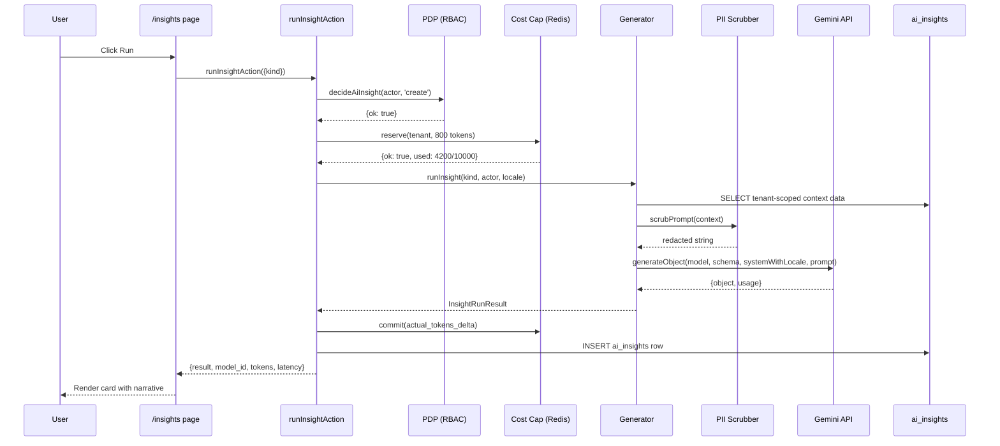

# AI Insights (Google Gemini)

**Route UI**: [`/insights`](http://localhost:3000/insights)
**Route Admin**: `.env.local` (server-side env vars)
**Table**: `public.ai_insights`
**Provider**: Google Gemini via `@ai-sdk/google` + Vercel AI SDK `generateObject`
**Prompt version tracked**: `v2-locale`

Fitur AI Insights menghasilkan analisa naratif terstruktur dari data
tenant Anda. Empat generator berjalan on-demand atau via cron:

1. **Predict Expense Impact** — dampak pengeluaran pending ke gross margin proyek.
2. **Analyze Resource Utilization** — flag over/under-allocated PM & karyawan.
3. **Analyze Client Health** — skor kesehatan hubungan klien.
4. **Analyze SLA Breach** — forecast risiko breach SLA 24-48 jam ke depan.

Semua output **structured** (validated Zod schema) — bukan free-form
text. Bahasa mengikuti locale UI user (Bahasa Indonesia atau English).

## Table of contents

- [Prasyarat](#prasyarat)
- [Setup langkah demi langkah](#setup-langkah-demi-langkah)
- [Verifikasi via CLI](#verifikasi-via-cli)
- [Verifikasi di UI](#verifikasi-di-ui)
- [Locale-aware output](#locale-aware-output)
- [Arsitektur](#arsitektur)
- [Security & AI Safety (rules §15)](#security--ai-safety-rules-15)
- [Environment variables](#environment-variables)
- [Model selection guide](#model-selection-guide)
- [Cost & rate limits](#cost--rate-limits)
- [Provider alternatif](#provider-alternatif)
- [Troubleshooting](#troubleshooting)
- [FAQ](#faq)

## Prasyarat

- Akun **Google** (tidak perlu credit card untuk free tier).
- Role **`TENANT_ADMIN`** atau **`GM`** untuk edit env var + restart aplikasi (dev / prod).
- **APP_ENCRYPTION_KEY** sudah terpasang (untuk encrypt bila mau simpan key di DB tenant di masa depan; saat ini masih di env vars).

## Setup langkah demi langkah

### Langkah 1 — Dapatkan API key Gemini

1. Buka [https://aistudio.google.com/apikey](https://aistudio.google.com/apikey).
2. Login dengan akun Google Anda.
3. Klik tombol **Create API Key**.
4. Pilih project Google Cloud (atau bikin baru — beri nama misalnya "ControlDesk-AI").
5. Key akan muncul di dialog. Format modern (per Juni 2026):
   ```
   AQ.Ab8RN6xxxxxxxxxxxxxxxxxxxxxxxxxxxxxxxxx
   ```
   ⚠ **Copy sekarang** — setelah dialog ditutup, key hanya bisa dilihat via "Show key".

> **Format lama (`AIza...`) masih bekerja tapi akan sunset di September 2026.**
> Kalau Anda punya key `AIza`, restrict ke Gemini API di AI Studio console
> sebagai stopgap, dan create key baru format `AQ.Ab` sebelum September.

### Langkah 2 — Paste ke `.env.local`

Buka `.env.local` di root repo, cari section `# --- AI Analytics Engine ---`,
lalu edit:

```bash
AI_PROVIDER="google"
AI_MODEL_ID="gemini-flash-latest"
GOOGLE_GENERATIVE_AI_API_KEY="AQ.Ab8RN6xxxxxxxxxxxxxxxxxxxxxxxxxxxxxxxxx"
AI_DAILY_TOKEN_CAP="10000"
```

Kolom yang **wajib** Anda set: `AI_PROVIDER`, `AI_MODEL_ID`, `GOOGLE_GENERATIVE_AI_API_KEY`.

**Tekan `Cmd+S`** (Mac) atau `Ctrl+S` (Windows/Linux) untuk save file.
Node membaca `.env.local` dari disk, jadi buffer editor yang belum di-save
tidak akan ke-load.

### Langkah 3 — Verifikasi via CLI

```bash
pnpm test:ai --locale=id
```

Ekspektasi output:

```
================================================================
ControlDesk AI smoke test
================================================================
provider  : google
model_id  : gemini-flash-latest
locale    : id
prompt    : Beri snapshot 3-poin kesehatan tenant BPO demo…

Calling model…

Result:
{
  "strength": "Tingkat retensi klien tinggi…",
  "risk": "Keterlambatan pembayaran piutang…",
  "action": "Kirimkan surat tagihan resmi…"
}

tokens in : 58
tokens out: 702
latency   : 4868ms

SUKSES — AI Insights sekarang bisa dijalankan live di /insights.
```

Kalau **SUKSES**, lanjut ke Langkah 4. Kalau **GAGAL**, lihat
[Troubleshooting](#troubleshooting).

### Langkah 4 — Restart dev server

```bash
# Di terminal `pnpm dev` yang sedang jalan:
# Ctrl+C untuk stop
pnpm dev
```

Restart wajib supaya Next.js re-load `.env.local` — hot reload TIDAK
mengcover env var.

### Langkah 5 — Verifikasi di UI

Lanjut ke [Verifikasi di UI](#verifikasi-di-ui) di bawah.

## Verifikasi via CLI

`pnpm test:ai` mendukung 3 skenario. Detail lengkap di [`../dev-tools.md`](../dev-tools.md).

```bash
# Default: English
pnpm test:ai

# Bahasa Indonesia
pnpm test:ai --locale=id

# Prompt custom
pnpm test:ai --locale=id "Analisa risiko cashflow 30 hari ke depan"
```

Sukses = exit code 0, print JSON hasil, tokens, latency.

## Verifikasi di UI

1. Buka [http://localhost:3000/insights](http://localhost:3000/insights) (login sebagai user apapun yang sudah ada di seed).
2. Anda akan melihat 4 kartu:
   - Dampak Pengeluaran (Predict Expense Impact)
   - Utilisasi Resource
   - Kesehatan Klien
   - Risiko Pelanggaran SLA
3. Klik tombol **Run** di salah satu kartu (mulai dari yang ringan seperti "Kesehatan Klien").
4. Loading state ~2-5 detik → hasil live Gemini muncul.
5. **Cek footer kartu** — ini yang membedakan mock vs live:

| Field           | Sebelum (mock)      | Sesudah (Gemini live)              |
| --------------- | ------------------- | ---------------------------------- |
| **MODEL**       | `mock`              | `gemini-flash-latest`              |
| **TOKEN IN/OUT**| `0/0`               | Angka real (mis. `340/180`)        |
| **LATENSI**     | `0ms`               | `1000-4000ms`                      |
| **Summary**     | "Mock deterministic…" | Analisa naratif kontekstual        |
| **Actions**     | Generic placeholders | Rekomendasi spesifik per klien     |

## Locale-aware output

Bahasa output otomatis mengikuti cookie `NEXT_LOCALE` yang di-set via
toggle bahasa di Topbar (rules §18).

**Aliran:**

```mermaid
flowchart LR
    Toggle[User Toggle di Topbar] -->|Set cookie| Cookie[NEXT_LOCALE=id or en]
    Cookie -->|read via cookies()| Action[insights/actions.ts]
    Action -->|pass ke runInsight| Generator[Generator]
    Generator -->|inject languageDirective| System[System Prompt]
    System -->|generateObject| Gemini[Gemini API]
    Gemini -->|Structured output| Payload[JSON dengan teks lokalisasi]
    Payload --> UI[UI insight card]
```

**Contoh directive yang di-inject:**

Untuk `locale = "id"`:
> Jawab HANYA dalam Bahasa Indonesia — register bisnis formal.
> Setiap nilai teks pada objek keluaran (headline, summary, drivers, actions, signals, reasons)
> WAJIB dalam Bahasa Indonesia. Nama proyek / klien / karyawan yang muncul di data konteks
> tetap dipertahankan apa adanya (jangan diterjemahkan).

Untuk `locale = "en"`:
> Reply ONLY in professional English.
> Every text value on the output object (headline, summary, drivers, actions, signals, reasons)
> MUST be in English. Keep project / client / employee names as they appear in the input.

**Yang TIDAK diterjemahkan**: nama proyek, kode proyek, nama klien, nama
karyawan, kode COA — semua tetap seperti di database. Yang diterjemahkan:
narasi, judul, action items, signal descriptions.

**Fallback (mock) juga bilingual** — kalau AI provider mati atau daily
cap habis, mock output tetap ditampilkan dalam bahasa yang benar via
helper `pick(locale, id, en)`.

## Arsitektur

### File paths

| File                                                                          | Fungsi                                                                        |
| ----------------------------------------------------------------------------- | ----------------------------------------------------------------------------- |
| [`src/lib/ai/generators.ts`](../../src/lib/ai/generators.ts)                  | 4 generator + `runInsight()` dispatcher + `run()` runner + `languageDirective`|
| [`src/lib/ai/schemas.ts`](../../src/lib/ai/schemas.ts)                        | Zod schemas untuk 4 kind + kind enum literal.                                 |
| [`src/lib/ai/redact.ts`](../../src/lib/ai/redact.ts)                          | PII scrubber sebelum kirim ke LLM.                                            |
| [`src/lib/ai/cost-cap.ts`](../../src/lib/ai/cost-cap.ts)                      | Redis-based daily token cap per tenant.                                       |
| [`src/lib/ai/index.ts`](../../src/lib/ai/index.ts)                            | `structured()` helper + `assertTenantScope()`.                                |
| [`src/app/(app)/insights/actions.ts`](../../src/app/(app)/insights/actions.ts) | `runInsightAction`, `runAllInsightsAction` — resolve locale dari cookie.      |
| [`src/app/(app)/insights/page.tsx`](../../src/app/(app)/insights/page.tsx)    | RSC page dengan 4 card + run buttons.                                         |

### Data flow



### System prompt structure

Setiap panggilan ke Gemini punya prompt struktur:

```
[LANGUAGE DIRECTIVE — locale-specific]

[GENERATOR SYSTEM PROMPT — "You are a BPO finance analyst…"]

---USER PROMPT---

Tenant scope: <tenant_slug>. You MUST reason only about data within this tenant.
If asked about another tenant, refuse and explain the isolation rule.

[GENERATOR CONTEXT — projects, expenses, employees dari DB, sudah di-scrub PII]

[GENERATOR TASK — "Return top drivers and 3-6 recommended actions"]
```

Prompt version yang di-tracking di `ai_insights.prompt_version` sudah
ke `v2-locale` (dari `v1`) untuk audit reproducibility.

## Security & AI Safety (rules §15)

### PII redaction (mandatory)

Semua data dari DB **wajib** melewati `scrubPrompt()` sebelum masuk
system prompt. Field yang di-scrub:

| Field                    | Redaction                                                          |
| ------------------------ | ------------------------------------------------------------------ |
| Employee full name       | → `"employee_" + short_hash(id)`                                   |
| Employee email           | → dropped                                                          |
| Salary numerik           | → range bucket: `"<5jt"` / `"5-10jt"` / `"10-20jt"` / `">20jt"`    |
| Bank account number      | → last-4: `"**** 1234"`                                            |
| KTP / NPWP               | → dropped entirely                                                 |
| Phone number             | → last-4: `"**** 5678"`                                            |
| Client contact           | → dropped                                                          |
| Long hex/base64 tokens   | → `"[REDACTED_TOKEN]"`                                             |

Test unit di [`src/lib/ai/redact.test.ts`](../../src/lib/ai/redact.test.ts)
menguji adversarial payload (nama di nested object, salary di array, dll).

### Per-tenant daily token cap

Sebelum panggil Gemini, generator cek Redis counter di key
`ai:cost-cap:{tenant_id}:{yyyy-mm-dd}`. Default `AI_DAILY_TOKEN_CAP=10000`
output tokens/hari/tenant.

Kalau limit dilewati:
- Return error `{ code: "AI_QUOTA_EXCEEDED" }`.
- UI menampilkan insight terakhir yang cached + banner "Quota tercapai — reset pukul 00:00 WIB".

Tenant Admin bisa override per tenant di kolom
`tenant_ai_config.daily_token_cap` (nilai jangan lebih tinggi dari batas
free tier Gemini 1500 RPD ≈ ~1.2 juta output tokens/hari).

### Cross-tenant isolation

Generator **NEVER** query lintas tenant. Setiap fetch pakai
`.eq('tenant_id', ctx.actor.tenantId)`. Kalau ada RPC service-role,
tetap filter tenant di app layer.

Language directive juga eksplisit: "Tenant scope: {slug}. You MUST reason
only about data within this tenant."

### Prompt version + model tracking

`ai_insights.prompt_version` dan `model_id` disimpan untuk **audit
reproducibility**. Kalau ada dispute ("kenapa AI recommend ini?"),
tim compliance bisa reproduce dengan prompt + model yang sama —
snapshot Git commit dari `PROMPT_VERSION` constant di `generators.ts`.

### Data privacy — free tier caveat

**Google Gemini free tier** may use your prompts to improve their
models (per Google's terms). ControlDesk sudah redact PII secara
default, tapi kalau tenant butuh compliance ketat (mis. data finansial
klien yang sangat sensitif):

**Opsi A** — Upgrade Gemini paid tier (billing linked di Google Cloud).
Data tidak dipakai training.

**Opsi B** — Ganti ke provider lain: OpenAI (paid), Anthropic (paid),
atau Ollama (lokal — 100% private).

Lihat [Provider alternatif](#provider-alternatif) di bawah.

## Environment variables

Detail lengkap di [`../env-reference.md`](../env-reference.md).

| Variable                          | Wajib?              | Default             | Deskripsi                                                                    |
| --------------------------------- | ------------------- | ------------------- | ---------------------------------------------------------------------------- |
| `AI_PROVIDER`                     | Ya (untuk live)     | `mock`              | `google` \| `openai` \| `anthropic` \| `mock`                                |
| `AI_MODEL_ID`                     | Ya (untuk live)     | provider default    | Model spesifik. Untuk Gemini: `gemini-flash-latest` (recommended).           |
| `GOOGLE_GENERATIVE_AI_API_KEY`    | Ya (kalau google)   | —                   | Format modern `AQ.Ab...` atau legacy `AIza...`. Get di aistudio.google.com.  |
| `OPENAI_API_KEY`                  | Kalau openai        | —                   | `sk-...` dari platform.openai.com                                            |
| `ANTHROPIC_API_KEY`               | Kalau anthropic     | —                   | `sk-ant-...` dari console.anthropic.com                                      |
| `AI_DAILY_TOKEN_CAP`              | No                  | `10000`             | Batas output tokens per tenant per hari.                                     |

## Model selection guide

Untuk **Google Gemini** (per 8 Aug 2026, list lengkap dari `GET /v1beta/models`):

| Model                          | RPM  | TPM     | RPD   | Konteks | Cocok untuk                                          |
| ------------------------------ | ---- | ------- | ----- | ------- | ---------------------------------------------------- |
| **`gemini-flash-latest`** ⭐    | ~10  | ~250K   | ~1500 | 1M      | **Default recommended** — auto-track versi terbaru.  |
| `gemini-3.6-flash`             | 10   | 250K    | 1500  | 1M      | Versi terkini GA (lebih baru dari 2.5).              |
| `gemini-3.5-flash`             | 10   | 250K    | 1500  | 1M      | Stable GA, sedikit lebih murah.                      |
| `gemini-3.5-flash-lite`        | 15   | 250K    | 1000  | 1M      | Task ringan, latency lebih rendah.                   |
| `gemini-2.0-flash`             | 15   | 1M      | 1500  | 1M      | Tokens/menit paling tinggi di kelas free.            |
| `gemini-flash-lite-latest`     | 15   | 250K    | 1000  | 1M      | Alias untuk lite terbaru.                            |
| `gemini-2.5-pro`               | 5    | 150K    | 50    | 1M      | High-quality, tapi 50 req/hari terlalu rendah.       |
| `gemini-3-flash-preview`       | -    | -       | -     | 1M      | ⚠ Preview — hindari untuk production.                |

Ubah `AI_MODEL_ID` di `.env.local`, restart, verifikasi via `pnpm test:ai`.

## Cost & rate limits

**Free tier Gemini** (per Aug 2026):
- ~1,500 request/hari (shared antara Flash + Flash-Lite RPD).
- 10-15 request/menit.
- 250K-1M tokens/menit tergantung model.
- **Data prompt bisa dipakai Google training.**

**Paid tier (Tier 1)**:
- Setup billing di Google Cloud Console.
- $0.30 / juta input tokens (text/image/video).
- $2.50 / juta output tokens.
- **Data tidak dipakai training.**
- Rate limit lebih tinggi (project-specific).

**Estimasi cost ControlDesk**:
- 1 insight = ~500-1000 output tokens.
- 4 insights per tenant per hari (kalau auto-run cron) = ~4000 tokens.
- 20 tenant aktif = 80K tokens/hari ≈ $0.20/hari = **~$6/bulan** untuk seluruh instance.

**Rate limit protection**: `AI_DAILY_TOKEN_CAP=10000` per tenant per hari. Bisa di-adjust di env atau per-tenant di `tenant_ai_config`.

## Provider alternatif

Codebase mendukung 4 provider via `AI_PROVIDER`:

### 1. `google` (recommended) — Gemini

Yang sedang Anda pakai. Free tier terbaik, structured output kelas satu.

### 2. `openai` — GPT

```bash
pnpm add @ai-sdk/openai
```

`.env.local`:
```bash
AI_PROVIDER="openai"
AI_MODEL_ID="gpt-4o-mini"    # atau gpt-4o, gpt-4-turbo
OPENAI_API_KEY="sk-..."
```

Tidak ada free tier — pay per token dari awal.

### 3. `anthropic` — Claude

```bash
pnpm add @ai-sdk/anthropic
```

`.env.local`:
```bash
AI_PROVIDER="anthropic"
AI_MODEL_ID="claude-3-5-haiku-latest"
ANTHROPIC_API_KEY="sk-ant-..."
```

Tidak ada free tier. Kualitas structured output paling stabil di kelas.

### 4. `mock` (default)

Kalau tidak ada key ATAU `AI_PROVIDER=mock`, semua generator return
deterministic fallback yang di-generate dari data DB tenant (bukan
LLM). Bilingual (id/en). Berguna untuk:
- Development tanpa cost.
- Testing offline.
- Fallback saat quota habis.

### 5. Ollama (belum wired di codebase)

Untuk 100% private + no rate limit + no cost, install `ollama-ai-provider`:

```bash
pnpm add ollama-ai-provider
```

Butuh Ollama server berjalan lokal (`brew install ollama`, `ollama pull qwen2.5:14b`).
Adapter belum di-plug — patch `src/lib/ai/generators.ts` `resolveModel()`
untuk tambahkan branch.

## Troubleshooting

### `API key not set (or still the placeholder)`

**Penyebab**: file `.env.local` belum di-save, atau nilai masih `PASTE_YOUR_...`.

**Fix**:
1. Buka `.env.local` di editor.
2. Pastikan nilai `GOOGLE_GENERATIVE_AI_API_KEY` bukan placeholder.
3. `Cmd+S` / `Ctrl+S` untuk save.
4. Verifikasi via CLI:
   ```bash
   node --env-file=.env.local -e "console.log(process.env.GOOGLE_GENERATIVE_AI_API_KEY?.slice(0,6))"
   ```
   Harusnya print `AQ.Ab8` atau `AIzaSy`.

### `This model models/gemini-2.5-flash is no longer available to new users`

**Penyebab**: model deprecated untuk user baru.

**Fix**: Ganti `AI_MODEL_ID` ke `gemini-flash-latest` atau `gemini-3.5-flash`.

### `429 Resource Exhausted` / rate limit

**Penyebab**: hit 10 request/menit atau 1500 req/hari.

**Fix**:
- Tunggu 1 menit (per-minute limit) atau esok hari (per-day limit).
- Upgrade ke paid tier di Google Cloud Console.
- Sementara switch ke `AI_PROVIDER=mock` supaya UI tidak error.

### `401 API_KEY_INVALID`

**Penyebab**: key salah / typo / expired.

**Fix**:
- Cek format key — `AQ.Ab...` atau `AIza...`.
- Kalau `AIza` sudah dipakai lama, mungkin sudah kena sunset Google (setelah Sep 2026).
- Create key baru di aistudio.google.com dan re-paste.

### `AI_QUOTA_EXCEEDED`

**Penyebab**: tenant ini sudah pakai 10K output tokens hari ini.

**Fix**:
- Tunggu reset jam 00:00 WIB.
- Naikkan cap di env `AI_DAILY_TOKEN_CAP` atau per-tenant `tenant_ai_config.daily_token_cap`.
- Investigate kenapa boros (cek `ai_insights` rows dengan `tokens_output > 2000` — mungkin cron loop).

### `TIMEOUT after 5s`

**Penyebab**: Gemini API lambat atau internet dari server ke API lambat.

**Fix**:
- Retry sekali. Kalau berulang, cek [status.cloud.google.com](https://status.cloud.google.com).
- Ubah `WA_TIMEOUT_MS` di `generators.ts` kalau perlu (tidak recommended).

### Response tidak sesuai bahasa

**Penyebab**: cookie `NEXT_LOCALE` tidak ke-set atau invalid value.

**Fix**:
- Di UI, ganti bahasa via toggle di Topbar.
- Cek Devtools → Application → Cookies → cari `NEXT_LOCALE`. Nilai harus `id` atau `en`.
- Kalau kosong, browser mungkin block cookie 3rd party. Whitelist domain.

### Structured output tidak valid schema

**Penyebab**: model kadang keluar dari schema (rare tapi bisa).

**Fix**:
- Turunkan `temperature` di `run()` (`generators.ts`) — default 0.2, coba 0.1.
- Cek log observability — pesan `ai_insight_payload_invalid` dengan issues.
- Kalau berulang, adjust Zod schema atau prompt supaya lebih explicit.

## FAQ

**Q: Berapa lama sampai insight jadi?**
A: 2-5 detik untuk request pertama (cold start), 1-2 detik berikutnya. Kalau > 5 detik, timeout kick in.

**Q: Bisa custom prompt sendiri?**
A: Ya — edit `system` string di generator yang relevan di `generators.ts`. Bump `PROMPT_VERSION` ke `v3-xxx` supaya audit tetap valid.

**Q: Bisa nambah generator baru (mis. "Analyze Contract Risk")?**
A: Ya. Tambah kind di enum `ai_insight_kind` (migration baru), Zod schema di `schemas.ts`, function generator di `generators.ts`, entry di `runInsight()` dispatcher. Full flow contoh: lihat `analyzeSlaBreach()`.

**Q: Insight muncul di HP saya via WA/Telegram?**
A: Belum wired. `AI_INSIGHT_NEW` notification kind ada, tapi belum ada trigger yang auto-push ke channel messenger. Ini roadmap Fase 12.

**Q: Kalau saya ganti dari `mock` ke `google` di production, insight lama tetap ada?**
A: Ya. Row lama di `ai_insights` tidak disentuh; hanya insight baru yang pakai model live. Bisa filter di UI by `model_id`.

**Q: Ada cara test AI tanpa akses internet?**
A: Set `AI_PROVIDER=mock`. Semua generator return deterministic fallback yang di-generate dari data DB tenant Anda. Bilingual, bisa dipakai buat demo klien tanpa risk quota / cost.

## Cross-references

- Business perspective → [`../modules/ai-and-notifications.md`](../modules/ai-and-notifications.md)
- Environment vars → [`../env-reference.md#ai-analytics-engine`](../env-reference.md)
- Security model → [`../security-model.md`](../security-model.md)
- CLI dev tools → [`../dev-tools.md`](../dev-tools.md)
- Observability → [`../ops/observability.md`](../ops/observability.md)
