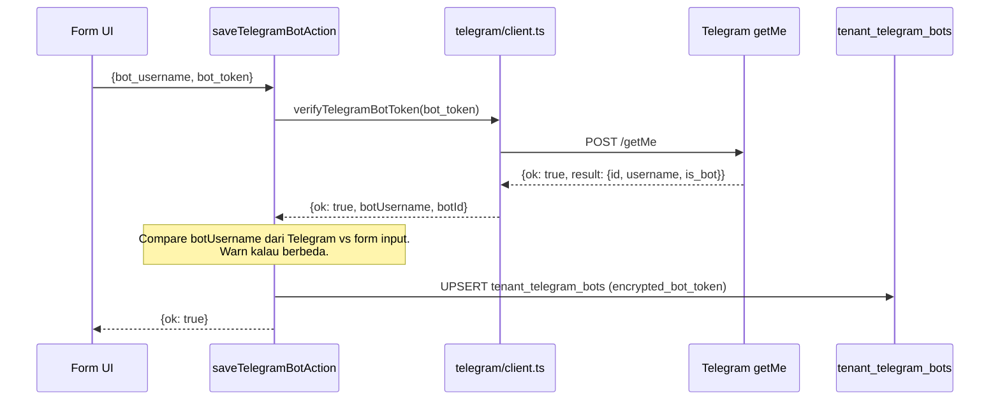
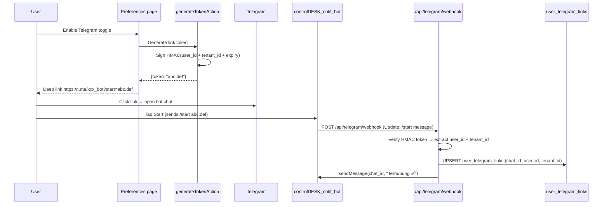
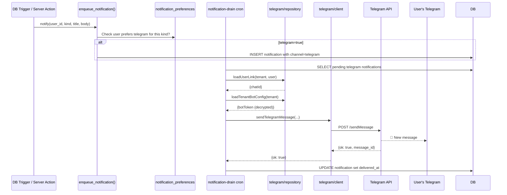

# Telegram Bot Integration

**Route Admin UI**: [`/settings/integrations/telegram-bot`](http://localhost:3000/settings/integrations/telegram-bot)
**Route User Preferences**: [`/settings/preferences`](http://localhost:3000/settings/preferences)
**Tables**: `public.tenant_telegram_bots`, `public.user_telegram_links`
**Provider**: [Telegram Bot API](https://core.telegram.org/bots/api) (official, gratis, unlimited)
**Migration**: `0069_telegram_integration.sql`

Kirim notifikasi ControlDesk ke tim internal via chat bot Telegram
per-tenant. Setiap tenant punya bot sendiri (dibuat via @BotFather),
setiap user opt-in dengan cara `/start` ke bot lalu link chat_id-nya ke
akun ControlDesk.

## Table of contents

- [Kenapa per-tenant bot?](#kenapa-per-tenant-bot)
- [Prasyarat](#prasyarat)
- [Setup Tenant Admin — buat bot & configure](#setup-tenant-admin--buat-bot--configure)
- [Setup User — link chat pribadi](#setup-user--link-chat-pribadi)
- [Verifikasi via CLI](#verifikasi-via-cli)
- [Verifikasi di UI](#verifikasi-di-ui)
- [Kirim notifikasi programmatically](#kirim-notifikasi-programmatically)
- [Arsitektur](#arsitektur)
- [Security](#security)
- [Database schema](#database-schema)
- [Environment variables](#environment-variables)
- [Troubleshooting](#troubleshooting)
- [FAQ](#faq)

## Kenapa per-tenant bot?

**Bukan** shared bot untuk semua tenant. Alasan:

1. **Brand isolation** — Tenant A pakai `@brandA_bot`, Tenant B pakai `@brandB_bot`. User lihat brand mereka sendiri.
2. **Rate limit isolation** — kalau satu tenant burst 100 pesan, tidak throttle tenant lain (Telegram limit per bot ~30 msg/detik).
3. **Compliance** — kalau tenant mau tarik akses, cukup delete bot; tidak ada risiko data mereka nyangkut di bot bersama.
4. **Migration path** — kalau ada regulasi baru (misal PDP data location), tenant bisa migrate ke provider lain tanpa affect tenant lain.

Trade-off: setiap tenant admin harus setup bot sendiri (5 menit di
@BotFather). Sepadan dengan isolation yang didapat.

## Prasyarat

**Untuk Tenant Admin**:
- Akun **Telegram** (nomor HP + install app).
- Role **`TENANT_ADMIN`** atau **`GM`** di ControlDesk.
- Akses ke `/settings/integrations/telegram-bot` (auto-approved untuk 2 role di atas).

**Untuk User biasa (yang mau terima notifikasi)**:
- Akun **Telegram**.
- Cukup role apapun — semua user bisa opt-in via `/settings/preferences`.

## Setup Tenant Admin — buat bot & configure

### Langkah 1 — Buat bot di @BotFather

1. Buka Telegram → cari [@BotFather](https://t.me/BotFather).
2. Tap **Start** kalau belum pernah.
3. Kirim command `/newbot`.
4. **Isi nama bot** (display name yang user lihat) — misalnya:
   ```
   ControlDesk Notif
   ```
5. **Isi username bot** (harus unik global, wajib akhiran `bot` atau `_bot`) — misalnya:
   ```
   controlDESK_notif_bot
   ```
   Kalau username sudah dipakai, BotFather minta yang lain.
6. **Copy token bot** yang muncul — format:
   ```
   8990434845:AAEqxxxxxxxxxxxxxxxxxxxxxxxxxxxxxxxx
   ```
   ⚠ **Simpan token ini** — anggap seperti password. Jangan commit ke git.

### Langkah 2 — Konfigurasi bot (opsional tapi recommended)

Masih di chat @BotFather, kirim command berikut untuk polish UX bot:

```
/setdescription
> pilih bot Anda
> paste: "Bot notifikasi ControlDesk untuk tenant <NamaTenant>. Kirim /start untuk mulai."

/setabouttext
> pilih bot Anda
> paste: "Notifikasi ControlDesk"

/setuserpic
> pilih bot Anda
> upload logo tenant

/setcommands
> pilih bot Anda
> paste:
start - Mulai interaksi dengan bot
help - Bantuan pemakaian
link - Link akun ControlDesk (paste kode dari UI)
```

### Langkah 3 — Paste token di ControlDesk

1. Login ke ControlDesk sebagai `TENANT_ADMIN` / `GM`.
2. Buka **Settings → Integrations → Bot Telegram**.
3. Isi form:
   - **Bot Username**: `controlDESK_notif_bot` (tanpa `@`)
   - **Bot Token**: paste token dari @BotFather
4. Klik **Simpan & Verifikasi**.

**Apa yang terjadi di balik layar:**



Kalau token valid, kartu di UI berubah status jadi **Terhubung** dengan
badge nama bot. Kalau ditolak Telegram, toast merah muncul dengan alasan
(mis. "Unauthorized" = token salah).

## Setup User — link chat pribadi

Setelah admin selesai, user biasa opt-in per-akun:

### Langkah 1 — Aktifkan channel Telegram di Preferences

1. Login ke ControlDesk sebagai user biasa.
2. Buka **Profile → Preferences** (atau **Settings → Preferences**).
3. Cari section **Telegram**. Toggle ke **On**.
4. Klik **Generate link token**. Sistem akan generate deep link ke bot dengan HMAC-signed token:
   ```
   https://t.me/controlDESK_notif_bot?start=abc123.def456
   ```
5. Klik link (atau scan QR di UI kalau ada).

### Langkah 2 — Kirim `/start` ke bot

1. Telegram otomatis buka chat bot.
2. Tap **Start** (atau kirim `/start abc123.def456` manual — token payload).
3. Bot terima `/start`, verifikasi HMAC token, resolve `user_id + tenant_id`, save `chat_id` ke `user_telegram_links`.
4. Bot balas:
   ```
   ControlDesk Telegram terhubung ✅
   Notifikasi ControlDesk akan dikirim ke chat ini.
   ```

Sekarang user opt-in. Setiap `notification` dengan channel `telegram: true`
akan ter-fanout ke chat ini.

### Langkah 3 — Test dari UI

Di halaman **Preferences**, tombol **Kirim pesan test** akan panggil
`sendTelegramTest()`. Pesan test langsung mendarat di HP user.

## Verifikasi via CLI

Detail lengkap di [`../dev-tools.md`](../dev-tools.md).

```bash
# Cek config + list user yang sudah /start
pnpm test:tg

# Kirim test message ke chat_id spesifik
pnpm test:tg 894167675

# Custom HTML message (bold, italic, link support)
pnpm test:tg 894167675 "<b>Halo</b> dari <i>ControlDesk</i>"

# Test tenant lain
pnpm test:tg <chat_id> --tenant=<uuid>
```

**Contoh output sukses:**

```
================================================================
ControlDesk Telegram smoke test
================================================================
tenant : 11111111-1111-1111-1111-111111111111
chatId : 894167675

[1/3] Loading tenant Telegram bot config…
  ✓ botUsername    : @ITPS_deskbot
  ✓ is_active      : true
  ✓ token length   : 46 chars

[2/3] Verifying bot against Telegram /getMe …
  ✓ bot id         : 8990434845
  ✓ bot username   : @ITPS_deskbot

[3/3] Sending message to chat 894167675 …
{ "ok": true, "providerMessageId": 2 }
  ✓ Sent!
```

## Verifikasi di UI

**Sebagai admin:**
1. `/settings/integrations` → kartu **Bot Telegram** badge **Terhubung**.
2. `/settings/integrations/telegram-bot` → form terisi + tombol **Nonaktifkan**.

**Sebagai user:**
1. `/settings/preferences` → section **Telegram** toggle **On**.
2. Badge "Terhubung ke @controlDESK_notif_bot" muncul.
3. Klik **Kirim pesan test** → pesan masuk di Telegram HP.

## Kirim notifikasi programmatically

Dari Server Action mana pun, panggil helper:

```typescript
import { sendTelegramMessage } from "@/lib/integrations/telegram/client";

const result = await sendTelegramMessage({
  tenantId: actor.tenantId,
  chatId: userLink.chatId,          // dari user_telegram_links
  text: "<b>Approval required</b>\nCash Advance #CA-2026-001 menunggu approval Anda.",
  disableNotification: false,       // true = silent notif
});

if (!result.ok) {
  log.warn("telegram_send_failed", {
    tenant_id: actor.tenantId,
    code: result.code,
    error: result.error,
  });
}
```

**Contract:**

- **Never throws** — return `{ ok: false, code, error }` untuk semua failure.
- **5-detik timeout** — mencegah wedge Server Action.
- **Parse mode: HTML** — support `<b>`, `<i>`, `<u>`, `<s>`, `<code>`, `<pre>`, `<a href>`.
- **Escape user input** — kalau text mengandung `<`, `>`, `&`, escape dulu supaya bukan HTML tag palsu.

**Fan-out otomatis via notification service**:

Kalau Anda enqueue via `enqueue_notification()` di trigger DB atau service
call, dan user preference `telegram=true`, worker `notification-drain`
akan otomatis panggil `sendTelegramMessage()`. Anda tidak perlu panggil
manual dari feature-level Server Action.

## Arsitektur

### File paths

| File                                                                                                    | Fungsi                                                                            |
| ------------------------------------------------------------------------------------------------------- | --------------------------------------------------------------------------------- |
| [`src/lib/integrations/telegram/client.ts`](../../src/lib/integrations/telegram/client.ts)              | HTTP client ke Telegram Bot API — `sendMessage`, `verifyTelegramBotToken`, dll.   |
| [`src/lib/integrations/telegram/repository.ts`](../../src/lib/integrations/telegram/repository.ts)      | DB CRUD untuk `tenant_telegram_bots` + `user_telegram_links`. Encryption in-out.  |
| [`src/lib/integrations/telegram/link-token.ts`](../../src/lib/integrations/telegram/link-token.ts)      | HMAC-SHA256 signed token untuk deep link `/start`.                                |
| [`src/lib/integrations/telegram/index.ts`](../../src/lib/integrations/telegram/index.ts)                | Barrel export.                                                                    |
| [`src/app/(app)/settings/integrations/telegram-bot/actions.ts`](../../src/app/(app)/settings/integrations/telegram-bot/actions.ts) | Server Actions admin: save/deactivate. `withSecureAction` + audit.                |
| [`src/app/(app)/settings/integrations/telegram-bot/page.tsx`](../../src/app/(app)/settings/integrations/telegram-bot/page.tsx)     | RSC page + form.                                                                  |
| [`src/app/(app)/settings/integrations/telegram-bot/telegram-bot-form.tsx`](../../src/app/(app)/settings/integrations/telegram-bot/telegram-bot-form.tsx) | Client form (RHF + Zod).                                                          |
| [`src/app/api/telegram/webhook/route.ts`](../../src/app/api/telegram/webhook/route.ts)                  | Webhook endpoint untuk terima update dari Telegram (inbound `/start`, `/link`).   |

### Deep link flow (user pairing)



**Kenapa HMAC token?**

- Deep link visible di URL bar / browser history → nilai `start=` bocor.
- Kalau kita pakai `user_id` langsung, attacker bisa impersonate.
- HMAC(secret + user_id + expiry) — attacker tidak bisa forge token tanpa akses secret. Expiry 10 menit membatasi replay attack.

Secret HMAC ada di env `TELEGRAM_LINK_TOKEN_SECRET` (32+ char random hex).

### Data flow — notifikasi outbound



## Security

### Bot token protection

- **Encrypted at rest** — column `encrypted_bot_token` AES-256-GCM.
- **RLS `no_direct`** — SELECT/INSERT/UPDATE dari role `authenticated` di-tolak. Hanya service-role client yang bisa akses.
- **Never returned to client** — Server Action tidak return token ke browser; UI hanya lihat masked prefix.
- **Audit trail** — audit log record `UPDATE tenant_telegram_bots` tanpa nilai token, hanya `bot_username` + `is_active`.

### HMAC link token

- Signed dengan `TELEGRAM_LINK_TOKEN_SECRET` (server-side only).
- Expiry 10 menit.
- Single-use (?) — tidak dijamin single-use di kode saat ini. Kalau critical, tambahkan replay-cache di Redis dengan TTL 10 menit.

### HTML injection

Bot API parse `parse_mode: HTML`. Kalau user input mengandung `<script>`
palsu — Telegram tidak execute, tapi UI di chat bisa render weird.
**Escape** user-supplied strings sebelum interpolate:

```typescript
function escapeHtml(s: string): string {
  return s
    .replace(/&/g, "&amp;")
    .replace(/</g, "&lt;")
    .replace(/>/g, "&gt;");
}

const text = `<b>Approval:</b> ${escapeHtml(userComment)}`;
```

### Cross-tenant

Setiap fetch dari `telegram/repository.ts` filter `.eq('tenant_id', ...)`
walaupun service-role bypass RLS. Cross-tenant leak defense-in-depth.

### Token rotation

Kalau token bocor:
1. `/settings/integrations/telegram-bot` → **Nonaktifkan** (row `is_active=false`).
2. Di @BotFather → `/revoke` → bot Anda → generate token baru.
3. Save token baru di form ControlDesk.
4. Verify + activate lagi.

Kalau di-force reset `APP_ENCRYPTION_KEY`, semua token lama unreadable —
setiap tenant admin harus re-paste token via UI. Runbook lengkap di
[`../ops/secret-rotation.md`](../ops/secret-rotation.md).

## Database schema

### `tenant_telegram_bots`

Migration `0069_telegram_integration.sql`:

| Kolom                 | Tipe            | Note                                                            |
| --------------------- | --------------- | --------------------------------------------------------------- |
| `tenant_id`           | `uuid` PK       | FK → `tenants.id`, ON DELETE CASCADE.                           |
| `bot_username`        | `text`          | Format `@controlDESK_notif_bot` tanpa `@` (contoh: `controlDESK_notif_bot`). |
| `encrypted_bot_token` | `text`          | AES-256-GCM ciphertext.                                         |
| `is_active`           | `boolean`       | Default `true`. Deaktivasi = soft-disable tanpa hapus token.    |
| `last_error`          | `text`          | Cache error terakhir (mis. "Unauthorized" saat verify gagal).   |
| `created_at`          | `timestamptz`   | `now()`.                                                        |
| `updated_at`          | `timestamptz`   | Auto-update via trigger.                                        |

**RLS**: 2 policy:
- `tenant_telegram_bots_no_direct` → USING/WITH CHECK `false` untuk role `authenticated` (deny all direct access).
- `tenant_telegram_bots_service` → USING/WITH CHECK `true` untuk role `service_role`.

### `user_telegram_links`

| Kolom                 | Tipe            | Note                                                            |
| --------------------- | --------------- | --------------------------------------------------------------- |
| `tenant_id`           | `uuid`          | PK bagian 1.                                                    |
| `user_id`             | `uuid`          | PK bagian 2. FK → `auth.users.id`.                              |
| `chat_id`             | `text`          | Chat ID Telegram (numeric-as-string).                           |
| `display_name`        | `text`          | Nama user di Telegram (dari `chat.first_name`, dll).            |
| `username`            | `text`          | Telegram `@username` kalau ada.                                 |
| `linked_at`           | `timestamptz`   |                                                                 |
| `opted_in_at`         | `timestamptz`   |                                                                 |
| `last_inbound_at`     | `timestamptz`   | Terakhir user kirim message ke bot (untuk staleness detection). |
| `last_error`          | `text`          | Cache — "Bot blocked by user" etc.                              |

## Environment variables

| Variable                         | Wajib?              | Default    | Deskripsi                                                             |
| -------------------------------- | ------------------- | ---------- | --------------------------------------------------------------------- |
| `APP_ENCRYPTION_KEY`             | Ya                  | —          | Master key untuk encrypt bot token (32+ char). Rotasi 90 hari.        |
| `TELEGRAM_LINK_TOKEN_SECRET`     | Ya (untuk user link)| —          | HMAC secret untuk deep link `/start` token (32+ char).                |
| `TELEGRAM_WEBHOOK_URL`           | Ya (production)     | —          | URL webhook publik. Dipakai `POST /setWebhook` saat tenant activate.  |
| `TELEGRAM_WEBHOOK_SECRET`        | Recommended         | —          | Secret path parameter untuk validasi webhook authenticity.            |

Detail lengkap di [`../env-reference.md`](../env-reference.md).

## Troubleshooting

### `Telegram rejected token: [TELEGRAM_ERROR] Unauthorized`

**Penyebab**: token salah, typo, atau sudah di-revoke di @BotFather.

**Fix**:
- Cek token via @BotFather → `/mybots` → bot Anda → API Token → **Show**.
- Copy ulang, pastikan tidak ada whitespace di depan/belakang.
- Kalau token yang bocor di git history, langsung revoke di @BotFather + generate baru.

### `Chat not found` saat kirim message

**Penyebab**: user belum kirim `/start` ke bot, atau `chat_id` salah.

**Fix**:
- User buka bot di Telegram, tap **Start**.
- Verifikasi via CLI:
  ```bash
  pnpm test:tg
  # Akan list semua chat yang sudah pernah interaksi
  ```

### `Bot was blocked by the user`

**Penyebab**: user tap "Block" di Telegram → bot tidak bisa kirim lagi.

**Fix**:
- Info user untuk unblock bot (Telegram → search bot → Unblock).
- Server akan handle graceful: `last_error='Bot blocked'` di `user_telegram_links`, notifikasi fallback ke channel lain (email/in-app).

### `Too Many Requests` (429)

**Penyebab**: Telegram limit ~30 msg/detik per bot, ~1 msg/detik per chat.

**Fix**:
- Batch: kirim ke banyak user via loop dengan `await sleep(50ms)` between calls.
- Kalau bulk (>100 users), pakai queue (Redis) + worker dengan concurrency = 5.
- Notification service ControlDesk sudah handle ini via cron + rate limiter.

### Webhook tidak terima update

**Penyebab**: URL webhook di Telegram side tidak match server, atau webhook belum di-set.

**Fix**:
- Cek current webhook: `GET https://api.telegram.org/bot<TOKEN>/getWebhookInfo`.
- Set ulang: `POST https://api.telegram.org/bot<TOKEN>/setWebhook?url=<TELEGRAM_WEBHOOK_URL>&secret_token=<TELEGRAM_WEBHOOK_SECRET>`.
- Verifikasi TLS certificate valid (Telegram butuh HTTPS + valid cert).
- Domain harus publicly reachable (Vercel/Cloudflare OK; localhost butuh ngrok).

### Bot username di form berbeda dengan yang di Telegram

**Penyebab**: user rename bot di @BotFather setelah paste di ControlDesk.

**Fix**: Script `verifyTelegramBotToken` sudah warn kalau berbeda. Update
form dengan username baru → save ulang.

## FAQ

**Q: Bisa share bot antar tenant?**
A: Tidak recommended. Setup 5 menit per tenant lebih baik dibanding risiko brand & isolation issue. Kalau butuh, contact tim untuk custom deployment.

**Q: Bisa terima balasan user (interactive) atau hanya push?**
A: Sekarang hanya push + `/start` + `/link`. Webhook `/api/telegram/webhook` menerima update tapi tidak process interactive command lain. Roadmap Fase 12: support command `/approvals` untuk approve dari Telegram.

**Q: Support Telegram group / channel?**
A: Belum. Bot bisa join group tapi belum diwire ke `user_telegram_links`. Kalau butuh, adjust schema jadi `target_type: 'user' | 'group' | 'channel'`.

**Q: Delivery report / read receipt?**
A: Telegram tidak provide read receipt via Bot API. Delivered atau tidak tercermin dari status 200 vs 4xx dari `sendMessage`.

**Q: Bagaimana kalau user hapus akun Telegram?**
A: `sendMessage` akan return "user is deactivated". Server tandai `last_error` dan tidak retry. User bisa re-link via UI kalau bikin akun baru.

**Q: Bisa attach file / gambar?**
A: Bisa via `sendPhoto`, `sendDocument`, dll. Belum wired di `sendTelegramMessage()` — patch client kalau butuh (rules §19 attachment convention).

## Cross-references

- Business perspective → [`../modules/ai-and-notifications.md`](../modules/ai-and-notifications.md)
- Environment vars → [`../env-reference.md`](../env-reference.md)
- User Preferences UI → [`../user-guides/internal-users.md`](../user-guides/internal-users.md)
- CLI dev tools → [`../dev-tools.md`](../dev-tools.md)
- Secret rotation → [`../ops/secret-rotation.md`](../ops/secret-rotation.md)
