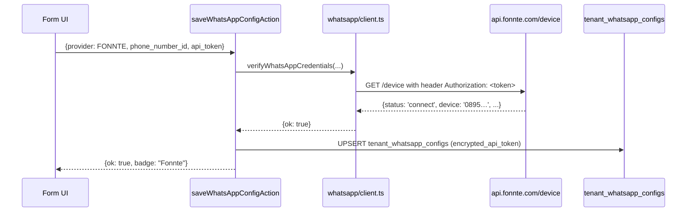

# WhatsApp Integration (via Fonnte)

**Route Admin UI**: [`/settings/integrations/whatsapp-business`](http://localhost:3000/settings/integrations/whatsapp-business)
**Route User Preferences**: [`/settings/preferences`](http://localhost:3000/settings/preferences)
**Tables**: `public.tenant_whatsapp_configs`, `public.user_whatsapp_links`
**Provider**: [Fonnte](https://fonnte.com) — unofficial WhatsApp gateway
**Migration**: `0070_whatsapp_integration.sql` + `0071_fonnte_whatsapp_provider.sql`

Kirim notifikasi ControlDesk ke nomor WhatsApp via Fonnte, gateway
WhatsApp non-resmi asal Indonesia. Cepat setup (5 menit dari QR scan
sampai first message), free tier 1,000 pesan/bulan.

> ## ⚠ Compliance Caveat
>
> **Fonnte adalah unofficial WhatsApp gateway** — bekerja dengan cara
> koneksi WhatsApp Web scraping/emulation. Berdasarkan
> [Terms of Service WhatsApp](https://www.whatsapp.com/legal/business-terms/),
> ini **melanggar ToS** dan berisiko:
>
> 1. **Ban nomor** — WhatsApp bisa suspend nomor Anda tanpa peringatan.
>    Nomor yang di-ban tidak bisa recovery.
> 2. **Ban lintas nomor** — kalau device kena flag heuristik anti-spam,
>    bisa affect nomor lain di device yang sama.
> 3. **Tidak ada SLA / accountability** — kalau Fonnte down, tidak ada
>    kompensasi.
> 4. **Data flow** — pesan lewat server Fonnte (di Indonesia). Cek
>    kebijakan mereka untuk compliance PDP/UU 27/2022.
>
> **Kapan pakai Fonnte:**
> - Prototyping / MVP di tenant kecil.
> - Internal ops team (bukan customer-facing critical).
> - Nomor throwaway yang boleh di-ban.
>
> **Kapan JANGAN pakai Fonnte:**
> - Nomor bisnis utama tenant.
> - Volume tinggi (>500/hari).
> - Regulated industry (banking, healthcare).
> - Kalau tenant butuh delivery receipt yang reliable.
>
> **Alternatif resmi** (belum wired, ada slot `META_CLOUD` di code):
> - **[WhatsApp Business API resmi (Meta Cloud)](https://developers.facebook.com/docs/whatsapp/cloud-api)** — official, template message wajib approval, tapi tidak ada ToS risk.
> - **[Twilio WhatsApp Business](https://www.twilio.com/whatsapp)** — reseller resmi Meta.
>
> Provider slot `META_CLOUD` dan `TWILIO` sudah reserved di enum kolom
> `provider` — tinggal wire adapter di `client.ts` kalau tenant Anda
> siap migrasi.

## Table of contents

- [Prasyarat](#prasyarat)
- [Setup Tenant Admin — buat device Fonnte & configure](#setup-tenant-admin--buat-device-fonnte--configure)
- [Setup User — link nomor WA pribadi](#setup-user--link-nomor-wa-pribadi)
- [Verifikasi via CLI](#verifikasi-via-cli)
- [Verifikasi di UI](#verifikasi-di-ui)
- [Kirim notifikasi programmatically](#kirim-notifikasi-programmatically)
- [Arsitektur](#arsitektur)
- [Security & compliance](#security--compliance)
- [Database schema](#database-schema)
- [Environment variables](#environment-variables)
- [Troubleshooting](#troubleshooting)
- [FAQ](#faq)

## Prasyarat

**Untuk Tenant Admin**:
- Nomor **WhatsApp aktif** di HP fisik (bisa nomor pribadi atau bisnis).
- Akun **Fonnte** — daftar di [https://fonnte.com](https://fonnte.com) (email + password, tidak perlu credit card untuk free tier).
- Role **`TENANT_ADMIN`** atau **`GM`** di ControlDesk.
- HP dengan koneksi internet stabil (Fonnte butuh WA Web session tetap aktif).

**Untuk User biasa**:
- Nomor WhatsApp yang mau opt-in.
- Cukup role apapun.

## Setup Tenant Admin — buat device Fonnte & configure

### Langkah 1 — Daftar & buat device di Fonnte

1. Buka [https://fonnte.com](https://fonnte.com) → **Daftar** kalau belum punya akun.
2. Login → Dashboard.
3. Klik **Add Device** → pilih tipe:
   - **Personal** — gratis, 1,000 msg/bulan.
   - **Premium** — Rp 25rb/bulan, 10,000 msg/bulan.
   - **Enterprise** — custom.
4. Beri nama device, misalnya "ControlDesk Tenant A".
5. Kartu device muncul dengan status **Not Connected**.

### Langkah 2 — Scan QR & connect

1. Klik device → tombol **Connect** → QR code muncul.
2. Di HP Anda:
   - WhatsApp → Settings → **Linked Devices** → **Link a Device**.
   - Scan QR di layar Fonnte.
3. Fonnte akan konfirmasi **Connected**. HP menampilkan browser WhatsApp Web session baru.

⚠ **Jangan matikan HP** — kalau HP mati / airplane mode / logout WA
Web session, Fonnte akan drop connection dan pesan tidak terkirim.

### Langkah 3 — Copy Device Token & Device ID

1. Di device detail, cari section **API Token** atau **Device Token**.
2. Copy nilai token (long string ~30 char) — contoh:
   ```
   BJ8i35pxxxxxxxxxxxxxxxxxxx
   ```
3. Copy **Device ID** — contoh:
   ```
   0895342152123
   ```
   (biasanya sama dengan nomor HP tanpa `+`).

### Langkah 4 — Paste di ControlDesk

1. Login ControlDesk sebagai `TENANT_ADMIN` / `GM`.
2. Buka **Settings → Integrations → WhatsApp Business**.
3. Isi form:
   - **Provider**: `Fonnte` (satu-satunya opsi saat ini — Twilio & Meta belum wired).
   - **Phone Number ID**: paste **Device ID** dari Fonnte (`0895342152123`).
   - **API Token**: paste **Device Token** dari Fonnte.
4. Klik **Simpan & Verifikasi**.

**Apa yang terjadi di balik layar:**



Kalau device offline / token salah, toast merah muncul dengan alasan
dari Fonnte (`status: 'disconnect'` etc.).

## Setup User — link nomor WA pribadi

### Langkah 1 — Enable channel WhatsApp di Preferences

1. Login ControlDesk sebagai user biasa.
2. **Profile → Preferences** atau **Settings → Preferences**.
3. Section **WhatsApp** → toggle **On**.
4. **Input nomor WA** (E.164): `+6281234567890`.
5. **Verifikasi**: klik **Kirim OTP**.

### Langkah 2 — Terima & masukkan OTP

1. Bot Fonnte kirim pesan WA ke nomor Anda: "Kode verifikasi ControlDesk: 123456. Kode berlaku 5 menit."
2. Di UI, paste 6-digit code → klik **Verifikasi**.
3. Sistem simpan `user_whatsapp_links` row dengan `verified_at`.

Sekarang user opt-in. Notifikasi dengan channel WA fanout ke nomor ini.

### Langkah 3 — Test dari UI

Tombol **Kirim pesan test** di Preferences kirim pesan langsung ke nomor
user. Kalau tidak terima dalam 10 detik, lihat [Troubleshooting](#troubleshooting).

## Verifikasi via CLI

Detail lengkap di [`../dev-tools.md`](../dev-tools.md).

```bash
# Cek device status (utility Fonnte-specific)
pnpm fonnte:device

# Kirim test message
pnpm test:wa "+62881234567890"

# Custom message
pnpm test:wa "088234567890" "Halo dari ControlDesk"

# Tenant lain
pnpm test:wa "+628…" --tenant=<uuid>
```

**Output sukses `pnpm test:wa`:**

```
================================================================
ControlDesk WhatsApp (Fonnte) smoke test
================================================================
tenant : 11111111-1111-1111-1111-111111111111
target : 088234567890 -> normalized 62881234567890
message: Test dari ControlDesk

[1/3] Loading tenant WhatsApp config…
  ✓ provider    : FONNTE
  ✓ device_id   : 0895342152123
  ✓ is_active   : true
  ✓ token length: 30 chars

[2/3] Verifying device with Fonnte /device …
  ✓ device online. autoread: true, quota: 998

[3/3] Sending to +62881234567890 …
  ✓ Sent!
  providerMessageId: 12345
  cost_credits     : 1
```

**Output `pnpm fonnte:device`** (debugging raw API):

```
================================================================
Fonnte /device raw dump
================================================================
tenant : 11111111-...

HTTP 200 OK
{
  "status": true,
  "device": "6289633000000",
  "quota": 998,
  "expired": "2029-08-08 22:32:00",
  "package": "Personal",
  "autoread": "yes",
  "webhook": "https://your-domain.com/api/whatsapp/webhook"
}
```

Kalau `status: false`, cek `reason` di response — biasanya:
- `Device not connected` — HP mati / WA Web disconnect.
- `Invalid token` — token salah / device di-delete di dashboard.

## Verifikasi di UI

**Sebagai admin:**
1. `/settings/integrations` → kartu **WhatsApp Business** badge **Terhubung** dengan provider `Fonnte`.
2. `/settings/integrations/whatsapp-business` → form terisi + tombol **Nonaktifkan**.

**Sebagai user:**
1. `/settings/preferences` → section **WhatsApp** toggle **On** + badge nomor terverifikasi.
2. Klik **Kirim pesan test** → WA masuk dalam 5-10 detik.

## Kirim notifikasi programmatically

Dari Server Action manapun:

```typescript
import { sendWhatsAppMessage } from "@/lib/integrations/whatsapp/client";

const result = await sendWhatsAppMessage({
  tenantId: actor.tenantId,
  toE164: "+6288234567890",     // Format E.164; helper juga terima 088… → normalize ke 62881…
  body: "Approval required\nCash Advance #CA-2026-001 menunggu Anda.",
});

if (!result.ok) {
  log.warn("wa_send_failed", { code: result.code, error: result.error });
}
```

**Contract:**

- **Never throws** — return `{ ok: false, code, error }` untuk semua failure.
- **5-detik timeout** — mencegah wedge Server Action.
- **Plain text** — Fonnte tidak support markdown/HTML. WhatsApp render `*bold*`, `_italic_`, `~strike~`, `` `code` `` di klien.
- **Auto normalize nomor** — `088…` → `62881…`, `+62…` → `62…`. Country default `62`.

## Arsitektur

### File paths

| File                                                                                                          | Fungsi                                                                                        |
| ------------------------------------------------------------------------------------------------------------- | --------------------------------------------------------------------------------------------- |
| [`src/lib/integrations/whatsapp/client.ts`](../../src/lib/integrations/whatsapp/client.ts)                    | HTTP client — `sendWhatsAppMessage` (switch Twilio/Meta/Fonnte), `verifyWhatsAppCredentials`. |
| [`src/lib/integrations/whatsapp/repository.ts`](../../src/lib/integrations/whatsapp/repository.ts)            | DB CRUD `tenant_whatsapp_configs` + `user_whatsapp_links`. Encryption.                        |
| [`src/lib/integrations/whatsapp/link-token.ts`](../../src/lib/integrations/whatsapp/link-token.ts)            | OTP token generator + verifier untuk user opt-in.                                             |
| [`src/lib/integrations/whatsapp/index.ts`](../../src/lib/integrations/whatsapp/index.ts)                      | Barrel export.                                                                                |
| [`src/app/(app)/settings/integrations/whatsapp-business/actions.ts`](../../src/app/(app)/settings/integrations/whatsapp-business/actions.ts) | Server Actions: save/deactivate. `withSecureAction` + audit.                                  |
| [`src/app/(app)/settings/integrations/whatsapp-business/page.tsx`](../../src/app/(app)/settings/integrations/whatsapp-business/page.tsx)     | RSC page + form + runbook.                                                                    |
| [`src/app/(app)/settings/integrations/whatsapp-business/whatsapp-config-form.tsx`](../../src/app/(app)/settings/integrations/whatsapp-business/whatsapp-config-form.tsx) | Client form (RHF + Zod). Fonnte-only.                                                         |
| [`src/app/api/whatsapp/webhook/route.ts`](../../src/app/api/whatsapp/webhook/route.ts)                        | Webhook stub — Fonnte support inbound tapi belum diproses.                                    |
| [`supabase/migrations/0070_whatsapp_integration.sql`](../../supabase/migrations/0070_whatsapp_integration.sql) | Initial WA schema.                                                                            |
| [`supabase/migrations/0071_fonnte_whatsapp_provider.sql`](../../supabase/migrations/0071_fonnte_whatsapp_provider.sql) | Expand `provider` CHECK constraint untuk include `FONNTE`.                                   |

### Provider adapter pattern

Function `sendWhatsAppMessage()` internal switch berdasarkan `provider`:

```typescript
switch (cfg.provider) {
  case "TWILIO":     return sendViaTwilio({ ... });      // stub, belum diwire
  case "META_CLOUD": return sendViaMeta({ ... });        // stub, belum diwire
  case "FONNTE":     return sendViaFonnte({ ... });      // live
  default:           return { ok: false, code: "PROVIDER_UNSUPPORTED" };
}
```

Fonnte adapter:

```typescript
async function sendViaFonnte({ config, toE164, body }): Promise<Result> {
  const target = toE164.replace(/^\+/, "").replace(/^0/, "62");
  const body_form = new URLSearchParams({ target, message: body, countryCode: "62" });

  const resp = await fetch("https://api.fonnte.com/send", {
    method: "POST",
    headers: {
      Authorization: decryptedToken,                    // Fonnte pakai header polos, TANPA "Bearer"
      "Content-Type": "application/x-www-form-urlencoded",
    },
    body: body_form,
    signal: AbortSignal.timeout(5000),
  });

  const data = await resp.json();
  if (!data.status) return { ok: false, code: "PROVIDER_ERROR", error: data.reason };
  return { ok: true, providerMessageId: data.id[0] };
}
```

**Perhatikan** kekhususan Fonnte:
- **Auth header polos** — bukan `Bearer <token>` tapi langsung `Authorization: <token>`.
- **Body form-encoded** — bukan JSON.
- **`countryCode: "62"`** — Fonnte tidak auto-detect Indonesia; wajib eksplisit.
- **`target` tanpa `+`** — `6288…` bukan `+6288…`.

### Data flow — outbound notification

Sama dengan [Telegram flow](./telegram-bot.md#data-flow--notifikasi-outbound) dengan swap `TGRepo/TGClient` → `WARepo/WAClient`.

## Security & compliance

### Token protection

Sama pattern dengan Telegram:
- **Encrypted at rest** — `encrypted_api_token` AES-256-GCM.
- **RLS `no_direct`** — service-role only.
- **Never returned to client** — Server Action tidak return token.
- **Audit trail** — record `UPDATE tenant_whatsapp_configs` tanpa nilai token.

### Rate limit + spam prevention

Fonnte tidak enforce hard rate limit di API side (mereka rely on WhatsApp's
own anti-spam). Server ControlDesk mitigate:
- **Timeout 5 detik per call**.
- **Cron worker concurrency = 3** (bukan burst).
- **Per-user throttle** — kalau 1 user terima > 10 pesan/menit, worker delay 30 detik.

### Self-messaging quirk

Fonnte accept request untuk kirim pesan ke **nomor yang sama** dengan
device, tapi WhatsApp silently drop delivery (tidak ada error di provider
response, tapi pesan tidak sampai). Ini karena WhatsApp tidak izinkan
"self messaging" via API.

**Fix di CLI test**: pakai nomor lain untuk test.

### Data location

Fonnte server **di Indonesia** (Jakarta). Compliant dengan UU 27/2022
Perlindungan Data Pribadi untuk data location, tapi cek dengan legal
tenant Anda karena Fonnte **tidak resmi terdaftar** sebagai processor.

### ToS risk mitigation

Kalau harus pakai Fonnte:
1. **Gunakan nomor khusus** — jangan nomor pribadi CEO.
2. **Rate-limit pengiriman** — jangan burst >30 pesan/menit.
3. **Content-quality tinggi** — hindari sales spam, hanya kirim transactional (approval, alert).
4. **User opt-in eksplisit** — user harus verify OTP dulu, bukan auto-subscribe.
5. **Monitor status device** — cron `pnpm fonnte:device` per jam; kalau `disconnect`, alert admin.

## Database schema

### `tenant_whatsapp_configs`

Migration `0070` + `0071`:

| Kolom                       | Tipe            | Note                                                                    |
| --------------------------- | --------------- | ----------------------------------------------------------------------- |
| `tenant_id`                 | `uuid` PK       | ON DELETE CASCADE.                                                      |
| `provider`                  | `text`          | CHECK: `'TWILIO'`, `'META_CLOUD'`, `'FONNTE'` (per migration `0071`).   |
| `phone_number_id`           | `text`          | Fonnte: Device ID. Meta: Phone Number ID. Twilio: Messaging Service SID.|
| `encrypted_api_token`       | `text`          | AES-256-GCM ciphertext.                                                 |
| `encrypted_account_sid`     | `text`          | Twilio-only. Null untuk Fonnte/Meta.                                    |
| `webhook_verify_token`      | `text`          | Meta-only. Null untuk Fonnte.                                           |
| `is_active`                 | `boolean`       |                                                                         |
| `last_error`                | `text`          |                                                                         |
| `created_at`, `updated_at`  | `timestamptz`   |                                                                         |

**RLS**: sama pola dengan `tenant_telegram_bots` — 2 policy (`no_direct` + `service`).

### `user_whatsapp_links`

| Kolom                 | Tipe            | Note                                                                    |
| --------------------- | --------------- | ----------------------------------------------------------------------- |
| `tenant_id`           | `uuid`          | PK bagian 1.                                                            |
| `user_id`             | `uuid`          | PK bagian 2. FK → `auth.users.id`.                                      |
| `phone_e164`          | `text`          | Nomor E.164 (`+6288234567890`).                                         |
| `verified_at`         | `timestamptz`   | Null = belum verify OTP.                                                |
| `opted_in_at`         | `timestamptz`   |                                                                         |
| `last_error`          | `text`          |                                                                         |

## Environment variables

| Variable                       | Wajib?              | Default    | Deskripsi                                                             |
| ------------------------------ | ------------------- | ---------- | --------------------------------------------------------------------- |
| `APP_ENCRYPTION_KEY`           | Ya                  | —          | Master key untuk encrypt api_token. Rotasi 90 hari.                   |
| `WHATSAPP_OTP_SECRET`          | Ya (untuk user link)| —          | HMAC secret untuk OTP token (32+ char).                               |
| `WHATSAPP_WEBHOOK_SECRET`      | Recommended         | —          | Header validation untuk inbound (belum digunakan untuk Fonnte).       |

## Troubleshooting

### `sent OK tapi tidak masuk ke HP`

**Penyebab paling sering**: nomor target = nomor device (self-messaging).

**Fix**: Test dari device Fonnte ke nomor **berbeda**.

Kalau nomor target beda dan tetap tidak masuk:
- Cek `pnpm fonnte:device` — apakah `status: 'connect'`?
- Cek kuota — free tier 1,000/bulan, kalau habis Fonnte return "quota exceeded".
- Cek WhatsApp di HP device — apakah masih login WA Web session? Kalau logout, reconnect.

### `Fonnte /device returned status:false, reason: Invalid token`

**Fix**:
- Cek token di dashboard Fonnte — device masih ada?
- Regenerate token di Fonnte → paste ulang di ControlDesk.

### `Fonnte /device returned status:false, reason: Device not connected`

**Fix**:
- Buka HP, WA → Linked Devices → cek apakah session masih ada.
- Kalau tidak ada, di dashboard Fonnte klik **Reconnect** → scan QR baru.

### `AbortError: signal is aborted`

**Penyebab**: Fonnte respond > 5 detik. Biasanya jaringan Anda ke Fonnte lambat, atau server Fonnte overload.

**Fix**:
- Retry manual dari CLI.
- Kalau berulang, cek status Fonnte di grup resmi mereka.
- Naikkan timeout di `client.ts` (tidak recommended — Server Action akan wedge).

### `Cannot save config: check constraint tenant_whatsapp_configs_provider_ck`

**Penyebab**: migration `0071_fonnte_whatsapp_provider.sql` belum applied.

**Fix**:
```bash
# Local dev
docker exec -i controldesk-supabase-db-1 psql -U postgres -d postgres < supabase/migrations/0071_fonnte_whatsapp_provider.sql

# Atau via supabase CLI
pnpm supabase migration up
```

### User tidak bisa terima OTP

**Penyebab**: nomor typo, atau device Fonnte disconnect saat OTP dikirim.

**Fix**:
- Verifikasi nomor di E.164 (`+62…`).
- Cek log ControlDesk — apakah `sendWhatsAppMessage` return `{ ok: true }`?
- Kalau ok tapi user tidak terima, kemungkinan self-message atau nomor tidak aktif di WhatsApp.

## FAQ

**Q: Bisa pakai Meta Cloud (WA Business API resmi) via ControlDesk?**
A: Enum `META_CLOUD` sudah di CHECK constraint. Adapter `sendViaMeta` sudah stub — tinggal wire ke `https://graph.facebook.com/v18.0/{phone_number_id}/messages` dengan template message. Kalau butuh, buka GitHub issue.

**Q: Fonnte support delivery receipt?**
A: Ya, webhook Fonnte kirim status `sent`, `delivered`, `read`. Endpoint `/api/whatsapp/webhook` sudah stub, tapi belum dipakai untuk update `notifications.delivered_at`. Roadmap Fase 12.

**Q: Bisa attach gambar / dokumen?**
A: Fonnte support `url` parameter untuk file. `sendWhatsAppMessage()` belum expose ini — patch client kalau butuh.

**Q: Kalau nomor kena ban WA, bagaimana recovery?**
A: **Tidak ada recovery** — WhatsApp ban permanent untuk nomor. Buat device baru dengan nomor lain di Fonnte, paste token baru di ControlDesk.

**Q: Fonnte turun / bangkrut, bagaimana?**
A: Nonaktifkan config di UI. Sistem otomatis fallback ke channel lain (Telegram, email, in-app). Tenant Admin bisa switch provider ke Meta/Twilio kalau sudah wired.

**Q: Bisa forward inbound WhatsApp message (user reply) ke Server?**
A: Bisa via webhook Fonnte, tapi belum processed. Roadmap: `/support` chatbot pattern.

**Q: Kirim ke banyak user sekaligus (broadcast)?**
A: Fonnte support batch API tapi tidak diwire di client. Lakukan loop dengan `sleep(200ms)` — rate limit WhatsApp yang lebih penting daripada Fonnte.

## Cross-references

- Business perspective → [`../modules/ai-and-notifications.md`](../modules/ai-and-notifications.md)
- Environment vars → [`../env-reference.md`](../env-reference.md)
- User Preferences UI → [`../user-guides/internal-users.md`](../user-guides/internal-users.md)
- CLI dev tools → [`../dev-tools.md`](../dev-tools.md)
- Secret rotation → [`../ops/secret-rotation.md`](../ops/secret-rotation.md)
