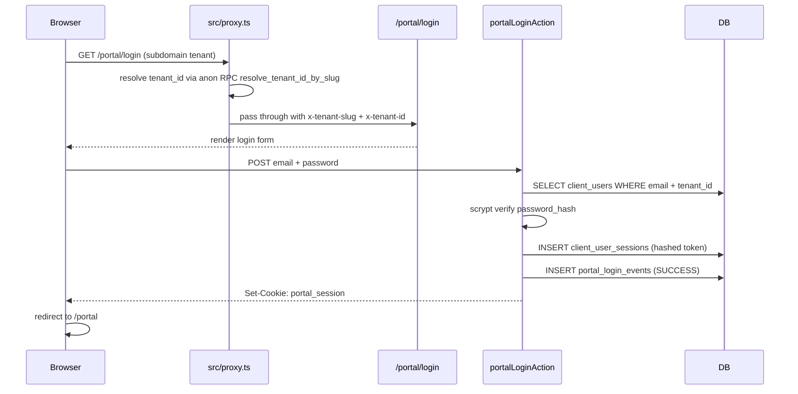

# Clients & Client Portal

Modul yang mengelola **customer** ControlDesk — dari master client,
kontrak BPO, komitmen SLA, sampai portal transparansi untuk klien
eksternal.

Route + folder:

- Internal management: `src/app/(app)/clients/*` — untuk staff internal (Sales, Admin, PM).
- External portal: `src/app/(portal)/portal/*` — untuk user klien.

## Client master

Tabel: `public.clients` (migration `0008_clients_and_projects.sql`).

Kolom penting:

| Kolom              | Tipe             | Note                                          |
| ------------------ | ---------------- | --------------------------------------------- |
| `id`               | `uuid`           | PK                                            |
| `tenant_id`        | `uuid`           | RLS discriminator                             |
| `name`             | `text`           | Nama perusahaan klien                         |
| `slug`             | `text`           | URL-safe (unique per tenant)                  |
| `industry`         | `text`           | Sektor bisnis                                 |
| `contact_name`     | `text`           | PIC utama                                     |
| `contact_email`    | `text`           | Email PIC                                     |
| `contact_phone`    | `text`           | Nomor telp PIC                                |
| `address`          | `text`           | Alamat                                        |
| `notes`            | `text`           | Free text                                     |
| `status`           | `client_status`  | `ACTIVE` / `INACTIVE` / `PROSPECT`            |
| `created_at`       | `timestamptz`    |                                               |

**Relasi**: `clients (1) ← (N) projects`. Satu client bisa punya banyak
proyek — critical untuk executive dashboard yang mengagregasi P&L per
klien.

Server Actions: `src/app/(app)/clients/actions.ts`.

## BPO Contracts

Tabel: `public.bpo_contracts`.

Kontrak layanan long-term antara tenant dan klien. Biasanya
retainer / managed services dengan MRR.

| Kolom                       | Tipe               | Note                                             |
| --------------------------- | ------------------ | ------------------------------------------------ |
| `id`                        | `uuid`             |                                                  |
| `tenant_id`                 | `uuid`             |                                                  |
| `client_id`                 | `uuid`             | FK → `clients.id`                                |
| `contract_number`           | `text`             | Nomor referensi legal                            |
| `contract_type`             | `bpo_contract_type`| `ONE_OFF` / `RETAINER` / `MANAGED_SERVICES`      |
| `start_date`, `end_date`    | `date`             |                                                  |
| `monthly_recurring_revenue` | `numeric(18,2)`    | MRR dalam IDR                                    |
| `status`                    | `bpo_contract_status` | `DRAFT` / `ACTIVE` / `EXPIRED` / `TERMINATED` |
| `signed_pdf_url`            | `text`             | Reference ke `attachments` bucket               |

Client Portal → project detail page **membaca kontrak yang overlap**
dengan periode proyek dan menampilkannya sebagai bagian dari
"Financials" (MRR, term, status). Tidak expose expense internal ke
klien.

## SLA Commitments

Tabel: `public.sla_commitments`.

Komitmen tingkat layanan per kontrak. Metrik yang dipantau di dashboard
+ dianalisis oleh AI `analyze-sla-breach`.

| Kolom                | Tipe                    | Note                                          |
| -------------------- | ----------------------- | --------------------------------------------- |
| `bpo_contract_id`    | `uuid`                  | FK                                            |
| `metric`             | `sla_metric_kind`       | `RESPONSE_TIME` / `RESOLUTION_TIME` / `UPTIME` / `CSAT` |
| `target_value`       | `numeric`               | e.g. 4 (hours), 99.5 (%), 4.5 (score)         |
| `target_unit`        | `text`                  | `hours`, `%`, `score`                         |
| `penalty_per_breach` | `numeric(18,2)`         | Nominal potongan MRR per breach               |
| `measurement_window` | `interval`              | e.g. `1 month`                                |

Breach terekam di `sla_breaches` (bukan bagian modul ini — cross-cut ke
Project Issues + Timesheet quality). AI insight
`analyze-sla-breach` scan kombinasi Project Issues + roster gaps 24-48
jam ke depan dan flag risiko.

## Client Portal (external surface)

**Root**: `/portal` (di semua tenant subdomain).
**Auth surface**: terpisah total dari `auth.users`.

### Why terpisah dari internal auth?

- User klien seringkali **tidak diinvite** — mereka dikirim akses oleh
  Sales / Account Manager. Tidak layak diberi hak `auth.users` (yang
  bisa hit Supabase Auth API langsung).
- **Security boundary**: kalau Supabase Auth di-compromised, portal
  user tetap aman karena credential mereka bukan `auth.users`.
- **Retention berbeda**: internal employee bisa terminated dan
  di-anonymize; portal user dinonaktifkan sederhana kalau kontrak
  selesai.

### Tables

- `public.client_users` — master user portal (migration `0023`).
- `public.client_user_sessions` — opaque session tokens (hashed).
- `public.portal_login_events` — jejak login attempt (migration `0032`, retensi 7 tahun).
- `public.portal_notifications` — feed notifikasi (migration `0033`).

`client_users`:

| Kolom            | Tipe                     | Note                                                             |
| ---------------- | ------------------------ | ---------------------------------------------------------------- |
| `id`             | `uuid`                   |                                                                  |
| `tenant_id`      | `uuid`                   | RLS discriminator                                                |
| `client_id`      | `uuid`                   | FK → `clients.id` — 1 user milik 1 client                        |
| `email`          | `text`                   | Login identifier (unique per tenant)                             |
| `display_name`   | `text`                   |                                                                  |
| `password_hash`  | `text`                   | scrypt hash + salt                                               |
| `status`         | `client_user_status`     | `ACTIVE` / `DISABLED` / `PENDING_ACTIVATION`                     |
| `last_signed_in_at` | `timestamptz`         |                                                                  |
| `created_by_employee_id` | `uuid`           | Audit — siapa admin yang invite user ini                         |

### Auth flow



**Force change password**: user dengan status `PENDING_ACTIVATION`
diredirect ke `/portal/change-password` sampai mereka set password baru.
Status di-transition ke `ACTIVE` setelah sukses. Guard di
`src/lib/portal/session.ts` `requirePortalSession()`.

**Kripto detail** (`src/lib/portal/crypto.ts`):

- `hashPassword(plaintext)` — Node's `crypto.scrypt` dengan random 16-byte salt, cost `N=16384`.
- `generateSessionToken()` — 32 random bytes, base64url.
- `hashToken(token)` — SHA-256, disimpan di `client_user_sessions.token_hash` (jadi plaintext token tidak tersimpan).
- `generateTempPassword()` — 16 random chars mixed case + digit, dipakai saat admin invite user baru atau reset password.

### Data isolation contract

**Client portal user TIDAK punya JWT claim** karena bukan `auth.users`.
Artinya RLS berbasis `current_tenant_id()` **tidak berlaku** — RLS akan
melihat tenant_id null dan tolak semua.

Untuk membaca data, portal RSC + Server Actions:

1. Panggil `requirePortalSession()` → dapat `{ tenantId, clientId, userId }`.
2. Pakai **service-role client** (`createServiceRoleClient()`) untuk query.
3. **WAJIB** filter setiap query dengan `.eq('tenant_id', tenantId).eq('client_id', clientId)`.

Aturan tegas di modul portal: **setiap data-access helper WAJIB filter
kedua kolom itu**. Ini adalah security contract yang direview manual
di code review — tidak ada RLS untuk fall back to.

Contoh:

```ts
// src/lib/portal/projects.ts (contract di komentar)
export async function listPortalProjects(session: PortalSession) {
  const supa = createServiceRoleClient();
  const { data } = await supa
    .from("projects")
    .select("id, name, status, progress_pct")
    .eq("tenant_id", session.tenantId)   // WAJIB
    .eq("client_id", session.clientId)   // WAJIB — never omit
    .order("created_at", { ascending: false });
  return data ?? [];
}
```

### Portal pages

| Path                              | Content                                                              |
| --------------------------------- | -------------------------------------------------------------------- |
| `/portal/login`                   | Form login.                                                          |
| `/portal/change-password`         | Force change password untuk `PENDING_ACTIVATION`.                    |
| `/portal`                         | Dashboard — daftar proyek aktif + KPI singkat + latest notifications.|
| `/portal/projects`                | List semua proyek untuk client ini.                                  |
| `/portal/projects/[id]`           | Detail proyek: summary + milestone timeline + financial summary.     |
| `/portal/notifications`           | Feed notifikasi + mark-as-read individual + bulk.                    |

### Notifications

Trigger otomatis di Postgres yang insert ke `portal_notifications`:

- `project_milestones` — status → `DONE` / `AT_RISK` / `CANCELLED`.
- `projects` — status → `COMPLETED`.

Function: `enqueue_portal_notification(tenant_id, client_id, kind, title, body, resource_uri)` — fan-out ke semua `client_users.status = 'ACTIVE'` untuk client tersebut.

UI:

- **Topbar bell** dengan unread count (server-rendered).
- **Near-realtime**: `PortalBellRefresh` client component polling
  `router.refresh()` tiap 45s, **visibility-aware** — pause saat tab
  tidak visible, langsung refresh saat tab kembali aktif.
- Notifications page dengan icon + tone per kind (`info` / `success` /
  `warning`).

### Login events audit

`portal_login_events` mencatat setiap attempt:

| Event                    | Kapan                                                         |
| ------------------------ | ------------------------------------------------------------- |
| `SUCCESS`                | Login berhasil, session created.                              |
| `FAILURE_BAD_PASSWORD`   | Email valid tapi password mismatch. Rate-limited di IP + email. |
| `FAILURE_LOCKED`         | User `status != 'ACTIVE'` — DISABLED atau (dulu) locked.      |
| `LOGOUT`                 | Explicit sign out.                                            |
| `SESSION_EXPIRED`        | Session token expired atau revoked.                           |
| `FAILURE_UNKNOWN_USER`   | Email tidak match apapun di tenant.                           |

Kolom: `id`, `tenant_id`, `client_id`, `client_user_id` (nullable —
UNKNOWN_USER attempts), `event_type`, `ip_address` (`inet`),
`user_agent`, `created_at`. **INSERT-only, retensi 7 tahun**.

UI: admin `/clients/[id]/portal-users` punya "Recent login events"
table (last 25 events per client). Bermanfaat untuk investigate
"user complaint: tidak bisa login" — bisa langsung lihat apakah
FAILURE_BAD_PASSWORD atau apa.

## Tenant admin: managing portal users

Path: `/clients/[id]/portal-users`.

Only reachable oleh canonical `ADMIN` (legacy `TENANT_ADMIN` /
`HR_ADMIN`) atau canonical `OM` / `DIRECTOR` per PDP
`decideClientPortalUser`.

Actions available:

1. **Invite user** — email + display_name → generate temp password,
   hash + insert, status `PENDING_ACTIVATION`. **Temp password
   dikembalikan sekali** di dialog UI — admin harus salin & kirim ke
   klien via channel aman. Sistem tidak akan bisa melihatnya lagi.
2. **Reset password** — rotate password, revoke semua sesi aktif user
   itu, set status → `PENDING_ACTIVATION` (jadi user harus set password
   sendiri lagi).
3. **Enable / Disable** — toggle `status` `ACTIVE ↔ DISABLED`. Disable
   revoke semua sesi.

Semua mutasi via `withSecureAction` → audit trail di
`security_audit_logs`.

## Cron cleanup

`/api/cron/portal-sessions-cleanup` (daily 04:00) — purge
`client_user_sessions` dengan `expires_at + 30 days < now()` (30-hari
forensic tail, lebih lama daripada session lifetime supaya investigasi
insiden masih bisa cross-reference `portal_login_events`).

## Testing

- Vitest: `src/lib/portal/crypto.test.ts`, `src/lib/validation/portal-auth.test.ts`, `src/lib/validation/portal-change-password.test.ts`.
- Playwright: `e2e/portal.spec.ts` (login, dashboard, project detail, cross-client isolation, notifications, financials, force change password), `e2e/portal-users-admin.spec.ts` (admin CRUD + temp password reveal).

## Where to look next

- End-user guide untuk klien eksternal → [`../user-guides/client-portal-users.md`](../user-guides/client-portal-users.md).
- Tenant admin flow → [`../user-guides/internal-users.md#tenant-admin`](../user-guides/internal-users.md#tenant-admin).
- Data schema detail → [`../reference/database-schema.md#client-portal-tables`](../reference/database-schema.md#client-portal-tables).
