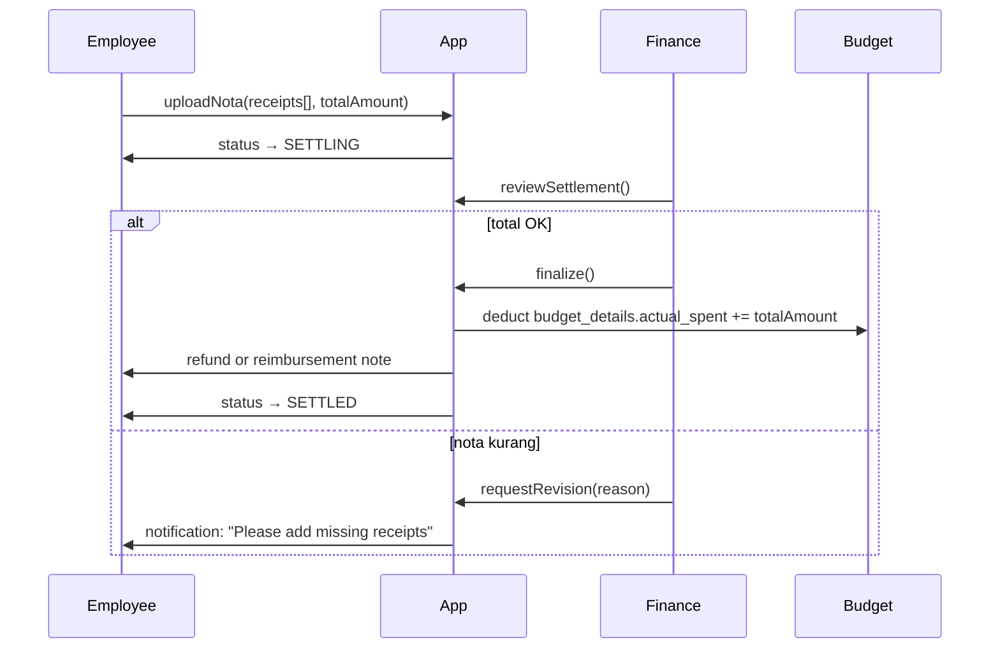

# Finance — Expenses, Cash Advance, Petty Cash, Budgets

Modul terpenting untuk **arus kas proyek** dan **compliance keuangan**.
Empat sub-modul saling terhubung tapi punya state machine sendiri-sendiri.

Route: `src/app/(app)/finance/*`. Dashboard konsolidasi: `/dashboard`
(executive tiles) + `/approvals` (unified inbox untuk approver).

## Money hygiene reminder

Sebelum masuk detail modul, hukum uang yang selalu berlaku (rules §18):

- Storage: `numeric(18,2)` di Postgres.
- Runtime: `bigint` cents atau `decimal.js` di TypeScript. **DILARANG**
  arithmetic pakai `number` (float).
- Display: `Intl.NumberFormat("id-ID", { style: "currency", currency: "IDR", maximumFractionDigits: 0 })` via `src/lib/format/money.ts`.

Kalau seorang engineer mengedit modul finance dan tergoda pakai
`amount1 + amount2` di JS, itu bug — pakai helper di
`src/lib/money/*.ts`.

## 1. Project Expenses

**Route**: `/finance/expenses`. Tabel: `public.expenses`,
`public.expense_approval_logs` (migration `0009`).

### Purpose

Pengajuan biaya proyek yang **sudah terjadi** — beda dari cash advance
(yang **belum** terjadi / minta uang muka).

### Schema

| Kolom              | Tipe             | Note                                                  |
| ------------------ | ---------------- | ----------------------------------------------------- |
| `project_id`       | `uuid`           | Wajib.                                                |
| `category`         | `expense_category`| `TRANSPORT` / `MEALS` / `LODGING` / `SUPPLIES` / dst. |
| `amount`           | `numeric(18,2)`  | IDR.                                                  |
| `receipt_url`      | `text`           | Reference ke Supabase Storage.                        |
| `status`           | `expense_status` | State machine.                                        |
| `description`      | `text`           | Free text justifikasi.                                |
| `incurred_at`      | `date`           | Tanggal transaksi (bukan submit).                     |

### State machine (legacy 10-role)

```
DRAFT → PENDING_L1_SUPERVISOR → PENDING_L2_PM → [PENDING_L3_OM] → [PENDING_L4_HM] → [PENDING_L5_GM] → PENDING_FINANCE → APPROVED
```

Skip level yang tidak diperlukan sesuai `requiredApprovalChain(amount)`.
Setiap level bisa REJECT → status `REJECTED`.

### Threshold matrix (rules §7 — legacy)

| Nominal (IDR)          | Chain L1 → L2 → …                    |
| ---------------------- | ------------------------------------ |
| `< 5.000.000`          | L1 Supervisor → L2 PM → Finance      |
| `5jt – < 25jt`         | + L2 PM tetap → Finance              |
| `25jt – < 100jt`       | + L3 OM → Finance                    |
| `100jt – < ∞`          | + L4 HM → L5 GM → Finance            |

Finance selalu di terminal (parallel gate).

### Server Actions

`src/app/(app)/finance/expenses/actions.ts`:

- `createExpenseAction` — submit new expense.
- `approveExpenseAction` — approve current level.
- `rejectExpenseAction` — reject with reason (audit).
- `cancelExpenseAction` — submitter cancel from DRAFT.

### UI

- List: `/finance/expenses` — table filter by status, project, submitter.
- Detail: `/finance/expenses/[id]` — full timeline of approvals + receipt preview.
- New: slide-over sheet dari list header.

## 2. Cash Advance (Kas Bon)

**Route**: `/finance/cash-advances`. Tabel: `public.cash_advances`,
`public.cash_advance_settlements`, `public.cash_advance_approval_logs`
(migration `0011`, GAS-align via `0027-0028`).

### Purpose

Uang muka kerja — karyawan minta uang cash **sebelum** aktivitas,
kemudian **settle** setelah aktivitas dengan upload nota. Selisih:
- Nota total ≤ CA amount → refund selisih ke kas.
- Nota total > CA amount → reimbursement top-up ke employee.

### Two types

| `ca_type`   | Use case                             | Approval flow                                        |
| ----------- | ------------------------------------ | ---------------------------------------------------- |
| `GENERAL`   | Kas bon bebas (kantor, meeting, dsb) | PM (≥2jt) + Finance (+ Director ≥20jt).              |
| `FIELD_OPS` | Kunjungan lapangan / field visit     | Supervisor selalu + PM (≥5jt) + OM (≥20jt) + Finance + Director (≥50jt). |

### Schema highlights

| Kolom                    | Tipe                    | Note                                                                |
| ------------------------ | ----------------------- | ------------------------------------------------------------------- |
| `ca_type`                | `ca_type_enum`          | `GENERAL` / `FIELD_OPS`                                             |
| `amount`                 | `numeric(18,2)`         | Yang diminta                                                        |
| `purpose`                | `text`                  | Justifikasi                                                         |
| `status`                 | `cash_advance_status`   | State machine                                                       |
| `settlement_due_date`    | `date`                  | Untuk FIELD_OPS: `disbursed_at + 10 hari kalender`                 |
| `disbursed_at`           | `timestamptz`           | Kapan Finance cair                                                  |
| `disbursed_amount`       | `numeric(18,2)`         | Nominal aktual yang cair (bisa < requested kalau Finance revisi)   |
| `settled_at`             | `timestamptz`           | Kapan settlement diterima Finance                                   |
| `settled_amount`         | `numeric(18,2)`         | Total nota                                                          |
| `variance`               | `numeric(18,2)`         | `settled_amount - disbursed_amount`                                 |

### State machine

Lihat [`../product/approval-workflows.md#cash-advance-canonical`](../product/approval-workflows.md#cash-advance-canonical) untuk diagram lengkap.

Ringkas:

```
DRAFT → [approval chain] → APPROVED → DISBURSED → SETTLING → SETTLED
```

- **DISBURSED**: Finance klik "Disburse" — timestamp + amount tercatat.
  Uang benar-benar keluar dari kas perusahaan (proses eksternal, tapi
  di-audit di sistem).
- **SETTLING**: Employee upload nota + isi total. Bisa iterative — Finance boleh minta revisi.
- **SETTLED**: Finance finalize; budget proyek terpotong resmi;
  reimbursement / refund settlement note tercatat.

### Field Ops SLA (10 hari kalender)

Setelah `DISBURSED`, hitung mundur 10 hari kalender ke
`settlement_due_date`.

Cron `/api/cron/ca-settlement-reminders` jalan **harian pagi**. Untuk
setiap CA `FIELD_OPS` yang belum `SETTLED`, kirim reminder di:

- `-3 hari` sebelum SLA — notifikasi "Segera settle kas bon".
- `0 hari` (H-SLA) — "Hari terakhir sebelum SLA".
- `+1 hari` past SLA — escalate ke Supervisor.
- `+3 hari` — escalate ke PM.
- `+7 hari` — escalate ke OM.

Semua reminder audited di `cash_advance_reminders`.

### Settlement flow detail



## 3. Petty Cash (Kas Kecil)

**Route**: `/finance/petty-cash`. Tabel: `public.petty_cash_funds`,
`public.petty_cash_vouchers`, `public.petty_cash_replenishments`
(migration `0012`).

### Purpose

Cash tunai kecil di lokasi untuk pengeluaran operasional minor.
Custodian pegang uang cash + book saldo. Sistem tracking imprest.

### Imprest Fund model

```
Fund (imprest_amount = 5.000.000)
  ├─ Voucher V1: -Rp 50.000 (parkir)      → saldo 4.950.000
  ├─ Voucher V2: -Rp 120.000 (makan)      → saldo 4.830.000
  ├─ Voucher V3: -Rp 800.000 (supplies)   → saldo 4.030.000
  │
  │ (saldo < 20% → auto trigger low-balance notif ke Custodian + Finance)
  │
  ├─ Replenishment: +Rp 970.000 (Finance approve + disburse)
  │                                        → saldo back to 5.000.000 (imprest reset)
```

### Petty Cash Funds

Satu tenant bisa punya beberapa fund (misal per cabang / lokasi).

| Kolom              | Tipe             | Note                                                        |
| ------------------ | ---------------- | ----------------------------------------------------------- |
| `name`             | `text`           | Mis. "Kas Cabang Jakarta Utara"                             |
| `location`         | `text`           | Alamat / cabang                                             |
| `custodian_id`     | `uuid`           | Employee `PETTY_CASH_CUSTODIAN`                             |
| `imprest_amount`   | `numeric(18,2)`  | Target saldo penuh                                          |
| `current_balance`  | `numeric(18,2)`  | Saldo runtime (materialized dari vouchers - replenishments) |
| `min_balance_threshold` | `numeric(18,2)`| Kalau saldo di bawah ini, trigger reminder replenish        |
| `status`           | `fund_status`    | `ACTIVE` / `CLOSED`                                         |

### Petty Cash Vouchers (transaksi keluar)

| Kolom              | Tipe                 | Note                                                       |
| ------------------ | -------------------- | ---------------------------------------------------------- |
| `fund_id`          | `uuid`               |                                                            |
| `amount`           | `numeric(18,2)`      | Nominal keluar                                             |
| `category`         | `petty_expense_kind` | `TRANSPORT` / `MEALS` / `SUPPLIES` / `MISC`                |
| `payee`            | `text`               | Siapa yang terima cash                                     |
| `receipt_url`      | `text`               | Nullable (required kalau amount ≥ Rp 100rb)                |
| `status`           | `voucher_status`     | `AUTO_APPROVED` / `PENDING_FINANCE` / `POSTED` / `REJECTED`|
| `approved_by`      | `uuid`               | Finance yang approve (kalau PENDING_FINANCE)               |

### Decision matrix (`pettyCashDecision`)

| Nominal                  | Decision                                | Note                                       |
| ------------------------ | --------------------------------------- | ------------------------------------------ |
| `< Rp 100.000`           | `AUTO_APPROVE`                          | No receipt required, langsung POSTED       |
| `Rp 100rb – < Rp 200rb`  | `AUTO_APPROVE` (+ `requiresReceipt=true`)| Auto approve TAPI receipt harus dilampirkan |
| `Rp 200rb – ≤ Rp 2jt`    | `FINANCE_APPROVAL_REQUIRED`             | Menunggu Finance                           |
| `≥ Rp 100rb` (bracket 3) | + `requiresReceipt=true`                | Receipt wajib                              |
| `> Rp 2.000.000`         | `ABOVE_CEILING`                         | Redirect ke expense flow, tidak boleh via petty cash |

### Petty Cash Replenishments (isi ulang)

Custodian ajukan saat saldo mendekati minimum.

```
DRAFT → PENDING_FINANCE → APPROVED → DISBURSED → POSTED
```

`amount_requested` = `imprest_amount - current_balance` (biasanya).
Finance approve + disburse dengan `disbursed_amount` bisa sedikit
berbeda (mis. dibulatkan). Setelah POSTED, `current_balance` reset ke
`imprest_amount`.

### Reconciliation

Setiap N hari (default 3, `RECON_OVERDUE_DAYS`), Custodian harus
**physical count** kas + input ke sistem.

- Kalau `physical_count - book_balance` ≤ `VARIANCE_TOLERANCE_IDR` (5rb) → OK.
- Di atas → variance investigation open.

Reconciliation di-track di `petty_cash_reconciliations` (nullable —
opsional per tenant).

## 4. Budgets & Budget Requests

### Budgets

**Route**: `/finance/budgets`. Tabel: `public.budgets` + `public.budget_details` (migration `0009`, GAS-align via `0025`).

Setiap proyek punya **satu** `budget` row (satu budget aktif per waktu).
`budget_details` adalah pecahan per kategori.

Contoh:

```
Budget (project_id=X, status=ACTIVE, total_planned=100.000.000)
  ├─ Detail 1: DIRECT_LABOR, planned=60.000.000, actual_spent=45.000.000
  ├─ Detail 2: OPERATIONAL,  planned=30.000.000, actual_spent=25.500.000
  └─ Detail 3: SUB_CONTRACT, planned=10.000.000, actual_spent=0
```

`actual_spent` updated ketika:
- Cash Advance `SETTLED` (settled_amount masuk ke kategori sesuai).
- Expense `APPROVED` (amount masuk ke kategori sesuai).
- Petty Cash Voucher `POSTED` (amount masuk ke kategori sesuai).

**Utilization %** = `sum(actual_spent) / total_planned`. Kalau > 80%,
system flag warning; kalau > 100%, blocking (PM harus submit Budget
Request Increase dulu).

### Budget Requests

**Route**: `/finance/budget-requests`. Tabel:
`public.budget_requests`, `public.budget_request_approval_logs`
(migration `0030`).

Perubahan anggaran setelah proyek berjalan **harus** via Budget
Request — tidak bisa edit langsung `budget_details.planned_amount`.

### Kinds

| Kind        | Use case                                                                      |
| ----------- | ----------------------------------------------------------------------------- |
| `INCREASE`  | Tambah anggaran ke satu kategori (mis. `DIRECT_LABOR +20jt`).                |
| `DECREASE`  | Kurangi anggaran (mis. proyek scope-down).                                    |
| `TRANSFER`  | Pindahkan dari satu kategori ke kategori lain (net-zero: +A -B).             |

Discriminated union di Zod (`src/lib/validation/budget-request.ts`).

### Schema

| Kolom               | Tipe                   | Note                                              |
| ------------------- | ---------------------- | ------------------------------------------------- |
| `project_id`        | `uuid`                 |                                                   |
| `budget_id`         | `uuid`                 | Snapshot target                                   |
| `kind`              | `budget_request_kind`  | INCREASE / DECREASE / TRANSFER                    |
| `amount`            | `numeric(18,2)`        | Nominal delta (untuk TRANSFER = absolute)         |
| `from_detail_id`    | `uuid`                 | Nullable — untuk TRANSFER dan DECREASE            |
| `to_detail_id`      | `uuid`                 | Nullable — untuk TRANSFER dan INCREASE            |
| `justification`     | `text`                 | 15–2000 karakter, wajib                           |
| `status`            | `budget_request_status`| State machine                                     |

### State machine

```
DRAFT → PENDING_PM (≥5jt) → PENDING_FINANCE → [PENDING_DIRECTOR ≥50jt] → APPROVED → APPLIED
   ↓         ↓                    ↓                        ↓
CANCELLED  REJECTED           REJECTED                REJECTED
```

**APPLIED**: state terminal yang **actually modifies budget** dalam
satu transaksi:

- INCREASE: `to_detail.planned_amount += amount` + `budget.total_planned += amount`.
- DECREASE: `from_detail.planned_amount -= amount` + `budget.total_planned -= amount`. Validasi: `planned - amount ≥ actual_spent` (tidak boleh minus).
- TRANSFER: `from_detail.planned -= amount` + `to_detail.planned += amount`. Net-zero, `budget.total_planned` tidak berubah.

Sebelum `APPLIED`, budget tetap seperti sebelumnya. Ini penting untuk
audit — kalau approved lalu APPLIED gagal, ada gap tapi angka nyata
aman.

## Unit Pengaju — pengaju request per unit organisasi

Kolom `unit_pengaju` menandai **unit / departemen mana yang mengajukan**
transaksi keuangan — bukan siapa yang login, dan bukan siapa yang
di-assign ke project. Field ini hanya label kategoris (bebas dipilih
dari daftar tenant-level lookup atau di-batasi per-project bila
whitelist di-set).

**Cakupan** (migration `0087` + `a97c433`):

| Modul                | Kolom                                          | Wajib? | Sumber pilihan                                                    |
| -------------------- | ---------------------------------------------- | ------ | ----------------------------------------------------------------- |
| Budget baru          | `budgets.unit_pengaju`                         | Opsional | Whitelist `project_allowed_units` untuk project itu, fallback ke tenant `unit_pengaju` lookup |
| Cash Advance General | `cash_advances.unit_pengaju` (type = `GENERAL`)| Opsional | Sama seperti Budget                                              |
| Cash Advance Field Ops | `cash_advances.unit_pengaju` (type = `FIELD_OPS`) | Opsional | Sama seperti Budget                                       |
| Petty Cash Voucher   | `petty_cash_vouchers.unit_pengaju`             | Opsional | Tenant-level `unit_pengaju` lookup saja (petty cash tidak project-scoped) |

### Cara kerja whitelist per-project

Tabel `public.project_allowed_units` (migration `0086`) memungkinkan
admin **membatasi** daftar unit pengaju yang boleh dipilih untuk
project tertentu — mis. project "ITPS-DC-2026" hanya boleh diajukan
oleh unit `ITPS-DC` + `IT-SUPPORT`.

- Bila project punya minimal 1 entry di `project_allowed_units` →
  dropdown "Unit Pengaju" di form Budget / CA General / Field Ops
  mengecil ke daftar itu, hint "Filtered by project whitelist" muncul.
- Bila project **tidak** punya entry di `project_allowed_units` →
  dropdown menampilkan **seluruh** `unit_pengaju` tenant-level (default
  seed 9 unit universal dari migration `0090`: NOC, Field Team, Sales,
  HRD, IT Support, Finance, Management, Project Operations, Lain-lain).
- Admin kelola whitelist di **`/projects/[id]/settings`** → tab
  "Allowed Units", atau via SQL langsung untuk seeding bulk (contoh:
  `scripts/seed-itps-project-allowed-units.sql`).

### Petty Cash — kenapa tidak project-scoped?

Petty cash voucher **tidak punya `project_id`** (imprest fund per lokasi,
bukan per project). Dropdown "Unit Pengaju" di form voucher karena itu
selalu tampilkan **semua** tenant-level `unit_pengaju`, tidak ada
filter whitelist. Bila kebutuhan Anda adalah tracking pengeluaran per
project, gunakan Expense atau CA (yang punya `project_id`), bukan petty
cash.

### Server-side enforcement

Selain filter UI, setiap Server Action men-validate ulang lewat
`isUnitAllowedForProject()` (helper di
`src/lib/data/project-allowed-units.ts`) — user tidak bisa bypass
whitelist dengan curl langsung ke Server Action. Kalau `unit_pengaju`
yang di-submit tidak ada di whitelist project, action mengembalikan
error `UNIT_NOT_ALLOWED_FOR_PROJECT`.

## Unified approvals inbox

`/approvals` menampilkan **semua item finance yang butuh approval
current user**:

- Expense yang pending di slot user (Supervisor / PM / OM / HM / GM / Finance).
- Cash Advance yang pending di slot user.
- Budget Request yang pending di slot user.
- Petty Cash Voucher `PENDING_FINANCE` (Finance only).
- Petty Cash Replenishment `PENDING_FINANCE` (Finance only).
- Cash Advance Settlement finalization (Finance only).

**Realtime**: subscribe ke Supabase Realtime `postgres_changes` di
channel `tenant:{tenant_id}:approvals`. Setiap state change trigger
`router.refresh()`.

## Where to look next

- Approval chains + threshold matrix detail → [`../product/approval-workflows.md`](../product/approval-workflows.md).
- End-user guides:
  - Employee (submit expense/CA) → [`../user-guides/internal-users.md#employee`](../user-guides/internal-users.md#employee).
  - Supervisor / PM / OM / Director (approve) → [`../user-guides/internal-users.md#managers-approvers`](../user-guides/internal-users.md#managers-approvers).
  - Lead Finance (disburse, settle, replenish) → [`../user-guides/internal-users.md#lead-finance`](../user-guides/internal-users.md#lead-finance).
  - Petty Cash Custodian → [`../user-guides/internal-users.md#petty-cash-custodian`](../user-guides/internal-users.md#petty-cash-custodian).
- Schema detail → [`../reference/database-schema.md#finance-tables`](../reference/database-schema.md#finance-tables).
