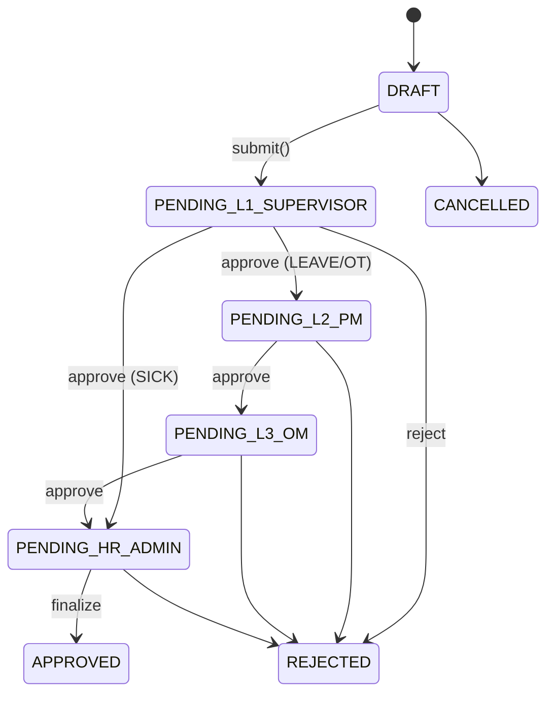
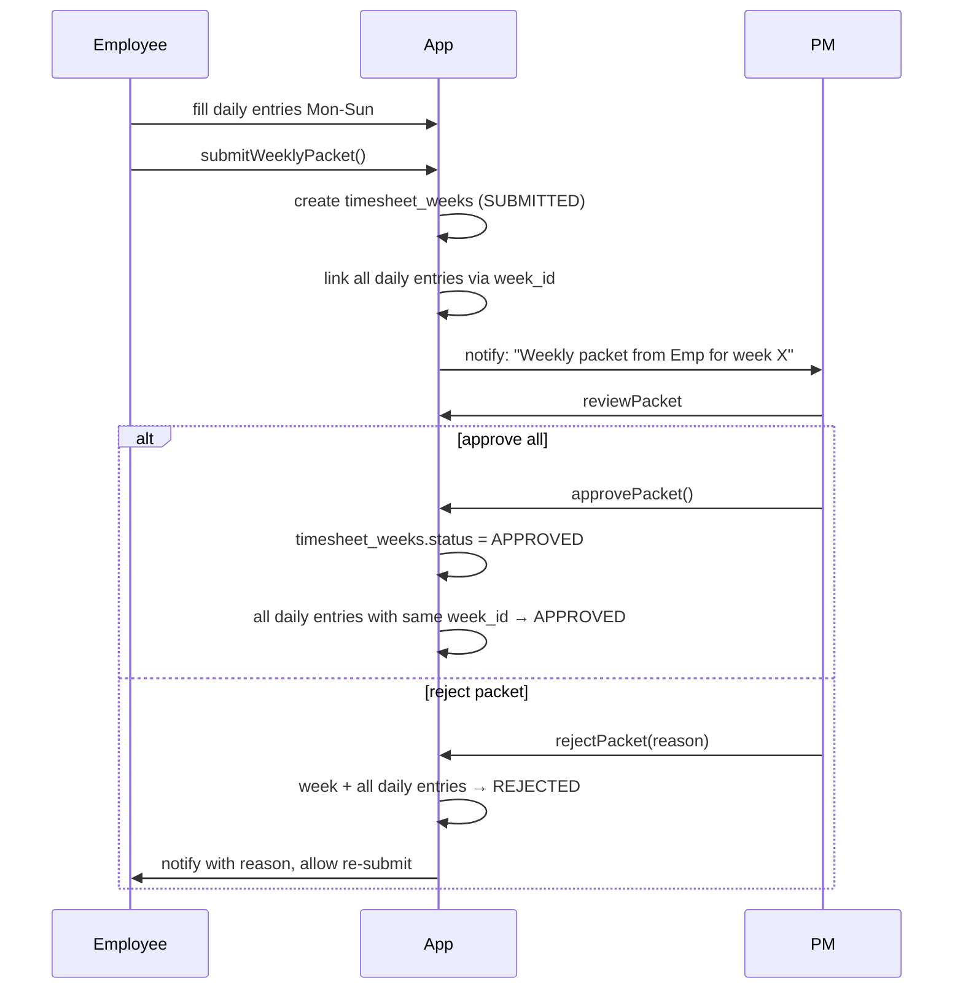

# HRIS & Payroll

Modul HR di ControlDesk mengelola siklus operasional karyawan:
**master data**, **shift & roster**, **request cuti/lembur/sakit**,
**timesheet** (daily + weekly), dan **payroll** (Direct Labor Cost).

Route: `src/app/(app)/hr/*`. Master employee dikelola di `/team` +
`/settings/hr` (Tenant/HR Admin only).

## 1. Employee master

Tabel: `public.employees` (migration `0002`).

### Sensitive PII handling

Kolom-kolom berikut **encrypted at rest** via `pgcrypto` + kunci
`APP_ENCRYPTION_KEY`:

- `salary` → `salary_encrypted bytea`.
- `bank_account_number` → `bank_account_number_encrypted bytea`.
- `ktp_number` → `ktp_number_encrypted bytea`.
- `npwp_number` → `npwp_number_encrypted bytea`.

**Read path**: cuma role dengan `canReadSensitive(role) === true` yang
melihat plaintext — yaitu `HR_ADMIN`, `TENANT_ADMIN`, `LEAD_FINANCE`
(canonical: `ADMIN`, `FINANCE`). Semua role lain melihat mask:

- Salary → `"REDACTED"`.
- Bank account → `"**** **** **** 1234"` (last-4 only).
- KTP → hidden entirely.
- NPWP → hidden entirely.

Helpers: `src/lib/security/crypto.ts`
`encryptedInsert()`, `decryptedSelect()`, `maskSensitive()`.

### Other columns

| Kolom                     | Tipe                | Note                                              |
| ------------------------- | ------------------- | ------------------------------------------------- |
| `id`                      | `uuid`              |                                                   |
| `tenant_id`               | `uuid`              |                                                   |
| `user_id`                 | `uuid`              | FK → `auth.users` (nullable — bisa employee tanpa login)|
| `full_name`               | `text`              |                                                   |
| `email`                   | `text`              | Sync dengan `auth.users.email` bila punya login   |
| `role`                    | `employee_role`     | Legacy 10-role enum (bisa ditulis canonical juga) |
| `reports_to_employee_id`  | `uuid`              | FK self — chain of command (rules §6)             |
| `hourly_rate`             | `numeric(18,2)`     | Untuk Direct Labor Cost                           |
| `overtime_multiplier`     | `numeric(4,2)`      | Default 1.5, tunable per employee                 |
| `hired_at`                | `date`              |                                                   |
| `terminated_at`           | `date`              | Nullable — kalau ada, employee locked             |
| `anonymized_at`           | `timestamptz`       | Setelah 5 tahun terminated, PII di-hash           |

### Anonymization (retensi HR)

Setelah 5 tahun `terminated_at`, cron `/api/cron/retention`
mengeksekusi anonymization untuk row employees terminated:

- `full_name` → `"REDACTED_" || md5(id)`.
- `email` → `null` (unique constraint dilepas via `WHERE terminated_at IS NULL`).
- `salary_encrypted`, `bank_account_number_encrypted`, `ktp_number_encrypted`, `npwp_number_encrypted` → `null`.
- FK reference tetap valid, jadi audit trail lama tidak break.
- Set `anonymized_at = NOW()`.

Rules §22 — WAJIB anonymize, bukan hard delete.

## 2. Shifts & rosters

Tabel: `public.work_shifts`, `public.employee_rosters` (migration `0015`).

### Work Shifts

Template shift yang bisa dijadwalkan ke roster.

| Kolom              | Tipe             | Note                                                  |
| ------------------ | ---------------- | ----------------------------------------------------- |
| `id`               | `uuid`           |                                                       |
| `tenant_id`        | `uuid`           |                                                       |
| `name`             | `text`           | Mis. "Morning Shift", "Night Shift"                   |
| `start_time`       | `time`           | Waktu mulai (contoh `07:00`)                          |
| `end_time`         | `time`           | Waktu selesai (contoh `15:00`) — bisa lebih kecil dari start_time untuk cross-midnight |
| `duration_interval`| `interval`       | `interval` di Postgres (bukan datetime math di TS)    |
| `is_night_shift`   | `boolean`        | Flag untuk night allowance                            |
| `weekend_allowance`| `numeric(18,2)`  | Tambahan jika di-roster hari Sabtu/Minggu             |

**Cross-midnight**: Postgres `interval` handle correctly. Kalau
`start_time = 22:00` dan `end_time = 06:00`, duration = 8 hours.
Jangan pernah hitung ini di TypeScript.

### Employee Rosters

Assignment shift ke employee di tanggal tertentu.

| Kolom              | Tipe               | Note                                                     |
| ------------------ | ------------------ | -------------------------------------------------------- |
| `employee_id`      | `uuid`             |                                                          |
| `shift_id`         | `uuid`             |                                                          |
| `roster_date`      | `date`             |                                                          |
| `status`           | `roster_status`    | `SCHEDULED` / `PRESENT` / `ABSENT` / `LEAVE` / `SICK` / `HOLIDAY` |
| `check_in_at`      | `timestamptz`      | Presence tracking (opsional, kalau ada mesin absensi)    |
| `check_out_at`     | `timestamptz`      |                                                          |

Roster auto-updated by HR Request:

- HR Request `LEAVE` approved → semua roster di rentang `LEAVE`.
- HR Request `SICK` approved → semua roster di rentang `SICK`.

UI: `/hr/roster` → heatmap 24/7 (Tremor / Recharts).

## 3. HR Requests

Tabel: `public.hr_requests`, `public.hr_approval_logs` (migration `0010`).

### Three kinds

| Kind        | Purpose                | Approval chain                                       | Special requirements                     |
| ----------- | ---------------------- | ---------------------------------------------------- | ---------------------------------------- |
| `LEAVE`     | Cuti (tahunan, penting)| Supervisor → PM → OM → HR Admin (final)              | Balance cuti tidak boleh minus           |
| `OVERTIME`  | Lembur                 | Supervisor → PM → OM → HR Admin (final)              | Multiplier applied ke DLC saat approved  |
| `SICK`      | Sakit                  | Supervisor → HR Admin (final) — chain lebih pendek   | **Surat dokter wajib** (attachment PDF)  |

Helpers: `src/lib/hris/state.ts` `hrChainForKind()`.

### Schema

| Kolom              | Tipe                    | Note                                                                    |
| ------------------ | ----------------------- | ----------------------------------------------------------------------- |
| `id`               | `uuid`                  |                                                                         |
| `employee_id`      | `uuid`                  | Submitter                                                               |
| `kind`             | `hr_request_kind`       | LEAVE / OVERTIME / SICK                                                 |
| `leave_type`       | `hr_leave_type`         | Untuk LEAVE: `ANNUAL` / `PERSONAL` / `MATERNITY` / `PATERNITY` / `UNPAID`|
| `start_date`, `end_date` | `date`            | Rentang cuti / sakit                                                    |
| `overtime_hours`   | `numeric(6,2)`          | Untuk OVERTIME                                                          |
| `reason`           | `text`                  | Justifikasi                                                             |
| `attachment_url`   | `text`                  | Surat dokter (wajib SICK, opsional lainnya)                             |
| `status`           | `hr_request_status`     | State machine                                                           |

### State machine



Setelah `APPROVED`, side effects:

- **LEAVE**: employee `leave_balance -= days_requested` (via
  `hr_leave_balances` table). Kalau `PATERNITY` / `MATERNITY`, pakai
  balance khusus. Roster otomatis `LEAVE` untuk rentang.
- **OVERTIME**: kolom `overtime_hours` masuk ke timesheet karyawan hari itu
  (kalau ada) atau di-track separately untuk payroll calc.
- **SICK**: roster `SICK` untuk rentang. Kalau > 3 hari, surat dokter
  wajib re-review oleh HR (compliance BPJS).

### UI

- List: `/hr/requests` — filter by status, kind, employee. Column
  "Chain" menampilkan compact `ApprovalChainProgress`.
- Detail: `/hr/requests/[id]` — full timeline dengan visual chain +
  surat dokter preview (kalau SICK).
- New: slide-over sheet.

## 4. Timesheets

Dua mode paralel — modul HR punya keduanya.

### Daily timesheet

Tabel: `public.timesheets` (migration `0015`).

Entry per hari per employee. Approval satu-per-satu oleh PM/Supervisor.

| Kolom              | Tipe                | Note                                                        |
| ------------------ | ------------------- | ----------------------------------------------------------- |
| `employee_id`      | `uuid`              |                                                             |
| `project_id`       | `uuid`              | Nullable — kalau bukan project work (mis. training internal)|
| `work_date`        | `date`              |                                                             |
| `hours_worked`     | `numeric(4,2)`      | Regular hours                                               |
| `hours_overtime`   | `numeric(4,2)`      | Overtime hours (harus match HR Request OT yang APPROVED)    |
| `description`      | `text`              |                                                             |
| `status`           | `timesheet_status`  | `DRAFT` / `SUBMITTED` / `APPROVED` / `REJECTED`             |
| `week_id`          | `uuid`              | FK → `timesheet_weeks` bila di-submit via weekly packet     |

### Weekly timesheet packet

Tabel: `public.timesheet_weeks` (migration `0031`).

Model kerja BPO seringkali punya banyak entry per minggu — approval
satu-per-satu tidak scalable. Weekly packet groups entry Senin-Minggu
ISO-8601 dan approve **satu paket sekaligus** oleh PM.

| Kolom              | Tipe               | Note                                                       |
| ------------------ | ------------------ | ---------------------------------------------------------- |
| `id`               | `uuid`             |                                                            |
| `employee_id`      | `uuid`             |                                                            |
| `week_start_date`  | `date`             | ISO-8601 Monday                                            |
| `week_end_date`    | `date`             | Sunday                                                     |
| `status`           | `timesheet_week_status` | `DRAFT` / `SUBMITTED` / `APPROVED` / `REJECTED`      |
| `total_hours_worked`| `numeric(6,2)`   | Aggregate                                                 |
| `total_hours_overtime` | `numeric(6,2)`| Aggregate                                                  |

Flow:



Audit log per action: `timesheet_week_approval_logs`.

**Provenance tracking**: setelah weekly packets landing, payroll page
menunjukkan `weekly_share_pct` — % approved hours yang sourced dari
weekly packet vs daily-only. Higher weekly share = better process
compliance.

## 5. Payroll

**Route**: `/hr/payroll`. Tabel: `public.payroll_periods` (migration `0015`).

### Purpose

Compute **Direct Labor Cost (DLC)** — biaya SDM langsung untuk periode
tertentu. Bukan full payroll integrator (tidak push ke bank / BPJS API);
export CSV untuk provider payroll eksternal.

### DLC formula

```
DLC per employee per period =
  Σ(timesheet.hours_worked   × employee.hourly_rate) +
  Σ(timesheet.hours_overtime × employee.hourly_rate × employee.overtime_multiplier)
```

Hanya timesheet dengan `status = APPROVED` yang dihitung. Daily-only
approved dan weekly-packet approved keduanya masuk — tapi tercatat
provenance-nya (lihat `weekly_share_pct`).

Extension per shift:

```
+ shift.night_shift_allowance   (jika roster.shift.is_night_shift = true)
+ shift.weekend_allowance       (jika roster_date is Sat/Sun)
```

Kode: `src/lib/payroll/compute.ts` — `computePayroll(employeeId, periodStart, periodEnd)`.

### Payroll periods

| Kolom              | Tipe               | Note                                                         |
| ------------------ | ------------------ | ------------------------------------------------------------ |
| `period_start`     | `date`             | Awal periode (biasa bulan ke-N)                              |
| `period_end`       | `date`             | Akhir periode                                                |
| `status`           | `payroll_status`   | `DRAFT` / `LOCKED` (finalized) / `EXPORTED`                 |
| `total_dlc`        | `numeric(18,2)`    | Sum DLC seluruh employee                                     |
| `locked_at`        | `timestamptz`      | Setelah lock, timesheet tidak bisa diedit untuk period ini   |
| `locked_by`        | `uuid`             | Finance / HR Admin                                           |

### Lock semantics

Setelah period `LOCKED`:

- Semua timesheet dengan `work_date` in `[period_start, period_end]` yang
  `status = APPROVED` di-freeze.
- Edit / delete → Server Action return `{ ok: false, code: "PERIOD_LOCKED" }`.
- Kalau ada correction, HR Admin buka period lagi (`UNLOCK_PERIOD` action, di-audit).

### Executive dashboard

`/dashboard` KPI cards menampilkan:

- **Gross Margin BPO** = `MRR - (DLC + Operational Expenses + Petty Cash + SLA Penalties)`.
- **DLC ratio** = `DLC / Revenue` per proyek.
- Warning kalau utilization > 100% budget kategori DIRECT_LABOR.

## Server Actions overview

| Module       | Actions                                                                                        | File                                                     |
| ------------ | ---------------------------------------------------------------------------------------------- | -------------------------------------------------------- |
| Employees    | `createEmployeeAction`, `updateEmployeeAction`, `terminateEmployeeAction`                     | `src/app/(app)/team/actions.ts`                          |
| Shifts       | `createShiftAction`, `updateShiftAction`                                                       | `src/app/(app)/hr/roster/actions.ts`                     |
| Roster       | `rosterEmployeeAction`, `updateRosterStatusAction`                                             | same                                                     |
| HR Requests  | `submitHrRequestAction`, `approveHrRequestAction`, `rejectHrRequestAction`, `cancelHrRequestAction`| `src/app/(app)/hr/requests/actions.ts`               |
| Daily TS     | `createTimesheetAction`, `submitTimesheetAction`, `approveTimesheetAction`, `rejectTimesheetAction`| `src/app/(app)/hr/timesheets/actions.ts`             |
| Weekly TS    | `submitWeeklyPacketAction`, `approveWeeklyPacketAction`, `rejectWeeklyPacketAction`            | `src/app/(app)/hr/timesheets/weekly/actions.ts`         |
| Payroll      | `lockPayrollPeriodAction`, `unlockPayrollPeriodAction`, `exportPayrollCsvAction`               | `src/app/(app)/hr/payroll/actions.ts`                    |

## Where to look next

- Approval chain detail per kind → [`../product/approval-workflows.md#hr-request-fixed-chain-tidak-by-nominal`](../product/approval-workflows.md#hr-request-fixed-chain-tidak-by-nominal).
- End-user guides:
  - Employee (submit HR request, isi timesheet) → [`../user-guides/internal-users.md#employee`](../user-guides/internal-users.md#employee).
  - HR Admin (finalize, kelola master, jalankan payroll) → [`../user-guides/internal-users.md#hr-admin`](../user-guides/internal-users.md#hr-admin).
- Schema detail → [`../reference/database-schema.md#hr-tables`](../reference/database-schema.md#hr-tables).
- Playwright specs: `e2e/hr-requests.spec.ts`, `e2e/weekly-timesheet.spec.ts`, `e2e/payroll.spec.ts`.
