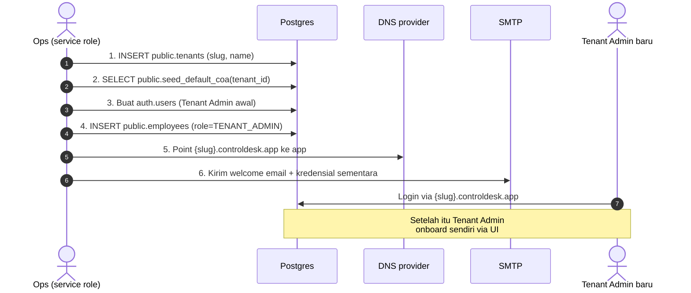

# Tenant Provisioning — Ops Runbook

Related rules: §3 (Multi-Tenancy), §4 (Security & RLS), §17 (Server
Action Contract), §22 (Data Retention).

Runbook operasional untuk **menambah tenant baru** di ControlDesk.
ControlDesk adalah SaaS **single-codebase, single-database,
multi-tenant** — satu deployment melayani banyak organisasi pelanggan
dengan isolasi 3-lapis (proxy → PDP → RLS). Runbook ini menjawab:
"apa yang perlu saya lakukan untuk onboard organisasi X di production?"

Doc pelengkap:

- [`../security-model.md`](../security-model.md) — model isolasi lengkap.
- [`../architecture.md#multi-tenant-routing`](../architecture.md) — proxy
  + subdomain routing.
- [`../product/roles-and-permissions.md`](../product/roles-and-permissions.md) —
  role canonical yang di-assign ke user tenant baru.
- [`../training/README.md`](../training/README.md) — untuk siapkan
  program onboarding pelanggan setelah provisioning selesai.

## Prinsip pertama — apa yang **shared**, apa yang **isolated**

Sebelum menambah tenant, pahami dulu apa yang otomatis tersedia
vs. apa yang harus di-provision manual.

**OTOMATIS shared** (tidak perlu deploy ulang, tidak perlu setup per
tenant):

| Kategori                        | Isi                                                                                                     |
| ------------------------------- | ------------------------------------------------------------------------------------------------------- |
| Codebase Next.js                | 1 image `controldesk/app:latest` — 1 process serve semua tenant                                         |
| Schema database                 | 75+ migrasi (semua tabel, enum, function, RLS policy)                                                   |
| Feature modules                 | Projects · WBS/Gantt · Clients · Finance (Expense/CA/Petty Cash/Budget Request) · HR · Timesheet · Approvals · Issues · Milestones |
| Integration provider catalog    | Fonnte · Twilio · Gemini · LLM lokal · SMTP · Telegram · Google Calendar                                |
| UI + i18n (ID/EN) + theme       | Semua peserta dapat UI konsisten; masing-masing user pilih locale/tema pribadi                          |
| Approval threshold **default**  | Fallback ke `APPROVAL_CONFIG` di `src/lib/rbac/roles.ts` — tenant boleh override, tidak wajib           |
| Server Actions + PDP            | Rules keamanan sama untuk semua tenant                                                                  |
| Cron jobs                       | 1 set cron (SLA sweep, calendar drain, digest) yang loop per tenant otomatis                            |

**Per-tenant isolated** (data disimpan di database yang sama, di-scope
dengan `tenant_id` + RLS):

| Kategori                          | Storage                                                                                     |
| --------------------------------- | ------------------------------------------------------------------------------------------- |
| Row `public.tenants`              | 1 row / tenant, unique `slug`                                                               |
| Semua data operasional            | Setiap tabel punya `tenant_id UUID NOT NULL` — RLS filter otomatis via JWT claim            |
| Users (Employee/PM/Admin/dst)     | `auth.users` global tapi `public.employees.tenant_id` mengisolasi identitas                 |
| Client portal users               | `public.client_users` — RLS ke `client_id → project → tenant_id`                            |
| Integration credentials           | `tenant_smtp_configs` · `tenant_ai_configs` · `tenant_whatsapp_configs` · `tenant_telegram_bots` · `google_calendar_credentials` — semua encrypted at rest |
| Approval threshold override       | `public.approval_thresholds` (kolom `tenant_id`) — kalau kosong, pakai default              |
| Chart of Accounts                 | `public.chart_of_accounts (tenant_id, ...)` — di-seed dari template default                 |
| File attachments (Supabase Storage) | Bucket `tenant-attachments`, path `{tenant_id}/{resource}/{id}/{file}` — RLS ketat        |
| AI daily cost cap                 | Redis counter `ai:tokens:{tenant_id}:{YYYY-MM-DD}`                                          |

**Kesimpulan operasional**: menambah tenant baru **tidak butuh deploy
ulang**, **tidak butuh migrasi baru**, **tidak butuh restart container**.
Cukup 6 langkah SQL + DNS di bawah, atau **1 command CLI** untuk
langkah 1–4.

## Cara cepat — 3 pintu masuk (CLI · Super-Admin UI · SQL manual)

Sejak Fase 2 landed (migration 0077), Anda punya **3 cara** provision
tenant baru — pilih sesuai konteks:

| Metode                            | Kapan pakai                                                                         |
| --------------------------------- | ----------------------------------------------------------------------------------- |
| **A. `pnpm tenant:create` CLI**   | Batch onboarding, scripting, offline / disaster recovery, environment tanpa browser |
| **B. Super-Admin UI di `/super-admin/tenants/new`** | Onboarding satu-satu dari komputer operator, ada form + copy-paste helper           |
| **C. Raw SQL templates**          | Debug, edge cases, ketika CLI + UI tidak available (misal Node.js belum di-install) |

**Yang terbaik untuk mayoritas kasus**: **B (UI)** — karena welcome
email + password langsung dirender di layar dengan tombol copy, dan
form validation langsung visual. **A (CLI)** untuk automation. **C
(SQL)** hanya sebagai fallback.

Ketiga cara menggunakan **RPC yang sama** (`public.provision_tenant()`
di migration 0076), jadi hasilnya identik:
- Row `tenants`
- ~45 akun CoA default
- Row `employees` role `TENANT_ADMIN`
- Row `security_audit_logs` action_type=CREATE resource_name=tenants

### Cara A — `pnpm tenant:create` CLI (Fase 1, sejak migration 0076; Fase 4 --send-email sejak Aug 2026)

Kalau Anda cuma butuh menjalankan langkah 1–4 (row `tenants` → CoA →
auth user → employees admin + audit log), pakai CLI yang di-bundle:

```bash
pnpm tenant:create \
  --slug=acme \
  --name="PT Acme Sejahtera Nusantara" \
  --admin-email=admin@acme.co.id \
  --admin-name="Budi Santoso"
```

Flag berguna:

| Flag                        | Fungsi                                                                             |
| --------------------------- | ---------------------------------------------------------------------------------- |
| `--dry-run`                 | Validasi + preflight (cek slug + email unik) tanpa mutasi. Aman diulang.           |
| `--yes`                     | Non-interaktif — skip konfirmasi. Untuk CI/scripting.                              |
| `--admin-password=<pw>`     | Password custom (min 12 char). Kalau tidak di-set, auto-generate 32-char base64url. |
| `--skip-coa`                | Skip Chart of Accounts seed (edge case, biasanya tidak dipakai).                    |
| `--send-email`              | **Fase 4**: kirim welcome email via env SMTP setelah sukses. Kalau `SMTP_HOST` unset, fall back ke print stdout dengan warning. |
| `--source=<label>`          | Label metadata audit (default: `ops-cli`; gunakan `super-admin-ui` bila via UI).    |
| `--help`                    | Print usage.                                                                        |

CLI melakukan preflight (slug regex + reserved list + slug uniqueness
di DB + email uniqueness di `auth.users`), lalu:

1. Buat `auth.users` via Supabase Admin API.
2. Panggil RPC `public.provision_tenant()` — **atomic transaction**
   yang insert `tenants` + seed CoA + insert `employees` admin + insert
   `security_audit_logs`. Kalau step 2 gagal, auth user dari step 1
   otomatis dihapus (rollback).
3. Verifikasi count CoA (minimum 30 akun).
4. Print welcome email siap-copy ke stdout dengan password
   ter-generate.

CLI **tidak** mengurus **DNS** (langkah 5) dan **tidak** mengirim
**email** (langkah 6) — dua langkah tersebut tetap manual by design
(operator harus punya kontrol eksplisit atas kirim credential).

Setelah CLI selesai, lanjut ke langkah 5 (DNS) + langkah 6 (kirim
email dari template yang di-print).

**Backward compat**: langkah 1–4 di section berikutnya (raw SQL
templates) tetap valid untuk skenario offline / DR / audit / kalau
CLI tidak bisa dijalankan (e.g. tidak ada Node.js env).

### Cara B — Super-Admin UI (Fase 2, sejak migration 0077)

URL: `https://controldesk.app/super-admin/tenants` (apex domain,
BUKAN subdomain tenant). Development lokal: `http://localhost:3000/super-admin/tenants`.

**Auth model**: Super-admin adalah **peran cross-tenant** yang
disimpan di tabel `public.platform_admins` — TIDAK di
`public.employees`, karena platform admin tidak scoped ke satu tenant.
JWT hook (`custom_access_token_hook`, updated di migration 0077)
otomatis inject claim `is_platform_admin: true` ke JWT saat user
login jika ada row aktif di `platform_admins`.

**Cara buat platform admin pertama (bootstrap chicken-and-egg)**:
karena UI Fase 5 baru bisa diakses setelah minimal ada satu platform
admin, admin **pertama** harus di-seed via SQL:

```sql
-- Prasyarat: auth.users row untuk email tersebut harus sudah ada.
-- (Kalau belum, buat via Supabase Admin API / dashboard dulu.)
insert into public.platform_admins (user_id, full_name, email, is_active)
select u.id, 'Nama Ops', 'ops@controldesk.app'::citext, true
from auth.users u
where u.email = 'ops@controldesk.app'
on conflict (user_id) do update set is_active = true;
```

Setelah row masuk, user tersebut logout+login lagi (supaya JWT baru
di-issue dengan claim `is_platform_admin=true`), lalu buka
`/super-admin/tenants`.

**Setelah admin pertama ada**: platform admin ke-2 dan seterusnya
dibuat lewat UI di `/super-admin/admins/new` (Fase 5). Dua mode:

- **Promote existing user** — user email harus sudah punya row di
  `auth.users` (mis. sudah pernah di-invite ke tenant lain). Aman,
  tidak menciptakan credential baru. Kalau row `platform_admins`
  lama ada dengan `is_active=false`, otomatis di-re-aktivasi.
- **Buat akun baru** — buat auth.users baru + row `platform_admins`
  sekaligus. Password auto-generate, ditampilkan sekali di UI, salin
  manual + kirim ke user via channel aman.

**Manage existing** — di `/super-admin/admins` operator bisa:

- Nonaktifkan platform admin lain (soft — set `is_active=false`;
  auth.users tetap ada, JWT claim `is_platform_admin` hilang di
  refresh berikutnya).
- Reaktivasi platform admin nonaktif.
- **Tidak bisa** nonaktifkan diri sendiri — block di UI dan server
  action. Kalau perlu, minta platform admin lain melakukannya.

Untuk hard-delete row `platform_admins` (bukan cuma soft-deactivate),
jalankan SQL langsung — audit log tetap immutable per rules §3.

**Fitur di Super-Admin UI**:

- **List semua tenant** (`/super-admin/tenants`) — 1 baris per tenant,
  status badge (active/suspended/terminated), counts employees +
  projects, quick link ke detail.
- **Provision tenant baru** (`/super-admin/tenants/new`) — form yang
  memanggil server action `createTenantAction` (yang wrap RPC
  `provision_tenant`). Setelah sukses, UI menampilkan panel confirm
  dengan tombol **Copy password + Copy welcome email** — operator
  kirim email manual via preferred channel.
- **Detail tenant** (`/super-admin/tenants/{id}`) — stat cards
  (employees/clients/projects/CA counts), **panel Suspend/Reactivate**,
  **panel Feature flags** (Fase 3), **recent audit log** (10 aksi
  platform-admin terakhir untuk tenant ini).
- **Platform admin management** (`/super-admin/admins`) — Fase 5.
  List semua platform admin (aktif + nonaktif), tombol nonaktifkan
  / reaktivasi. Tambah admin baru via `/super-admin/admins/new`
  dengan dua mode: **Promote existing user** atau **Buat akun baru**.
  Self-deactivate diblock baik di UI maupun server.

**Semua aksi platform-admin di-audit** ke tabel terpisah
`public.platform_admin_audit_logs` (immutable, INSERT-only, trigger
enforced) — bukan `security_audit_logs` karena aksi cross-tenant
tidak "milik" tenant tunggal.

### Fase 3 — Feature flags per tenant

Migration 0077 menambahkan tabel `public.tenant_feature_flags` untuk
gating feature per tenant. Registry key feature ada di
`src/lib/ops/feature-flags.ts` — 7 keys awal:

| Feature key                | Default | Fungsi                                                                    |
| -------------------------- | ------- | ------------------------------------------------------------------------- |
| `wbs_gantt`                | ✓ on    | WBS + Gantt di project detail (migration 0075)                            |
| `ai_insights`              | ✓ on    | AI narrative insights via Vercel AI SDK                                    |
| `google_calendar_sync`     | ✗ off   | Push milestones + events ke Google Calendar (butuh OAuth setup)            |
| `telegram_bot`             | ✗ off   | Forward notifications ke Telegram bot per-tenant                          |
| `whatsapp_notifications`   | ✗ off   | Forward notifications via Fonnte / Twilio (butuh SMTP config di tenant)   |
| `bulk_import`              | ✓ on    | CSV import clients/projects/employees                                     |
| `advanced_reports`         | ✓ on    | Monthly reports PDF export (slice B)                                       |

**Kontract**: missing row = fallback ke `defaultEnabled` di registry.
`enabled=false` = OFF. `enabled=true` = ON. Fail-open — kalau DB
query error, log warning + fallback ke default (mencegah down-time
karena bug config).

**Toggle**: hanya platform admin (via `/super-admin/tenants/{id}`).
Tenant admin **tidak bisa** toggle flag mereka sendiri (RLS policy
`tenant_feature_flags_platform_write` di migration 0077) — decision
tersebut ada di sisi platform team.

**Read-only view untuk tenant admin (Fase 5)**: tenant admin bisa
melihat status fitur mereka di **Settings → Fitur Aktif**
(`/settings/features`). Halaman ini menampilkan setiap key registry
lengkap dengan status Aktif/Nonaktif dan badge "default" kalau tidak
ada row eksplisit. RLS policy `tenant_feature_flags_self_read`
memastikan hanya baris untuk tenant sendiri yang di-fetch. Gate role:
`TENANT_ADMIN` + `GENERAL_MANAGER` (konsisten dengan surface admin
lainnya di Settings).

**Bagaimana pakai di code**:

```ts
import { isFeatureEnabled } from "@/lib/ops/feature-flags";

const employee = await requireCurrentEmployee();
const canUseGcal = await isFeatureEnabled(employee.tenant_id, "google_calendar_sync");
if (canUseGcal) {
  // render Google Calendar OAuth setup panel
}
```

`isFeatureEnabled()` cached per-request (React `cache()`) — panggil
sebanyak yang perlu di RSC tree tanpa hit DB berulang.

### Fase 2 — Tenant status (active / suspended / terminated)

Migration 0077 menambah kolom `tenants.status public.tenant_status`
(enum: `active`, `suspended`, `terminated`). Default `active`.

**Behavior per status** (enforced di `src/proxy.ts` layer 1):

| Status       | Effect                                                                         |
| ------------ | ------------------------------------------------------------------------------ |
| `active`     | Normal — request diteruskan ke app.                                            |
| `suspended`  | Proxy rewrite ke `/suspended?slug={slug}` — halaman statis "Tenant sedang di-suspend, hubungi support". User TIDAK bisa login. Data tetap utuh. |
| `terminated` | Proxy return `HTTP 410 Gone`. Sengaja tidak render halaman apapun.             |

**Cara toggle**:

- **Suspend / Reactivate**: via `/super-admin/tenants/{id}` panel.
  Server action `setTenantStatusAction` — di-audit di
  `platform_admin_audit_logs`.
- **Terminate**: **TIDAK ADA** UI. Terminate hanya via SQL langsung —
  by design supaya tidak accidental. Ikuti section Rollback di bawah.

## Prasyarat

- Anda punya akses **service role Supabase** (tidak cukup pakai anon /
  authenticated token — RLS akan block).
- Anda tahu:
  - Nama legal organisasi tenant baru.
  - Slug subdomain yang diinginkan (harus match regex
    `^[a-z0-9][a-z0-9-]{1,62}$`).
  - Email + full name **Tenant Admin pertama** dari sisi pelanggan.
- Environment target sudah healthy — cek `/api/health` + `/api/ready`
  return 200.
- Rencana rotasi password sementara sudah siap (jangan pakai
  `ControlDesk#2026` — itu hanya untuk demo/training sandbox).

## Alur provisioning (bird's-eye view)



Setelah 6 langkah, tenant baru **fully functional** — semua feature
(WBS, Gantt, expense chain, HR, integrations, dst) langsung tersedia.

## Step-by-step SQL

Semua SQL di bawah **idempotent** (aman dijalankan ulang). Ganti
placeholder `:tenant_slug`, `:tenant_name`, `:admin_email`,
`:admin_name`, `:admin_password` sesuai input pelanggan.

Sample values yang dipakai dalam contoh:

- `:tenant_slug` = `acme`
- `:tenant_name` = `PT Acme Sejahtera Nusantara`
- `:admin_email` = `admin@acme.co.id`
- `:admin_name` = `Budi Santoso`
- `:admin_password` = **generate 16+ char random string** (jangan
  hardcode di script — gunakan `openssl rand -base64 24` atau password
  manager).

### Step 1 — Buat row tenants

```sql
insert into public.tenants (slug, name)
values ('acme', 'PT Acme Sejahtera Nusantara')
returning id;
```

Simpan UUID yang dikembalikan sebagai `:tenant_id` untuk step
berikutnya. Contoh: `9d1f8e2a-6b3c-4d5e-8f9a-1234567890ab`.

**Validasi**:

- Constraint `tenants_slug_shape` menolak slug yang tidak match regex.
- Slug harus unique — insert kedua dengan slug sama akan raise
  `unique_violation`.
- Slug **tidak boleh** ada di daftar `RESERVED_SUBDOMAINS`
  (`src/lib/tenant/resolve.ts`): `www`, `app`, `api`, `admin`, `auth`,
  `assets`, `static`, `cdn`, `mail`, `docs`. Reserved slug akan lolos
  DB insert tapi proxy akan reject request.

### Step 2 — Seed Chart of Accounts

```sql
select public.seed_default_coa('9d1f8e2a-6b3c-4d5e-8f9a-1234567890ab'::uuid);
```

Ini populate ~45 akun standar (1000/2000/…/5900) ke
`public.chart_of_accounts` dengan `tenant_id=:tenant_id`. Idempotent —
kalau di-run ulang, hanya insert akun yang belum ada.

**Kenapa perlu**: modul Finance (Expense, Petty Cash, CA settlement)
butuh referensi CoA saat catat jurnal. Kalau CoA kosong, Server
Action Expense akan return `{ ok: false, code: "COA_MISSING" }`.

### Step 3 — Buat auth user untuk Tenant Admin pertama

**Cara A — via Supabase Admin API (recommended untuk production)**:

Pakai service role di script server-side, jangan SQL langsung:

```ts
import { createClient } from "@supabase/supabase-js";

const supa = createClient(
  process.env.NEXT_PUBLIC_SUPABASE_URL!,
  process.env.SUPABASE_SERVICE_ROLE_KEY!,
);

const { data, error } = await supa.auth.admin.createUser({
  email: "admin@acme.co.id",
  password: "REPLACE_WITH_SECURE_RANDOM",
  email_confirm: true,
  user_metadata: { full_name: "Budi Santoso" },
});
// data.user.id === UUID auth.users yang baru dibuat
```

**Cara B — SQL langsung** (untuk offline / disaster recovery / local
Docker):

Reuse helper `public._seed_user` yang ada di `supabase/seed.sql`:

```sql
select public._seed_user(
  'admin@acme.co.id'::text,
  'REPLACE_WITH_SECURE_RANDOM'::text,
  'Budi Santoso'::text
) as admin_user_id;
```

Simpan UUID yang dikembalikan sebagai `:admin_user_id`.

> **Catatan**: `_seed_user` didefinisikan di seed.sql, tersedia di dev
> Docker. Untuk production yang tidak menjalankan seed, gunakan Cara A.

### Step 4 — Insert Tenant Admin di public.employees

```sql
insert into public.employees (
  tenant_id,
  user_id,
  role,
  reports_to_employee_id,
  full_name,
  email,
  is_active
) values (
  '9d1f8e2a-6b3c-4d5e-8f9a-1234567890ab'::uuid,   -- :tenant_id
  '<UUID hasil step 3>'::uuid,                     -- :admin_user_id
  'TENANT_ADMIN',                                  -- role canonical: ADMIN
  null,                                            -- top of chain
  'Budi Santoso',
  'admin@acme.co.id',
  true
)
returning id;
```

**Penting**: setelah row ini eksis, pada login berikutnya
`custom_access_token_hook` (di migration `0020_jwt_role_claim_fix.sql`)
akan otomatis inject claim ke JWT:

- `tenant_id` = `:tenant_id`
- `tenant_slug` = `acme`
- `user_role` = `TENANT_ADMIN`
- `employee_id` = row `employees.id` yang baru

Semua RLS policy di 75 tabel langsung mengizinkan akses ke data tenant
`acme` untuk user ini.

### Step 5 — Konfigurasi DNS

Untuk **production** — di DNS provider (Cloudflare/Route53/etc):

Opsi terbaik: **wildcard record** sekali setup, semua tenant slug
otomatis resolve:

```
Type:  CNAME (atau ALIAS/A untuk apex)
Name:  *.controldesk.app
Value: <app-ingress.example.com> (Vercel/Cloud Run/Fly/etc)
TTL:   300
```

Opsi manual per-tenant (kalau wildcard tidak feasible karena kebijakan
DNS):

```
Type:  CNAME
Name:  acme.controldesk.app
Value: <app-ingress.example.com>
TTL:   300
```

**Wildcard TLS certificate** (Let's Encrypt via DNS-01 challenge, atau
managed certificate di Vercel/GCP) harus mencakup `*.controldesk.app`.

Untuk **staging** — wildcard sudah setup di
`*.staging.controldesk.app` — cukup insert row tenant, tidak butuh DNS
change.

Untuk **local Docker**:

- `localhost` sudah wildcard by default (Chrome/Firefox resolve
  `{anything}.localhost` ke `127.0.0.1`).
- `pnpm docker:app` sudah expose port 3001 — akses langsung ke
  `acme.localhost:3001/login`.

### Step 6 — Kirim welcome email

Template email untuk Tenant Admin baru:

```
Subject: Selamat datang di ControlDesk — {tenant_name}

Halo {admin_name},

Akun ControlDesk untuk {tenant_name} sudah aktif. Silakan login untuk
mulai onboarding.

URL:      https://{tenant_slug}.controldesk.app/login
Email:    {admin_email}
Password: {admin_password_temporary}

Wajib segera setelah login:
1. Ganti password (menu Profile).
2. Setup email SMTP (Settings → Integrations → Email) supaya
   notifikasi ke tim Anda terkirim.
3. Undang tim Anda (Settings → Users → Invite).

Bahan bacaan onboarding:
- Panduan pengguna:  https://docs.controldesk.app/user-guides/internal-users
- Alur kerja per role: https://docs.controldesk.app/training/user-guide-workflows
- Materi training:    https://docs.controldesk.app/training/README

Kalau ada kendala, balas email ini atau kontak support@controldesk.app.

Salam,
Tim ControlDesk
```

Kirim via SMTP relay yang **default** (bukan tenant-specific SMTP —
karena tenant belum setup punyanya sendiri). Set variable
`SMTP_HOST` / `SMTP_USER` di deployment env supaya default relay
tersedia.

## Post-provisioning — verifikasi

Sebelum kirim email, verify tenant benar-benar hidup:

**A. Health check tenant** (via psql sebagai service role):

```sql
select
  t.id, t.slug, t.name, t.created_at,
  (select count(*) from public.employees e where e.tenant_id = t.id) as employees,
  (select count(*) from public.chart_of_accounts c where c.tenant_id = t.id) as coa_accounts
from public.tenants t
where t.slug = 'acme';
```

Ekspektasi: `employees=1`, `coa_accounts >= 40`.

**B. Login smoke test** (buka browser):

1. Buka `https://acme.controldesk.app/login`.
2. Login dengan `admin@acme.co.id` + password.
3. Harus mendarat di dashboard tenant `acme` — sidebar menampilkan
   semua modul (Projects · Clients · Finance · HR · Settings).
4. Buka `/settings/audit-log` — harus muncul 1 event
   `TENANT_ADMIN_LOGIN_SUCCESS`.

**C. Isolation check** (kritikal — pastikan `acme` tidak lihat data
tenant lain):

1. Login sebagai `admin@acme.co.id` di browser tab 1.
2. Login sebagai admin tenant lain (misal `demo`) di tab incognito.
3. Buka `/clients` di masing-masing tab — harus **tidak overlap**.
4. Ambil UUID sebuah client dari `demo`, coba buka
   `https://acme.controldesk.app/clients/{uuid_dari_demo}` — harus
   dapat **404 atau access-denied**, bukan data leak.

## Rollback

**Penting — audit log immutability (rules §3)**: begitu ada row di
`public.security_audit_logs` yang mereferensikan tenant, tenant
**tidak bisa** di-hard-delete lewat `DELETE FROM tenants` biasa. FK
kolom `security_audit_logs.tenant_id` menggunakan `ON DELETE RESTRICT`
sehingga PostgreSQL akan raise error. Ini disengaja — audit trail
harus utuh.

`pnpm tenant:create` sendiri menulis 1 audit log entry, jadi tenant
yang baru di-provision **sudah tidak bisa** di-hard-delete secara
langsung.

Opsi rollback:

**A. CLI rollback otomatis** (built-in, tidak butuh manual):

- Kalau `pnpm tenant:create` gagal setelah step 2 (auth user dibuat)
  tapi sebelum step 3 (`provision_tenant` RPC selesai), auth user
  otomatis di-delete via Supabase Admin API. State DB tetap bersih.
- Kalau `provision_tenant` sudah selesai lalu terjadi kegagalan
  eksternal (mis. DNS gagal), tenant tetap ada di DB — gunakan opsi B
  atau C.

**B. Soft-freeze** (recommended untuk tenant apapun yang sudah ada
audit log — misal tenant test yang sudah di-provision full):

```sql
-- Turunkan semua user tenant jadi inactive. Hook JWT tidak akan
-- inject claim untuk user inactive → user tidak bisa login → tenant
-- efektif "frozen" tanpa hilang audit trail.
update public.employees
set is_active = false
where tenant_id = (select id from public.tenants where slug = 'acme');
```

**C. Hard-delete untuk dev / smoke test only** (JANGAN dipakai di
staging/prod):

```sql
-- Bypass audit immutability trigger. HANYA di dev DB.
begin;
set session_replication_role = 'replica';
delete from public.security_audit_logs
  where tenant_id = (select id from public.tenants where slug = 'acme');
delete from auth.users
  where id in (select user_id from public.employees
               where tenant_id = (select id from public.tenants where slug = 'acme'));
delete from public.tenants where slug = 'acme';
set session_replication_role = 'origin';
commit;
```

`on delete cascade` di FK `tenant_id` (migration 0002) menghapus row
anak (`employees`, `chart_of_accounts`, `projects`, dst) tapi FK
`security_audit_logs.tenant_id` adalah `ON DELETE RESTRICT` — makanya
audit log harus dihapus dulu (dengan trigger dibypass sementara).

File di Supabase Storage bucket `tenant-attachments/{tenant_id}/*`
**tidak** auto-delete — hapus manual dari Supabase Studio.

Untuk tenant produksi, **JANGAN opsi C**. Selalu pakai opsi B.

```sql
-- Opsi soft-delete: tambahkan kolom is_active kalau belum ada
-- (planned untuk future migration). Untuk sekarang, cara paling aman:
-- turunkan semua user tenant jadi inactive dan izinkan RLS drop mereka.
update public.employees
set is_active = false
where tenant_id = (select id from public.tenants where slug = 'acme');
```

User inactive → hook JWT tidak inject claim → tidak bisa login →
tenant efektif "frozen" tanpa hard-delete data.

## Failure modes

| Gejala                                                                | Penyebab & fix                                                                                                             |
| --------------------------------------------------------------------- | -------------------------------------------------------------------------------------------------------------------------- |
| `INSERT tenants` gagal dengan `check_violation tenants_slug_shape`    | Slug tidak match regex. Hanya `[a-z0-9-]`, 2–63 char, mulai dengan alfanumerik.                                            |
| Slug reserved (misal `admin.controldesk.app`)                         | Insert lolos DB tapi proxy return `{ kind: "reserved" }` → redirect ke apex. Ganti slug.                                   |
| Login tenant baru → redirect terus / "Access denied"                  | JWT hook belum inject claim. Cek: (1) `employees.is_active = true`; (2) hook `custom_access_token_hook` enabled di Supabase Auth dashboard; (3) user sudah `email_confirmed`. |
| Login → dashboard tampil tapi menu kosong                             | Employee role bukan `TENANT_ADMIN` — tidak punya nav item yang di-gate. Cek: `select role from employees where email='...';` |
| Server Action pertama gagal `COA_MISSING`                             | Step 2 dilewat. Jalankan `select public.seed_default_coa(:tenant_id);`                                                    |
| Klien lihat data tenant lain                                          | RLS bug — **HENTIKAN** provisioning, escalate ke security team. Cek log audit + policy per tabel via                        |
|                                                                       | `select relname from pg_class c join pg_policy p on p.polrelid=c.oid;`                                                     |
| DNS resolusi gagal (`ERR_NAME_NOT_RESOLVED`)                          | Wildcard record belum propagate. Butuh 5–30 menit. Coba `nslookup acme.controldesk.app`.                                   |
| TLS cert error di browser                                             | Wildcard cert belum cover. Cek issuer + SAN via `openssl s_client -connect acme.controldesk.app:443`.                     |

## Compliance & audit

Setiap provisioning wajib menghasilkan **audit trail**:

- Row `public.tenants` punya `created_at` auto-stamp.
- Kalau pakai Cara A (Admin API), Supabase log request di `auth.audit_log_entries`.
- Kalau pakai Cara B (SQL), **manual insert** ke
  `security_audit_logs`:

```sql
insert into public.security_audit_logs (
  tenant_id, actor_id, action_type, resource_name, new_values, ip_address, user_agent
) values (
  '9d1f8e2a-...'::uuid,
  null,  -- ops action, no in-app actor
  'TENANT_PROVISIONED',
  'tenants',
  jsonb_build_object('slug','acme','name','PT Acme Sejahtera Nusantara','provisioned_by','ops-runbook'),
  '10.0.0.42',
  'psql/ops-runbook'
);
```

**Retention**: row `public.tenants` + `security_audit_logs` masuk
kategori 7-tahun retention (rules §22). Jangan hard-delete tenant
setelah go-live — pakai soft-freeze pattern di bagian Rollback.

## Frequently asked questions

**Q: Fitur baru yang saya deploy di dev (misal WBS + Gantt) apakah
otomatis tersedia untuk semua tenant lama?**

A: Ya, otomatis. Deploy = 1 image + 1 batch migration. Semua tenant
punya schema yang sama; feature toggle **bukan** per-tenant (kecuali
kalau ada `feature_flags` table — sekarang belum ada). Setelah
migration jalan di 1 DB, semua tenant langsung punya WBS + Gantt.

**Q: Kalau saya mau roll-out fitur baru **hanya** ke tenant tertentu
(canary)?**

A: Belum ada feature flag native. Workaround saat ini: (1) code-level
guard `if (tenant.slug === 'acme')` — jelek karena spread di kode,
(2) tabel `tenant_feature_flags (tenant_id, feature, enabled)` — belum
diimplementasi. Roadmap Fase 5+.

**Q: Bisakah 1 user (`auth.users`) punya akses ke > 1 tenant?**

A: Secara schema **bisa** — `public.employees` unique
constraint-nya `(tenant_id, user_id)`, jadi 1 user_id boleh punya
banyak employees row di tenant berbeda. Tapi `custom_access_token_hook`
sekarang **hanya inject claim dari 1 employees row (LIMIT 1 ORDER BY
created_at)** — jadi user hanya bisa switch tenant dengan logout +
login ulang, atau dengan tambahan endpoint `POST /api/switch-tenant`.
Belum ada UI switcher. Roadmap.

**Q: AI cost cap — apakah dishared antar tenant?**

A: Tidak. Cap harian per-tenant via Redis counter
`ai:tokens:{tenant_id}:{YYYY-MM-DD}` (rules §15). Default 10.000 token
output/hari, bisa di-override di `tenant_ai_configs.daily_token_cap`.

**Q: Storage attachment — apakah dishared bucket?**

A: 1 bucket `tenant-attachments`, tapi path convention
`{tenant_id}/{resource}/{id}/{file.ext}` + RLS `SELECT USING (name LIKE
current_tenant_id() || '/%')`. File isolation dijaga di path + policy
level, bukan di bucket level. Ini disengaja supaya total bucket count
di Supabase tidak meledak dengan pertambahan tenant.

**Q: Backup — kalau saya harus restore 1 tenant tanpa impact tenant
lain?**

A: Belum otomatis. Sekarang Postgres backup = full DB. Untuk selective
restore per tenant: (1) restore full DB ke staging, (2) `pg_dump` filter
`WHERE tenant_id = ...` untuk semua tabel, (3) apply ke production DB
dengan `ON CONFLICT DO NOTHING`. Butuh script custom — TBD di roadmap.

## Roadmap penyempurnaan

Status roadmap tenant lifecycle:

| Fase | Item                                                                                                                                     | Status                                             |
| ---- | ---------------------------------------------------------------------------------------------------------------------------------------- | -------------------------------------------------- |
| 1    | **CLI script** `pnpm tenant:create` — atomic provisioning via `provision_tenant()` RPC + auto-rollback                                   | ✅ Shipped — migration 0076 + `scripts/tenant/create.ts` |
| 2    | **Super-admin UI** di route `/super-admin/tenants` + `platform_admins` table + JWT `is_platform_admin` claim + separate audit log        | ✅ Shipped — migration 0077 + `src/app/(super-admin)/`  |
| 2    | **Tenant suspension** — kolom `tenants.status enum('active', 'suspended', 'terminated')` + proxy guard + `/suspended` static page        | ✅ Shipped — migration 0077 + `src/app/suspended/`      |
| 3    | **Feature flag per tenant** — tabel `tenant_feature_flags` + `isFeatureEnabled()` helper + toggle UI + registry di `src/lib/ops/feature-flags.ts` | ✅ Shipped — migration 0077 + `src/lib/ops/feature-flags.ts` |
| 4    | **Automated welcome email** — `--send-email` flag di CLI, env-scoped SMTP (bypass server-only mailer)                                    | ✅ Shipped — CLI `scripts/tenant/create.ts` upgrade    |
| 5    | **Read-only feature-flag view untuk tenant admin** — panel "Fitur aktif untuk tenant Anda" di Settings                                   | ✅ Shipped — `src/app/(app)/settings/features/`      |
| 5    | **Platform admin management UI** — tambah / promote / nonaktifkan platform admin. Self-demote di-block. Chicken-egg: admin pertama tetap SQL. | ✅ Shipped — `src/app/(super-admin)/super-admin/admins/`  |
| 6+   | **Tenant self-signup** — marketing page apex → `/register-org` → auto-provision + Stripe billing                                          | ⏳ Planned                                          |
| 6+   | **Bulk feature-flag toggle** — set flag ke ON/OFF untuk semua tenant sekaligus (canary rollout ke 10% tenant, dsb.)                       | ⏳ Planned                                          |

Rekomendasi pattern:

- **Onboarding satu-satu manual**: Super-Admin UI (Cara B).
- **Batch / scripted onboarding**: `pnpm tenant:create --send-email --yes` (Cara A).
- **DR / offline**: raw SQL templates (Cara C).

## Kontak

- Ops emergency (provisioning gagal, isolation breach): `ops@controldesk.app`.
- Roadmap tenant lifecycle: `product@controldesk.app`.
- Runbook improvement: file issue di GitHub label `docs/ops`.
