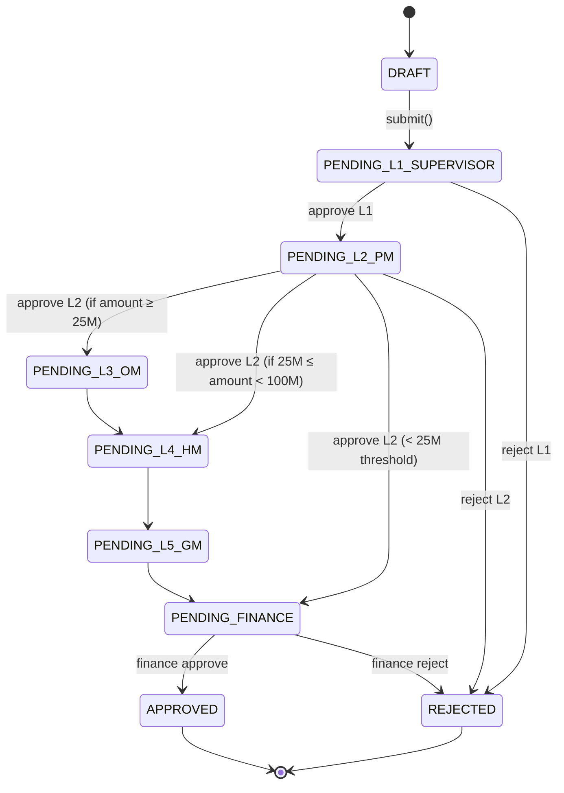
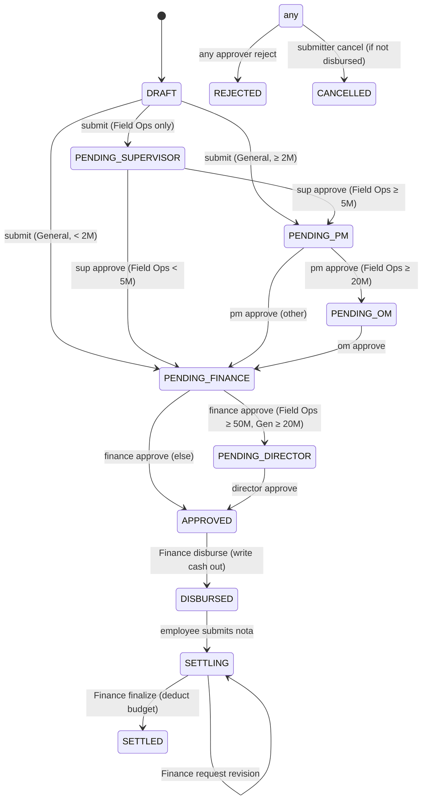
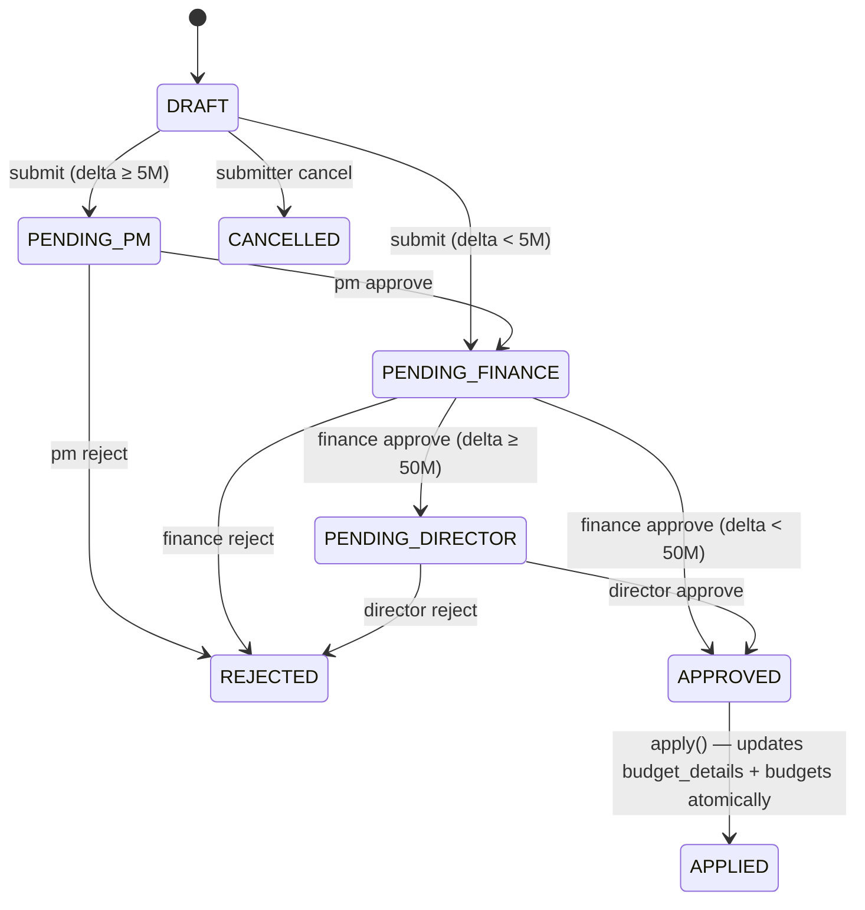
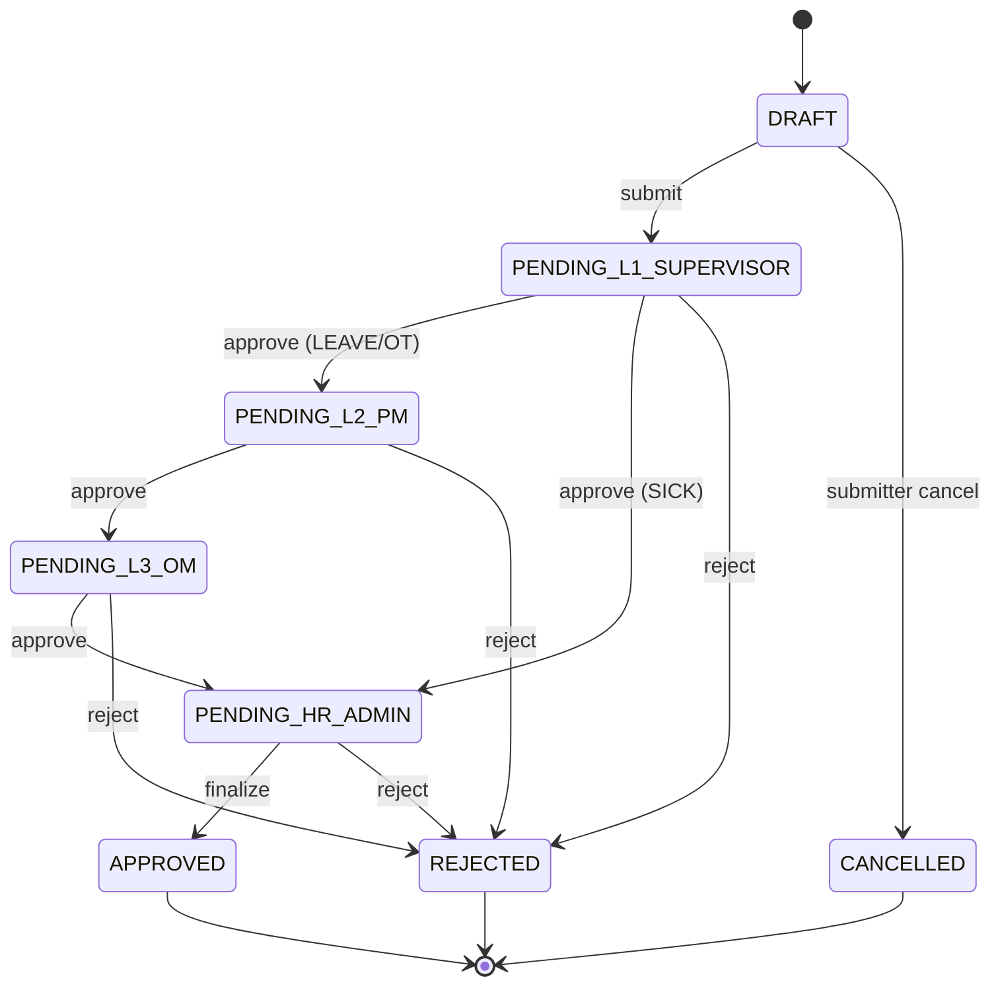
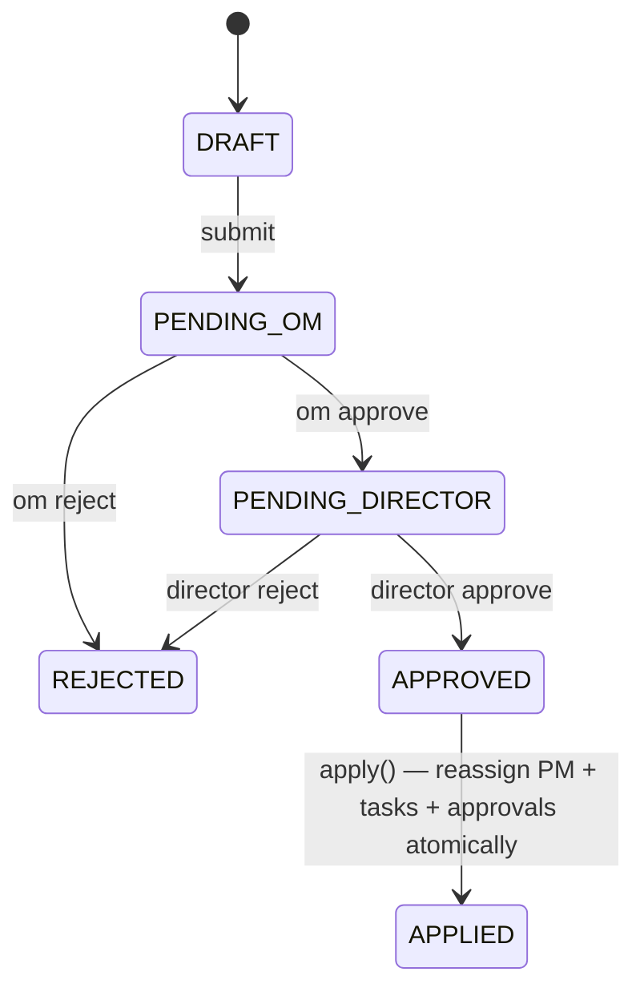
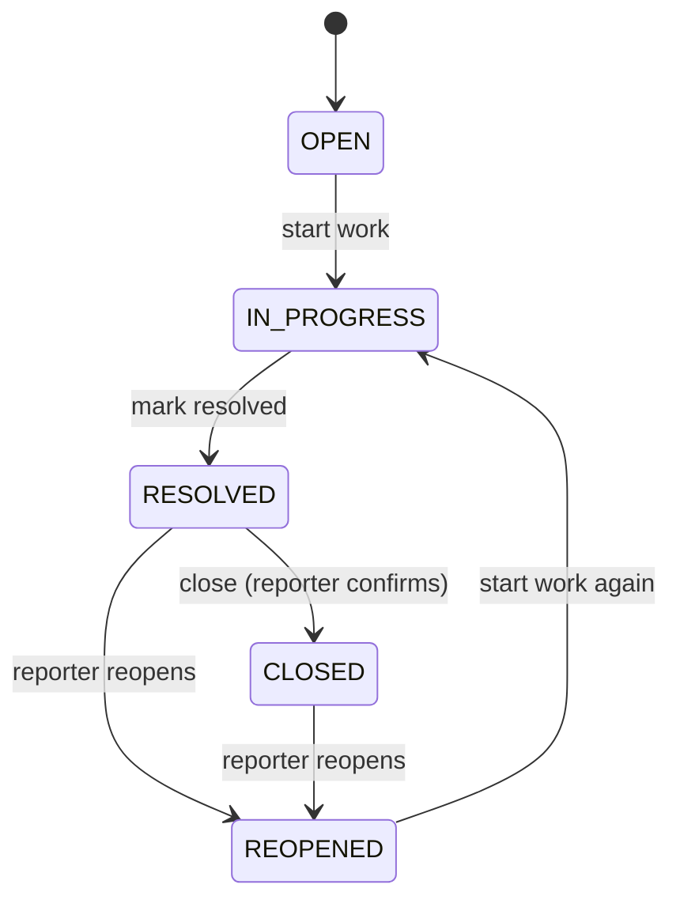

# Approval workflows

Semua approval di ControlDesk driven oleh **satu engine terpusat** dengan
**threshold matrix by nominal** + **parallel finance gate**. Doc ini
menjelaskan matriksnya, cara membaca setiap chain, dan state machine
tiap resource yang punya approval.

Kode canonical: [`src/lib/rbac/roles.ts`](../../src/lib/rbac/roles.ts)
(fungsi `*ApprovalChain(amountIDR)`).

## Threshold matrix (canonical)

Semua nominal dalam IDR. Sumber: `APPROVAL_CONFIG` di `roles.ts`.

### Project Expense (`expenseApprovalChain`)

| Nominal              | Chain                     | Note                             |
| -------------------- | ------------------------- | -------------------------------- |
| `< Rp 5.000.000`     | `[FINANCE]`               | Finance-only fast lane.          |
| `Rp 5jt – < 50jt`    | `[PM, FINANCE]`           | PM validasi + Finance cair.      |
| `≥ Rp 50.000.000`    | `[PM, FINANCE, DIRECTOR]` | Board-level scrutiny.            |

### Budget submission (`budgetApprovalChain`)

Perhatikan: yang dihitung `total_planned_amount` dari `budget_details`.

| Total planned       | Chain                     |
| ------------------- | ------------------------- |
| `< Rp 50.000.000`   | `[FINANCE]`               |
| `≥ Rp 50.000.000`   | `[FINANCE, DIRECTOR]`     |

### Cash Advance — General (`caGeneralApprovalChain`)

Bebas / non-lapangan. Nominal lebih ketat karena tidak ada pengawasan
langsung Supervisor lapangan.

| Nominal             | Chain                     |
| ------------------- | ------------------------- |
| `< Rp 2.000.000`    | `[FINANCE]`               |
| `Rp 2jt – < 20jt`   | `[PM, FINANCE]`           |
| `≥ Rp 20.000.000`   | `[PM, FINANCE, DIRECTOR]` |

### Cash Advance — Field Ops (`caFieldOpsApprovalChain`)

Lapangan / field visit. Supervisor **selalu di rung 0** karena
field trip Supervisor-initiated. Punya **settlement SLA 10 hari**
(otomatis reminder di offset -3, 0, +1, +3, +7).

| Nominal             | Chain                                     |
| ------------------- | ----------------------------------------- |
| `< Rp 5.000.000`    | `[SUPERVISOR, FINANCE]`                   |
| `Rp 5jt – < 20jt`   | `[SUPERVISOR, PM, FINANCE]`               |
| `Rp 20jt – < 50jt`  | `[SUPERVISOR, PM, OM, FINANCE]`           |
| `≥ Rp 50.000.000`   | `[SUPERVISOR, PM, OM, FINANCE, DIRECTOR]` |

### Petty Cash voucher (`pettyCashDecision`)

Petty cash **tidak** pakai chain — pakai decision **discriminated
union**:

| Nominal                             | Decision                             |
| ----------------------------------- | ------------------------------------ |
| `< Rp 200.000`                      | `AUTO_APPROVE` — langsung posted.    |
| `Rp 100rb – < Rp 200rb`             | `AUTO_APPROVE` + `requiresReceipt`   |
| `Rp 200rb – ≤ Rp 2.000.000`         | `FINANCE_APPROVAL_REQUIRED`          |
| `≥ Rp 100.000` di dalam bracket 3   | `FINANCE_APPROVAL_REQUIRED` + `requiresReceipt` |
| `> Rp 2.000.000`                    | `ABOVE_CEILING` — redirect ke expense flow. |

Ekstra config Petty Cash:

- `LOW_BALANCE_RATIO: 0.2` — kalau saldo kas < 20% imprest → auto-trigger notification ke Custodian + Finance.
- `RECON_OVERDUE_DAYS: 3` — vouchers unreconciled > 3 hari → escalation.
- `VARIANCE_TOLERANCE_IDR: 5000` — physical count vs book difference ≤ Rp 5 rb → OK; di atas → variance investigation.

### Budget Request (`budgetRequestApprovalChain`)

Increase / Decrease / Transfer anggaran. Justifikasi wajib 15–2000
karakter.

| Nominal (delta)     | Chain                     |
| ------------------- | ------------------------- |
| `< Rp 5.000.000`    | `[FINANCE]`               |
| `Rp 5jt – < 50jt`   | `[PM, FINANCE]`           |
| `≥ Rp 50.000.000`   | `[PM, FINANCE, DIRECTOR]` |

### HR Request (fixed chain, tidak by nominal)

Hardcoded karena non-monetary — tapi tetap slot-based.

| Kind              | Chain                                                    |
| ----------------- | -------------------------------------------------------- |
| `LEAVE`           | `SUPERVISOR → PM → OM → HR_ADMIN (final)`                |
| `OVERTIME`        | `SUPERVISOR → PM → OM → HR_ADMIN (final)`                |
| `SICK`            | `SUPERVISOR → HR_ADMIN (final)` + surat dokter wajib     |

Kode: [`hrChainForKind()`](../../src/lib/hris/state.ts).

### PM Handover

Bukan monetary — fixed chain untuk transisi kepemimpinan proyek.

Chain: `OM → DIRECTOR`

State machine:

```
DRAFT (PM lama) → PENDING_OM → PENDING_DIRECTOR → APPROVED → APPLIED
                                                              (transaction:
                                                               update project_pm_assignments,
                                                               reassign pending approvals,
                                                               reassign active tasks)
```

Reject bisa dari OM (mundur ke DRAFT) atau Director (mundur ke
PENDING_OM).

## The parallel Finance gate

Kalau di chain ada `FINANCE`, itu **gate paralel** — artinya Finance
tidak perlu menunggu approver operasional selesai; tapi item tidak
bisa berpindah ke "APPROVED" sampai kedua slot (operational terminal +
finance) sudah check.

Konsekuensi UX:

- Di **Approvals Inbox**, Finance melihat item begitu di-submit (bukan
  setelah PM approve dulu). Ini sengaja — Finance sering lebih cepat
  respond, dan menahan sinkron-serial akan bottleneck.
- Kalau Finance reject, chain berhenti dan status `REJECTED` — operator
  yang sudah approve tetap tercatat di audit log dengan action mereka.

## State machines

### Expense



**Note**: state names di atas pakai legacy 10-role terminology.
Modul yang sudah GAS-aligned (Cash Advance, Budget Request) pakai
canonical statuses:
`DRAFT → PENDING_SUPERVISOR? → PENDING_PM? → PENDING_OM? → PENDING_FINANCE → PENDING_DIRECTOR? → APPROVED → DISBURSED/APPLIED`.

### Cash Advance (canonical)



**SLA khusus Field Ops**: setelah `DISBURSED`, employee punya **10 hari
kalender** untuk `SETTLED`. Cron reminder auto-notify di offset:
- `-3 hari` (sebelum SLA): "Segera settle kas bon".
- `0` (H-SLA): "Hari terakhir".
- `+1, +3, +7` (past SLA): escalate ke Supervisor → PM → OM.

### Budget Request



`APPLIED` adalah state terminal yang **memodifikasi anggaran aktual** di
tabel `budget_details.planned_amount` + `budgets.total_planned_amount`
dalam satu transaksi. Sebelum `APPLIED`, semua state hanya proposal —
belum ada perubahan anggaran real.

### HR Request



### PM Handover



### Project Issue



**SLA business-hours** per severity:

| Severity | SLA (business-hours) | Auto-escalation ladder                                        |
| -------- | -------------------- | ------------------------------------------------------------- |
| Critical | 1 hour               | Supervisor → PM → OM → Director, tiap sweep 15 menit lewat.   |
| High     | 4 hours              | Supervisor → PM → OM → Director, tiap sweep 15 menit lewat.   |
| Medium   | 8 hours              | Supervisor → PM → OM → Director, tiap sweep 15 menit lewat.   |
| Low      | 24 hours             | Supervisor → PM → OM → Director, tiap sweep 15 menit lewat.   |

**Business hours** default: Senin-Jumat 09:00–17:00 timezone tenant.
Bisa di-tune per tenant di `tenants.business_hours_json` (default:
`{"tz":"Asia/Jakarta","days":[1,2,3,4,5],"start":"09:00","end":"17:00"}`).

Cron `/api/cron/issues-sla` jalan setiap 15 menit — kalau ada issue
past SLA yang belum di-escalate ke tingkat berikutnya, cron insert
row baru di `project_issue_escalations` + kirim notifikasi in-app +
email ke escalation target.

## Unified Approvals Inbox

Semua item di atas tampil di satu tempat: `/approvals`.

**Filter default**: item yang butuh **actor's role** untuk maju.
Misal: PM login → `PENDING_L2_PM` + `PENDING_PM` (canonical) + PM-slot
di CA Field Ops di semua chain. Finance login → semua `PENDING_FINANCE`
+ `PETTY_CASH_FINANCE_APPROVAL_REQUIRED` + settlement finalizations.

**Realtime**: page subscribe ke Supabase Realtime channel
`tenant:{tenant_id}:approvals`. Setiap state change trigger
`router.refresh()`, jadi inbox up-to-date tanpa reload manual.

**Bulk actions**: opsional per resource type — Approve N items atau
Reject N items dengan satu reason string. Semua tetap masuk audit log
sebagai N event terpisah.

## Delegation & override

- **Higher-rank canonicals boleh short-circuit**: Director bisa sign
  slot PM kalau perlu (`canonicalCanApprove` return true). Audit tetap
  mencatat Director yang bertindak, bukan PM.
- **ADMIN override**: TENANT_ADMIN / canonical ADMIN bisa approve slot
  apa saja. Ini break-glass — audit log flag `override: true` untuk
  ADMIN yang bukan slot-holder biasa.
- **NO** self-approval: submitter tidak bisa approve requestnya
  sendiri, bahkan kalau role-nya cocok. Enforcement di PDP:
  `if (attrs.submitterId === actor.employeeId) return DENY`.

## Cancellation

Semua state machine punya path `submitter cancel` dari DRAFT → CANCELLED.
Setelah state pindah dari DRAFT (ada slot yang pending), submitter TIDAK
BISA cancel sendiri — harus reject dari salah satu approver. Ini untuk
mencegah manipulasi ("submit besar-besaran, lalu cancel setelah approver
terlihat cape scrolling").

## Where the code lives

| Module               | State machine helper                                              | Approval chain fn                 |
| -------------------- | ----------------------------------------------------------------- | --------------------------------- |
| Expense (legacy)     | `src/lib/expenses/state.ts`                                       | `requiredApprovalChain` (10-role) |
| Cash Advance         | `src/lib/cash-advances/state.ts`                                  | `caGeneralApprovalChain`, `caFieldOpsApprovalChain` |
| Budget Request       | `src/lib/budget-requests/state.ts`                                | `budgetRequestApprovalChain`      |
| Petty Cash           | `src/lib/petty-cash/state.ts`                                     | `pettyCashDecision` (no chain)    |
| HR Request           | `src/lib/hris/state.ts`                                           | `hrChainForKind`                  |
| PM Handover          | `src/lib/handovers/state.ts`                                      | fixed OM → DIRECTOR               |
| Project Issue        | `src/lib/issues/state.ts` + `src/lib/issues/sla.ts`               | escalation ladder                 |
| Approval decisions   | `src/lib/security/decideCanonicalApproval.ts`                     | shared for canonical modules      |

All state transitions are pure functions, unit-tested in `*.test.ts`.
Server Actions do NOT contain state transition logic — they call the
helpers.
