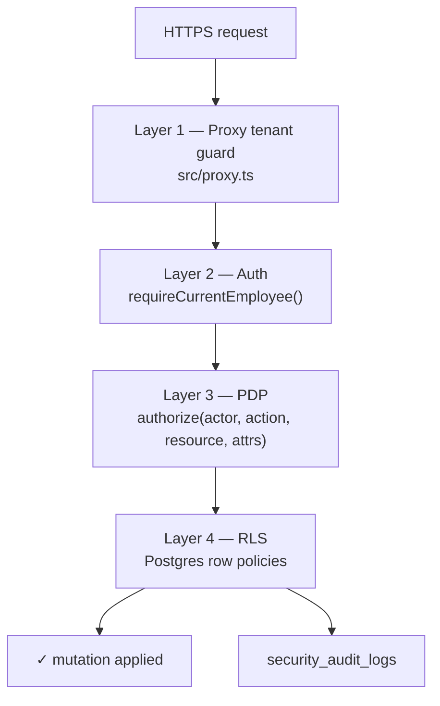

# Roles & permissions

ControlDesk memakai **dua model role paralel** yang keduanya valid di
tabel `employees.role`:

1. **Legacy 10-role model** — hasil desain awal ControlDesk yang meniru
   hirarki BPO klasik (rules §4/§7).
2. **Canonical 7-role model** — hasil alignment dengan GAS ERP asal
   (rules §21+), dipakai oleh semua modul baru (Cash Advance align,
   Budget Requests, Project Issues, dst).

Kode di [`src/lib/rbac/roles.ts`](../../src/lib/rbac/roles.ts) menyediakan
`toCanonicalRole()` untuk fold legacy → canonical, dan
`toLegacyDbRole()` untuk arah sebaliknya. **Aturan praktisnya**: modul
baru pakai canonical; modul lama yang belum di-migrate tetap legacy
sampai ada PR migrasi khusus.

## Legacy 10-role model

Ini yang tersimpan di enum Postgres `public.employee_role` sampai
migrasi role-swap final (Fase 0.2 belum landing).

### Operational ladder (approver chain)

```
EMPLOYEE  →  SUPERVISOR  →  PROJECT_MANAGER  →  OPERATIONS_MANAGER  →  HEAD_MANAGER  →  GENERAL_MANAGER  →  TENANT_ADMIN
   L0            L1                L2                    L3                   L4                L5                (bypass)
```

Setiap rank berikutnya BOLEH menyetujui slot rank di bawahnya (Director
boleh sign in-place PM, dst). Audit tetap merekam siapa yang bertindak.

### Staff / functional roles (parallel gates)

Tidak ikut ladder — dipanggil **paralel** di titik-titik yang butuh
otoritas fungsional:

- `LEAD_FINANCE` — gate keuangan (semua expense/CA/budget/replenishment).
- `PETTY_CASH_CUSTODIAN` — pemegang kas kecil di lokasi/cabang.
- `HR_ADMIN` — final approver cuti/sakit/lembur + pengelola master HR.
- `TENANT_ADMIN` — override semua di dalam tenant.

## Canonical 7-role model (GAS-aligned)

Ini yang dipakai modul-modul post-alignment. Enum:

```
EMPLOYEE  |  SUPERVISOR  |  PM  |  OM  |  FINANCE  |  DIRECTOR  |  ADMIN
```

Plus satu **external portal role** yang **bukan** di `employees`:

- `CLIENT` — user eksternal, tersimpan di `client_users`, otentikasi via
  scrypt + opaque session token.

### Fold mapping legacy → canonical

| Legacy                     | Canonical  | Alasan                                                |
| -------------------------- | ---------- | ----------------------------------------------------- |
| `TENANT_ADMIN`             | `ADMIN`    | Highest privilege internal.                           |
| `HR_ADMIN`                 | `ADMIN`    | ADMIN capabilities termasuk HR final approver.        |
| `GENERAL_MANAGER`          | `DIRECTOR` | GAS collapse GM + HM ke satu level Director.          |
| `HEAD_MANAGER`             | `DIRECTOR` | Sama seperti di atas.                                 |
| `LEAD_FINANCE`             | `FINANCE`  | Gate finance canonical.                               |
| `PETTY_CASH_CUSTODIAN`     | `FINANCE`  | Custodian → sub-role FINANCE (permission subset).     |
| `OPERATIONS_MANAGER`       | `OM`       | 1:1 mapping.                                          |
| `PROJECT_MANAGER`          | `PM`       | 1:1 mapping.                                          |
| `SUPERVISOR`               | `SUPERVISOR` | 1:1 mapping.                                        |
| `EMPLOYEE`                 | `EMPLOYEE` | 1:1 mapping.                                          |

Kode: [`toCanonicalRole()`](../../src/lib/rbac/roles.ts).

### Slot vs Role

**Slot** = posisi di approval chain (`SUPERVISOR`, `PM`, `OM`, `FINANCE`,
`DIRECTOR`). **Role** = jabatan aktual seseorang.

Aturan `canonicalCanApprove(actor, slot)`:

| Slot         | Boleh diapprove oleh                                          |
| ------------ | ------------------------------------------------------------- |
| `SUPERVISOR` | `SUPERVISOR`, `PM`, `OM`, `DIRECTOR`, `ADMIN`                 |
| `PM`         | `PM`, `OM`, `DIRECTOR`, `ADMIN`                               |
| `OM`         | `OM`, `DIRECTOR`, `ADMIN`                                     |
| `FINANCE`    | `FINANCE`, `ADMIN` (finance eksklusif — bukan ladder)         |
| `DIRECTOR`   | `DIRECTOR`, `ADMIN`                                           |

Kode: [`canonicalCanApprove()`](../../src/lib/rbac/roles.ts).

## Capability matrix (canonical)

`R` = Read, `W` = Write / Create, `A` = Approve / Reject, `X` = Execute
(disburse / settle / apply / final), `⊘` = None.

Legacy role di-fold ke canonical dulu sebelum lookup matrix.

### Client & project

| Resource                        | EMPLOYEE | SUPERVISOR | PM   | OM   | FINANCE | DIRECTOR | ADMIN |
| ------------------------------- | -------- | ---------- | ---- | ---- | ------- | -------- | ----- |
| `client` (list / detail)        | R (own)  | R (own)    | R    | R    | R       | R        | RW    |
| `client_portal_user`            | ⊘        | ⊘          | ⊘    | RW   | ⊘       | RWX      | RWX   |
| `bpo_contract`                  | ⊘        | ⊘          | R    | R    | R       | R        | RW    |
| `sla_commitment`                | R (own)  | R (own)    | R    | R    | ⊘       | R        | RW    |
| `project` (create/update)       | ⊘        | ⊘          | RW   | RW   | ⊘       | RW       | RW    |
| `project` (read)                | R (own)  | R (own)    | R    | R    | R       | R        | R     |
| `project_pm_assignment`         | ⊘        | ⊘          | ⊘    | RW   | ⊘       | RW       | RW    |
| `project_employee_assignment`   | R (own)  | R (own)    | RW   | RW   | ⊘       | RW       | RW    |
| `project_budget` (view)         | ⊘        | R (own)    | R    | R    | R       | R        | R     |
| `project_budget` (mutate)       | ⊘        | ⊘          | ⊘    | ⊘    | W       | ⊘        | RW    |
| `project_issue`                 | R (own)  | RW         | RW A | RW A | ⊘       | A        | RWA   |
| `pm_handover`                   | ⊘        | ⊘          | W    | A    | ⊘       | A        | RWA   |

### Finance

| Resource                        | EMPLOYEE | SUPERVISOR | PM   | OM   | FINANCE | DIRECTOR | ADMIN |
| ------------------------------- | -------- | ---------- | ---- | ---- | ------- | -------- | ----- |
| `expense` (submit)              | W (own)  | W (own)    | W    | W    | ⊘       | ⊘        | W     |
| `expense` (approve L1)          | ⊘        | A          | A    | A    | ⊘       | A        | A     |
| `expense` (approve L2 PM)       | ⊘        | ⊘          | A    | A    | ⊘       | A        | A     |
| `expense` (approve Finance)     | ⊘        | ⊘          | ⊘    | ⊘    | A       | ⊘        | A     |
| `expense` (approve Director)    | ⊘        | ⊘          | ⊘    | ⊘    | ⊘       | A        | A     |
| `cash_advance` (submit)         | W (own)  | W (own)    | W    | W    | ⊘       | ⊘        | W     |
| `cash_advance` (approve slot)   | (per chain — mengikuti `canonicalCanApprove`) |
| `cash_advance` (disburse)       | ⊘        | ⊘          | ⊘    | ⊘    | X       | ⊘        | X     |
| `cash_advance_settlement` (submit) | W (own) | W (own)  | W    | W    | ⊘       | ⊘        | W     |
| `cash_advance_settlement` (finalize) | ⊘   | ⊘          | ⊘    | ⊘    | X       | ⊘        | X     |
| `petty_cash_fund` (create/close)| ⊘        | ⊘          | ⊘    | ⊘    | RWX     | ⊘        | RWX   |
| `petty_cash_voucher` (submit)   | ⊘        | ⊘          | ⊘    | ⊘    | W       | ⊘        | W     |
| `petty_cash_replenishment` (approve/disburse) | ⊘ | ⊘      | ⊘    | ⊘    | XA      | ⊘        | XA    |
| `budget_request` (submit)       | ⊘        | ⊘          | W    | W    | ⊘       | ⊘        | W     |
| `budget_request` (approve slot) | (per chain — mengikuti `canonicalCanApprove`) |
| `budget_request` (apply)        | ⊘        | ⊘          | ⊘    | ⊘    | X       | ⊘        | X     |

### HR & payroll

| Resource                    | EMPLOYEE | SUPERVISOR | PM   | OM   | FINANCE | DIRECTOR | ADMIN |
| --------------------------- | -------- | ---------- | ---- | ---- | ------- | -------- | ----- |
| `employee` (self view)      | R (self) | R (self)   | R    | R    | R (mask)| R        | R     |
| `employee` (sensitive PII)  | ⊘        | ⊘          | ⊘    | ⊘    | R       | ⊘        | R     |
| `employee` (create/update)  | ⊘        | ⊘          | ⊘    | ⊘    | ⊘       | ⊘        | RW    |
| `work_shift` / `roster_entry`| R (own) | RW (team)  | RW   | RW   | ⊘       | R        | RW    |
| `timesheet` (self)          | RW (self)| R (team)   | R    | R    | ⊘       | R        | R     |
| `timesheet` (approve daily) | ⊘        | A          | A    | A    | ⊘       | ⊘        | A     |
| `timesheet_week` (submit)   | W (self) | ⊘          | ⊘    | ⊘    | ⊘       | ⊘        | ⊘     |
| `timesheet_week` (approve)  | ⊘        | ⊘          | A    | A    | ⊘       | ⊘        | A     |
| `hr_request` (leave/OT submit) | W (self) | ⊘        | ⊘    | ⊘    | ⊘       | ⊘        | ⊘     |
| `hr_request` (L1 supervisor)| ⊘        | A          | A    | A    | ⊘       | ⊘        | A     |
| `hr_request` (L2 PM)        | ⊘        | ⊘          | A    | A    | ⊘       | ⊘        | A     |
| `hr_request` (L3 OM)        | ⊘        | ⊘          | ⊘    | A    | ⊘       | ⊘        | A     |
| `hr_request` (final HR)     | ⊘        | ⊘          | ⊘    | ⊘    | ⊘       | ⊘        | X     |
| `hr_request_sick` (attach doc + submit) | W (self)| ⊘| ⊘   | ⊘    | ⊘       | ⊘        | ⊘     |
| `hr_request_sick` (L1)      | ⊘        | A          | A    | A    | ⊘       | ⊘        | A     |
| `hr_request_sick` (final)   | ⊘        | ⊘          | ⊘    | ⊘    | ⊘       | ⊘        | X     |
| `payroll_period`            | ⊘        | ⊘          | ⊘    | ⊘    | RW      | R        | RW    |

### AI & ops

| Resource                    | EMPLOYEE | SUPERVISOR | PM   | OM   | FINANCE | DIRECTOR | ADMIN |
| --------------------------- | -------- | ---------- | ---- | ---- | ------- | -------- | ----- |
| `ai_insight`                | ⊘        | R (project)| R    | R    | R       | R        | RW    |
| `audit_log`                 | ⊘        | ⊘          | ⊘    | ⊘    | ⊘       | R (own tenant) | R (own tenant) |
| `data_archive`              | ⊘        | ⊘          | ⊘    | ⊘    | ⊘       | ⊘        | RWX   |
| `secret_rotation`           | ⊘        | ⊘          | ⊘    | ⊘    | ⊘       | ⊘        | RWX   |
| Tenant settings             | ⊘        | ⊘          | ⊘    | ⊘    | ⊘       | ⊘        | RWX   |

## Enforcement layers

Setiap decision di atas dijalankan di **empat lapisan independen**
(rules §3 defense-in-depth). Bila satu bug → tiga lapisan lain harus
tetap menahan.



Lihat [`../security-model.md`](../security-model.md) untuk detail
implementasi tiap layer.

## Where roles are enforced in code

| Layer               | File                                                                                                | Contract                                                                            |
| ------------------- | --------------------------------------------------------------------------------------------------- | ----------------------------------------------------------------------------------- |
| Nav sidebar         | [`src/lib/nav/config.ts`](../../src/lib/nav/config.ts)                                              | Hide menu items yang user tidak boleh akses. Cosmetic saja — bukan security.        |
| RSC page guard      | [`src/lib/auth/session.ts`](../../src/lib/auth/session.ts) `requireCurrentEmployee({ roles })`      | Redirect ke `/dashboard` kalau role tidak match.                                    |
| Server Action       | [`src/lib/security/action-wrapper.ts`](../../src/lib/security/action-wrapper.ts)                    | Panggil `authorize()` sebelum handler jalan. `{ ok: false, code: "FORBIDDEN" }`.    |
| PDP                 | [`src/lib/security/pdp.ts`](../../src/lib/security/pdp.ts)                                          | Pure decision function per `ResourceType`. Unit-tested.                             |
| RLS                 | `supabase/migrations/*.sql` (semua yang enable RLS)                                                 | Row filter: `tenant_id = current_tenant_id()` + policy tambahan per role bila perlu.|
| JWT claim           | `supabase/migrations/0003_rls_helpers.sql`                                                          | Access token carries `tenant_id`, `tenant_slug`, `role`, `employee_id`.             |

## Adding a new resource type

Setiap penambahan resource baru WAJIB:

1. Tambahkan literal ke `ResourceType` union di `src/lib/security/pdp.ts`.
2. Tulis fungsi `decide{Resource}` yang murni (no I/O) dan return `AuthorizeDecision`.
3. Tulis unit test di `src/lib/security/pdp.test.ts` — minimum coverage:
   - Cross-tenant harus DENY.
   - Each role harus tepat allow / deny.
   - Setiap atribut yang mempengaruhi decision harus punya test case.
4. Kalau resource punya row di DB — enable RLS + tulis policy
   `tenant_isolation` + policy tambahan bila perlu.
5. Update matriks di dokumen ini.

Contoh flow lengkap: [`../development.md#adding-a-new-module`](../development.md#adding-a-new-module).
