# Database schema reference

**Postgres 17** (via Supabase), 33 migrasi yang landed. Semua table
tenant-scoped punya `tenant_id uuid NOT NULL REFERENCES tenants(id)`
plus RLS policy `tenant_id = current_tenant_id()`.

Migrations landing di `supabase/migrations/NNNN_*.sql` — **never edit
in place**, selalu append migrasi baru (rules §22).

## High-level ER

```mermaid
erDiagram
    tenants ||--o{ employees        : "has many"
    tenants ||--o{ clients          : "has many"
    tenants ||--o{ projects         : "has many"
    tenants ||--o{ client_users     : "has many (portal)"

    clients ||--o{ projects          : "has many"
    clients ||--o{ bpo_contracts     : "has many"
    clients ||--o{ client_users      : "has many"

    bpo_contracts ||--o{ sla_commitments : "has many"

    projects ||--o{ project_pm_assignments       : "has many"
    projects ||--o{ project_employee_assignments : "has many"
    projects ||--o{ project_milestones          : "has many"
    projects ||--o{ project_issues              : "has many"
    projects ||--o{ pm_handovers                : "has many"
    projects ||--o{ budgets                     : "1 active per project"
    projects ||--o{ expenses                    : "has many"
    projects ||--o{ cash_advances               : "has many"
    projects ||--o{ budget_requests             : "has many"
    projects ||--o{ timesheets                  : "has many"

    budgets ||--o{ budget_details : "has many"

    cash_advances ||--o{ cash_advance_settlements : "has many"

    petty_cash_funds ||--o{ petty_cash_vouchers       : "has many"
    petty_cash_funds ||--o{ petty_cash_replenishments : "has many"

    employees ||--o{ hr_requests               : "submits"
    employees ||--o{ timesheets                : "logs"
    employees ||--o{ timesheet_weeks           : "submits"
    employees ||--o{ employee_rosters          : "assigned to"
    employees ||--o{ project_pm_assignments    : "as PM"
    employees ||--o{ project_employee_assignments : "as staff"

    timesheet_weeks ||--o{ timesheets : "packet contains"

    hr_requests ||--o{ hr_approval_logs : "audit"

    client_users ||--o{ client_user_sessions   : "logs in"
    client_users ||--o{ portal_login_events    : "audit"
    client_users ||--o{ portal_notifications   : "receives"
```



## Migration timeline

| #    | File                                          | What it adds                                                        |
| ---- | --------------------------------------------- | ------------------------------------------------------------------- |
| 0001 | `extensions.sql`                              | `pgcrypto`, `uuid-ossp`, `unaccent`, `pg_trgm`                     |
| 0002 | `tenants_and_auth.sql`                        | `tenants`, `employees`, `employee_role` enum (10-role legacy)      |
| 0003 | `rls_helpers.sql`                             | `current_tenant_id()`, JWT custom hook, RLS helpers                |
| 0004 | `security_audit.sql`                          | `security_audit_logs` (INSERT-only), `record_audit_log()` RPC      |
| 0005 | `tenants_timezone_and_prefs.sql`              | `tenants.timezone`, `tenants.locale`, prefs JSON                   |
| 0006 | `notifications_and_attachments.sql`           | `notifications`, `attachments`, `email_outbox`, `enqueue_notification` |
| 0007 | `storage_buckets.sql`                         | `tenant-attachments`, `tenant-archives` buckets + RLS              |
| 0008 | `clients_and_projects.sql`                    | `clients`, `bpo_contracts`, `sla_commitments`, `projects`          |
| 0009 | `expenses_and_approvals.sql`                  | `expenses`, `expense_approval_logs`, budgets initial               |
| 0010 | `hris_requests.sql`                           | `hr_requests`, `hr_approval_logs`, leave balance                   |
| 0011 | `cash_advance.sql`                            | `cash_advances`, `cash_advance_settlements`                        |
| 0012 | `petty_cash.sql`                              | `petty_cash_funds`, `petty_cash_vouchers`, `petty_cash_replenishments` |
| 0013 | `pm_handovers.sql`                            | `pm_handovers` + apply transaction fn                              |
| 0014 | `ai_insights.sql`                             | `ai_insights`, `ai_insight_reads`, `tenant_ai_config`              |
| 0015 | `shifts_roster_timesheets_payroll.sql`        | `work_shifts`, `employee_rosters`, `timesheets`, `payroll_periods` |
| 0016 | `retention_and_ops_logs.sql`                  | `cron_run_log`, retention config, HR anonymization function        |
| 0017 | `data_archives.sql`                           | `data_archives` registry + purge helper                            |
| 0018 | `secret_rotations.sql`                        | `secret_rotations` + rotation-status fn                            |
| 0019 | `public_grants.sql`                           | Grants adjustments                                                 |
| 0020 | `jwt_role_claim_fix.sql`                      | JWT hook fix — inject role claim                                   |
| 0021 | `gas_alignment_role_expansion.sql`            | Add canonical 7-role values to `employee_role` enum                |
| 0022 | `projects_gas_align.sql`                      | Add `contract_type`, `progress_pct`, `project_milestones`          |
| 0023 | `client_users.sql`                            | Client portal user table + sessions                                |
| 0024 | `approval_thresholds.sql`                     | Per-tenant threshold override table                                |
| 0025 | `budgets_gas_align.sql`                       | Budget details schema + spent tracking                             |
| 0026 | `project_assignments_gas.sql`                 | `assignment_role` enum, allocation constraint trigger              |
| 0027 | `cash_advance_gas_align.sql`                  | `ca_type`, canonical statuses, settlement due date logic           |
| 0028 | `cash_advance_index_refresh.sql`              | Query performance indices                                          |
| 0029 | `project_issues.sql`                          | Issue tracker + SLA + escalation                                   |
| 0030 | `budget_requests.sql`                         | Budget request state machine + logs                                |
| 0031 | `timesheet_weeks.sql`                         | Weekly timesheet packet                                            |
| 0032 | `portal_login_events.sql`                     | Portal auth audit + `resolve_tenant_id_by_slug()` RPC              |
| 0033 | `portal_notifications.sql`                    | Portal-specific notifications + triggers                           |

## Table catalog (grouped by concern)

### Tenant + auth

| Table                    | Rows                                              | RLS                              |
| ------------------------ | ------------------------------------------------- | -------------------------------- |
| `tenants`                | 1 per company subscribed to ControlDesk           | Read: self only; Write: super-admin only (no UI) |
| `employees`              | 1 per internal user                               | Tenant-scoped                    |
| `client_users`           | 1 per portal user (external)                      | Tenant-scoped + client-scoped    |
| `client_user_sessions`   | Opaque session tokens (hashed) untuk portal      | Service-role only                |

### Security + ops

| Table                    | Rows                                              | Retention        |
| ------------------------ | ------------------------------------------------- | ---------------- |
| `security_audit_logs`    | Every mutation of sensitive data                  | 7 tahun (UU PPh) |
| `portal_login_events`    | Every portal auth attempt                         | 7 tahun          |
| `cron_run_log`           | Every cron endpoint hit + outcome                 | 90 hari          |
| `secret_rotations`       | Registry secret + last rotated                    | Forever          |
| `data_archives`          | Cold archive manifest + SHA-256 checksum          | Forever          |

### Clients + projects

| Table                            | Rows                                                | Notes                                       |
| -------------------------------- | --------------------------------------------------- | ------------------------------------------- |
| `clients`                        | 1 per customer of the tenant                        |                                             |
| `bpo_contracts`                  | 1 per contract with a client                        | Contracts overlap projects via date range   |
| `sla_commitments`                | N per contract (multiple metrics)                   |                                             |
| `projects`                       | 1 per delivery engagement                           | Multi-project per client                    |
| `project_milestones`             | N per project                                       | Triggers portal notification                |
| `project_pm_assignments`         | 1 PRIMARY_PM active + N CO_PM per project           | Enforced by partial unique index            |
| `project_employee_assignments`   | N per project with `allocation_percentage`          | Sum ≤ 100% across ACTIVE per employee       |
| `project_issues`                 | N per project                                       | SLA business-hours + escalation ladder      |
| `project_issue_escalations`      | N per issue (escalation history)                    |                                             |
| `pm_handovers`                   | N per project                                       | State machine w/ atomic apply()             |

### Finance

| Table                             | Rows                                              | Retention          |
| --------------------------------- | ------------------------------------------------- | ------------------ |
| `expenses`                        | N per project                                     | 10 tahun (UU KUP)  |
| `expense_approval_logs`           | N per expense state change                        | 7 tahun            |
| `cash_advances`                   | N per project (+ per employee)                    | 10 tahun           |
| `cash_advance_settlements`        | 1..N per CA                                       | 10 tahun           |
| `cash_advance_approval_logs`      | N per CA state change                             | 7 tahun            |
| `cash_advance_reminders`          | Reminder history untuk SLA field ops              | 90 hari            |
| `petty_cash_funds`                | 1 per lokasi/cabang                               |                    |
| `petty_cash_vouchers`             | N per fund                                        | 10 tahun           |
| `petty_cash_replenishments`       | N per fund                                        | 10 tahun           |
| `petty_cash_reconciliations`      | N per fund (opsional, per rekon period)           | 10 tahun           |
| `budgets`                         | 1 active per project                              | 10 tahun           |
| `budget_details`                  | N per budget (by category)                        | 10 tahun           |
| `budget_requests`                 | N per project                                     | 10 tahun           |
| `budget_request_approval_logs`    | N per budget request state change                 | 7 tahun            |

### HR

| Table                       | Rows                                                | Retention                            |
| --------------------------- | --------------------------------------------------- | ------------------------------------ |
| `employees` (already above) | Master user                                         | Anonymize 5 yrs post-terminated      |
| `hr_leave_balances`         | 1 per employee per year per leave_type              | Forever (used for calc)              |
| `hr_requests`               | N per employee (leave / OT / sick)                  | 10 tahun                             |
| `hr_approval_logs`          | N per hr_request state change                       | 7 tahun                              |
| `work_shifts`               | Templates                                           |                                      |
| `employee_rosters`          | N per employee per day                              | 5 tahun (payroll cross-ref)          |
| `timesheets`                | N per employee per day per project                  | 10 tahun (payroll basis)             |
| `timesheet_weeks`           | 1 per employee per ISO week                         | 10 tahun                             |
| `timesheet_week_approval_logs` | N per weekly packet                              | 7 tahun                              |
| `payroll_periods`           | 1 per tenant per period (biasa bulanan)             | 10 tahun                             |

### Notifications + AI

| Table                       | Rows                                              | Retention       |
| --------------------------- | ------------------------------------------------- | --------------- |
| `notifications`             | N per user                                        | 90 hari         |
| `email_outbox`              | N per notification (kalau opt-in email)           | 90 hari         |
| `notification_preferences`  | N per user (per kind)                             | Forever         |
| `portal_notifications`      | N per client_user                                 | 90 hari         |
| `ai_insights`               | N per tenant per scope                            | 1 tahun         |
| `ai_insight_reads`          | N per user per insight                            | 1 tahun         |
| `tenant_ai_config`          | 1 per tenant                                      | Forever         |

## RLS pattern

Setiap table tenant-scoped punya policy standar:

```sql
alter table public.<table> enable row level security;

create policy <table>_tenant_isolation
  on public.<table>
  for all
  using  (tenant_id = public.current_tenant_id())
  with check (tenant_id = public.current_tenant_id());
```

Beberapa table punya policy tambahan by role. Contoh: `payroll_periods`
hanya boleh dibaca oleh `LEAD_FINANCE`, `HR_ADMIN`, `TENANT_ADMIN`:

```sql
create policy payroll_periods_finance_read
  on public.payroll_periods
  for select
  using (
    tenant_id = public.current_tenant_id()
    and (auth.jwt() ->> 'role') = any (array['LEAD_FINANCE', 'HR_ADMIN', 'TENANT_ADMIN'])
  );
```

Global infrastructure tables (`cron_run_log`, `data_archives`,
`secret_rotations`, `email_outbox`) tidak punya `tenant_id`:

- Beberapa restricted ke `service_role` only (`cron_run_log`).
- Beberapa restricted by role via JWT (`data_archives`, `secret_rotations` — `TENANT_ADMIN` only).

## Enum reference

Semua enum di-versioned di migrations. Perubahan enum WAJIB pakai `ALTER
TYPE ... ADD VALUE ...` di migrasi baru (never drop values).

### Employee & role

- `employee_role`: `EMPLOYEE`, `SUPERVISOR`, `PROJECT_MANAGER`,
  `OPERATIONS_MANAGER`, `HEAD_MANAGER`, `GENERAL_MANAGER`,
  `PETTY_CASH_CUSTODIAN`, `LEAD_FINANCE`, `HR_ADMIN`, `TENANT_ADMIN`
  (legacy 10) + `PM`, `OM`, `FINANCE`, `DIRECTOR`, `ADMIN` (canonical 5,
  added via `0021`). `EMPLOYEE` dan `SUPERVISOR` shared.

### Project & assignment

- `project_status`: `DRAFT`, `PLANNED`, `ACTIVE`, `COMPLETED`, `CANCELLED`.
- `project_contract_type`: `ONE_OFF`, `RETAINER`, `MANAGED_SERVICES`.
- `assignment_status`: `ACTIVE`, `INACTIVE`.
- `project_assignment_role`: `PRIMARY_PM`, `CO_PM`, `SUPERVISOR`, `SENIOR_STAFF`, `STAFF`.
- `project_milestone_status`: `PLANNED`, `IN_PROGRESS`, `DONE`, `AT_RISK`, `CANCELLED`.

### Issue

- `issue_severity`: `CRITICAL`, `HIGH`, `MEDIUM`, `LOW`.
- `issue_status`: `OPEN`, `IN_PROGRESS`, `RESOLVED`, `CLOSED`, `REOPENED`.

### Finance

- `expense_status`: legacy chain — `DRAFT`, `PENDING_L1_SUPERVISOR`, `PENDING_L2_PM`, `PENDING_L3_OM`, `PENDING_L4_HM`, `PENDING_L5_GM`, `PENDING_FINANCE`, `APPROVED`, `REJECTED`, `CANCELLED`.
- `expense_category`: `TRANSPORT`, `MEALS`, `LODGING`, `SUPPLIES`, `SUBCONTRACT`, `PROFESSIONAL_FEES`, `MISC`.
- `cash_advance_status` (canonical): `DRAFT`, `PENDING_SUPERVISOR`, `PENDING_PM`, `PENDING_OM`, `PENDING_FINANCE`, `PENDING_DIRECTOR`, `APPROVED`, `DISBURSED`, `SETTLING`, `SETTLED`, `REJECTED`, `CANCELLED`.
- `ca_type`: `GENERAL`, `FIELD_OPS`.
- `budget_request_status`: `DRAFT`, `PENDING_PM`, `PENDING_FINANCE`, `PENDING_DIRECTOR`, `APPROVED`, `APPLIED`, `REJECTED`, `CANCELLED`.
- `budget_request_kind`: `INCREASE`, `DECREASE`, `TRANSFER`.
- `voucher_status`: `AUTO_APPROVED`, `PENDING_FINANCE`, `POSTED`, `REJECTED`.
- `fund_status`: `ACTIVE`, `CLOSED`.

### HR

- `hr_request_kind`: `LEAVE`, `OVERTIME`, `SICK`.
- `hr_request_status`: `DRAFT`, `PENDING_L1_SUPERVISOR`, `PENDING_L2_PM`, `PENDING_L3_OM`, `PENDING_HR_ADMIN`, `APPROVED`, `REJECTED`, `CANCELLED`.
- `hr_leave_type`: `ANNUAL`, `PERSONAL`, `MATERNITY`, `PATERNITY`, `UNPAID`, `OTHER`.
- `roster_status`: `SCHEDULED`, `PRESENT`, `ABSENT`, `LEAVE`, `SICK`, `HOLIDAY`.
- `timesheet_status`: `DRAFT`, `SUBMITTED`, `APPROVED`, `REJECTED`.
- `timesheet_week_status`: `DRAFT`, `SUBMITTED`, `APPROVED`, `REJECTED`.
- `payroll_status`: `DRAFT`, `LOCKED`, `EXPORTED`.

### Portal

- `client_user_status`: `ACTIVE`, `DISABLED`, `PENDING_ACTIVATION`.
- `portal_login_event_type`: `SUCCESS`, `FAILURE_BAD_PASSWORD`, `FAILURE_LOCKED`, `FAILURE_UNKNOWN_USER`, `LOGOUT`, `SESSION_EXPIRED`.
- `portal_notification_kind`: `MILESTONE_DONE`, `MILESTONE_AT_RISK`, `MILESTONE_CANCELLED`, `PROJECT_COMPLETED`, `SYSTEM`.

### Other

- `notification_kind` — see [`../modules/ai-and-notifications.md#notification-kinds`](../modules/ai-and-notifications.md#notification-kinds).
- `ai_insight_kind`: `EXPENSE_IMPACT`, `RESOURCE_UTILIZATION`, `CLIENT_HEALTH`, `SLA_BREACH_RISK`.
- `ai_insight_severity`: `INFO`, `WARN`, `ACTION_REQUIRED`.

## Generating TypeScript types

```bash
pnpm db:types
```

Runs `supabase gen types typescript --local > src/types/database.generated.ts`.
Barrel exports at `src/types/database.ts` re-export the generated types
plus manual helpers.

**Always regenerate types after landing a migration** — CI does not
regenerate automatically to keep runs fast. PR reviewers will ask.

## Query performance notes

- Setiap tabel tenant-scoped punya index `(tenant_id, ...)` — biasanya
  `(tenant_id, created_at DESC)` untuk list views.
- `security_audit_logs` punya index `(tenant_id, actor_id, created_at)`
  untuk investigation queries.
- `expenses`, `cash_advances`, `budget_requests` punya index composite
  `(tenant_id, status, project_id)` untuk unified approvals inbox
  filter.
- `project_issues` punya index `(tenant_id, status, sla_target_at)`
  untuk SLA sweeper cron.

Slow queries di logging → open PR untuk tambah index. `.cursorrules` §22
require migration baru + rollback SQL di header comment.
