# State machines reference

Semua state machine di ControlDesk tercatat di satu tempat sebagai
reference visual. Untuk detail behaviour + code links, ikuti tautan
per modul.

Aturan universal (rules §17):

- **State transitions adalah pure functions** — hidup di
  `src/lib/{module}/state.ts`, tanpa I/O. Unit-tested.
- **Server Actions memanggil helper state**, tidak mengulang logic.
- **Setiap transition wajib audit** — direkam otomatis oleh
  `withSecureAction()` dengan `auditAction` sesuai transition.
- **Rollback**: state tidak "undo-able" — cara mengembalikan adalah
  submit item baru dengan kind yang tepat (mis. refund via new
  expense, budget request kind=DECREASE, dst).

## Table of contents

- [Expense (legacy)](#expense-legacy)
- [Cash Advance (canonical)](#cash-advance-canonical)
- [Budget Request](#budget-request)
- [HR Request](#hr-request)
- [Project](#project)
- [Project Milestone](#project-milestone)
- [Project Issue](#project-issue)
- [PM Handover](#pm-handover)
- [Petty Cash Voucher](#petty-cash-voucher)
- [Petty Cash Replenishment](#petty-cash-replenishment)
- [Timesheet (daily)](#timesheet-daily)
- [Timesheet Weekly Packet](#timesheet-weekly-packet)
- [Payroll Period](#payroll-period)
- [Client Portal User](#client-portal-user)

---

## Expense (legacy)

Modul: [`finance.md#1-project-expenses`](../modules/finance.md#1-project-expenses).

Kode helper: `src/lib/expenses/state.ts`.

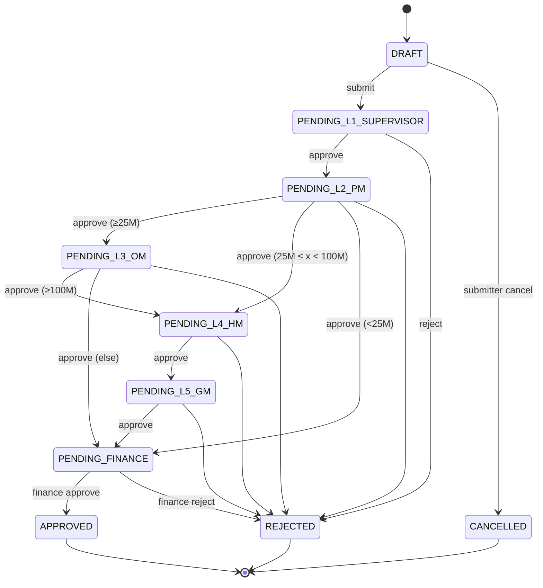

**Threshold matrix**: [`../product/approval-workflows.md#project-expense-expenseapprovalchain`](../product/approval-workflows.md#project-expense-expenseapprovalchain).

---

## Cash Advance (canonical)

Modul: [`finance.md#2-cash-advance-kas-bon`](../modules/finance.md#2-cash-advance-kas-bon).

Kode helper: `src/lib/cash-advances/state.ts`.

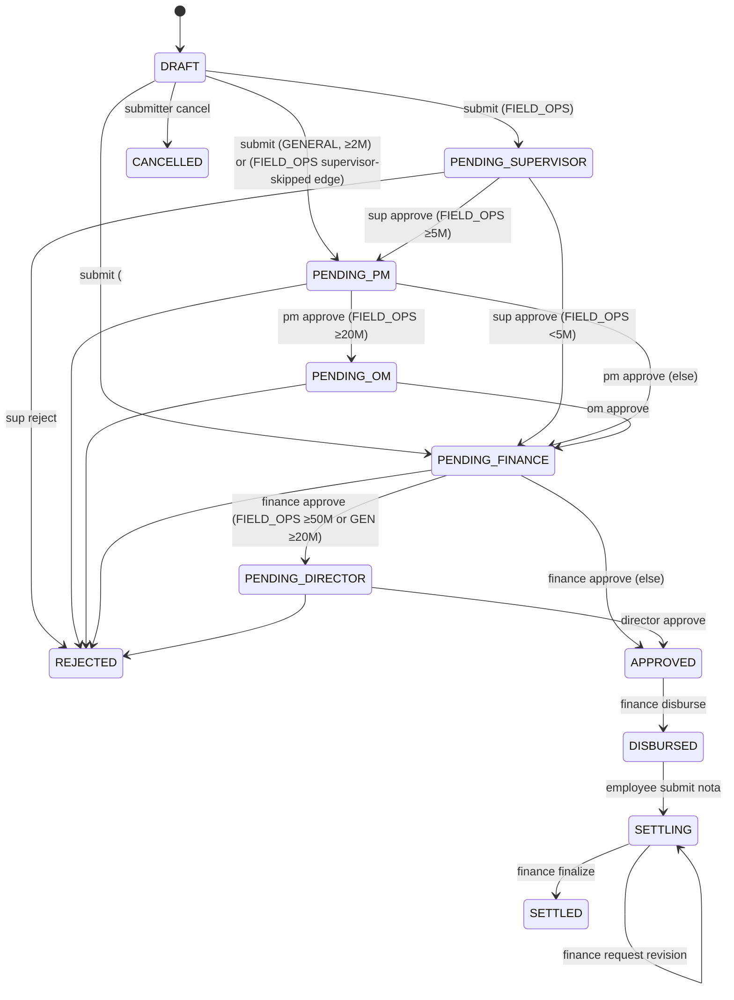

**Field Ops SLA**: 10 hari kalender dari `DISBURSED` ke `SETTLED`.
Reminder cron di offset `-3, 0, +1, +3, +7`.

---

## Budget Request

Modul: [`finance.md#budget-requests`](../modules/finance.md#budget-requests).

Kode helper: `src/lib/budget-requests/state.ts`.

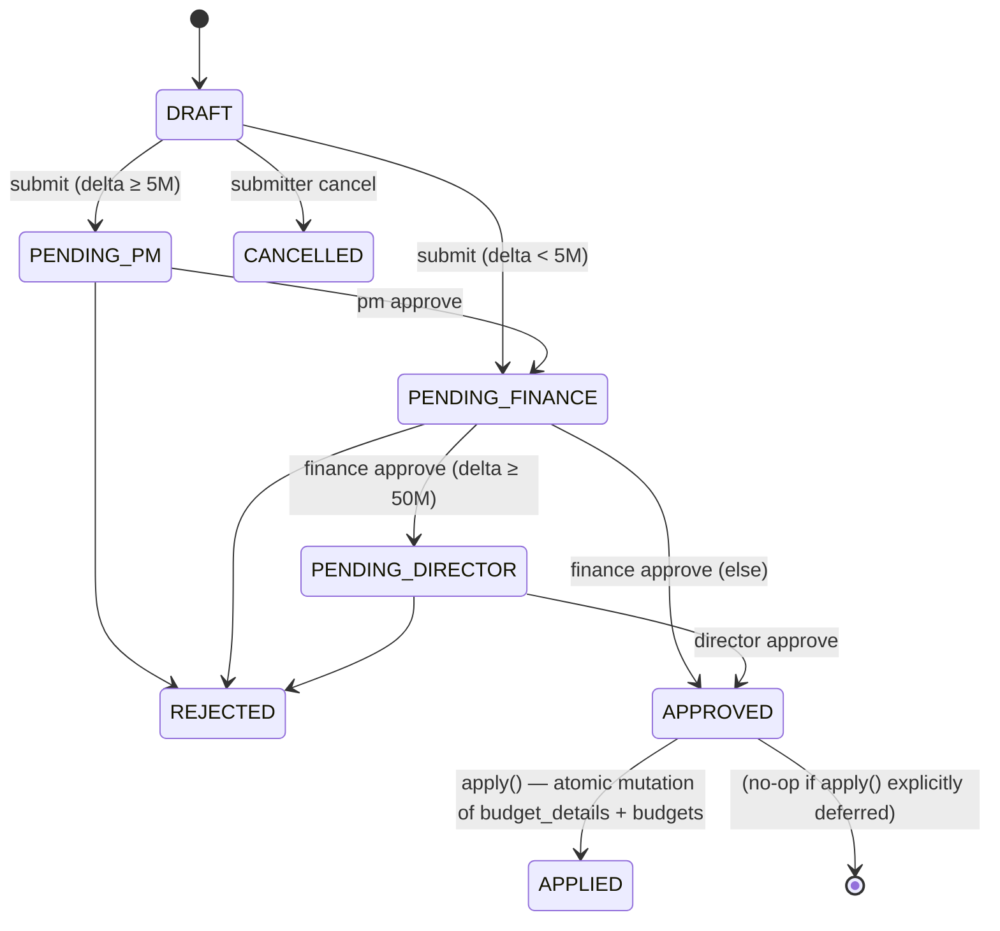

**Terminal `APPLIED`**: satu-satunya state yang **actually modifies
budget**. Sebelum APPLIED, approval hanya proposal.

---

## HR Request

Modul: [`hris-and-payroll.md#3-hr-requests`](../modules/hris-and-payroll.md#3-hr-requests).

Kode helper: `src/lib/hris/state.ts`.

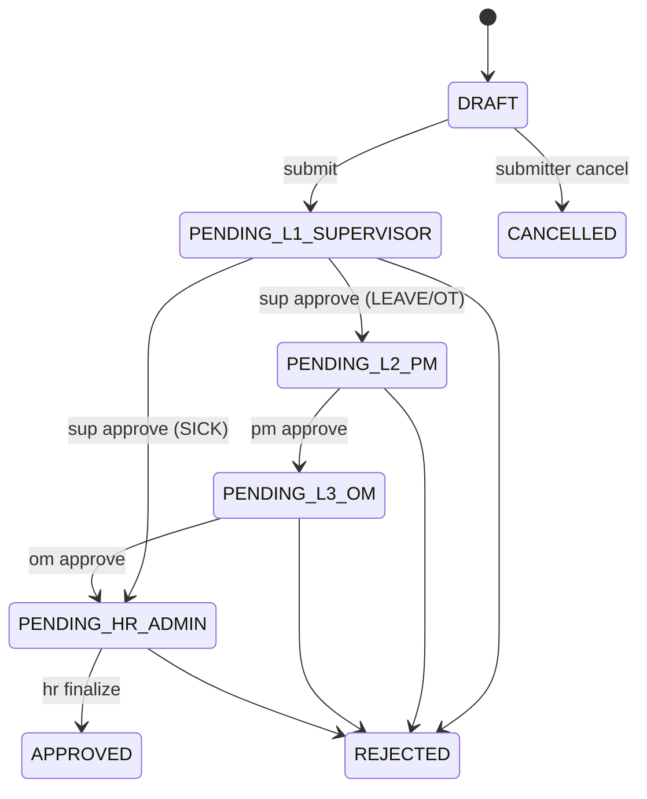

**Chain by kind**: `hrChainForKind()`.

---

## Project

Modul: [`projects.md#project`](../modules/projects.md#project).

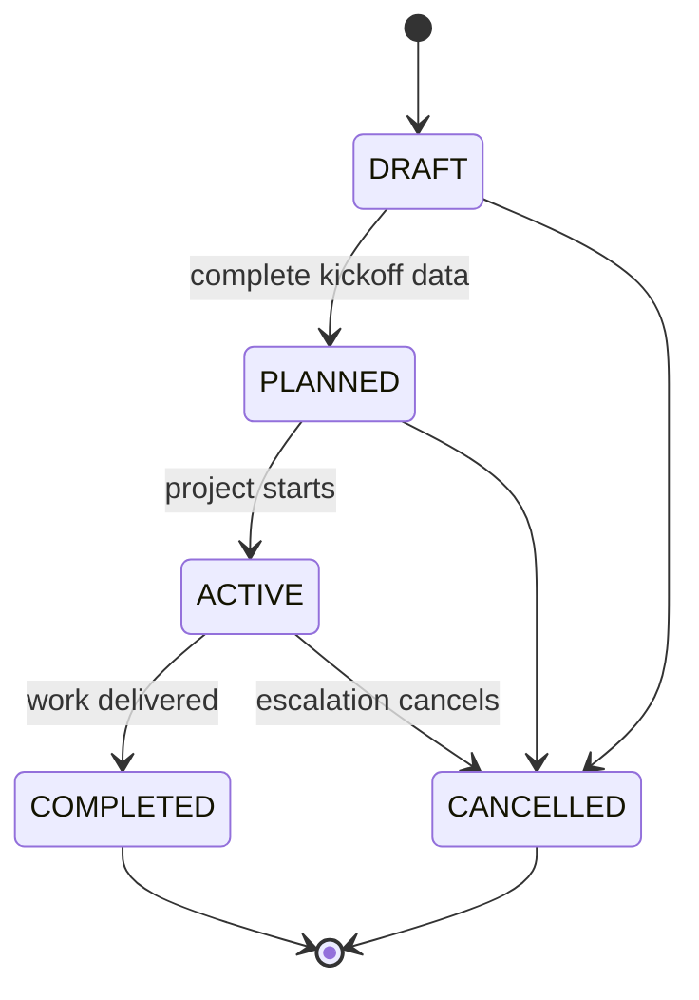

**Side effect di `CANCELLED`**: semua pending approvals untuk proyek
ini auto-reject dengan reason `PROJECT_CANCELLED`.

---

## Project Milestone

Modul: [`projects.md#project-milestones`](../modules/projects.md#project-milestones).

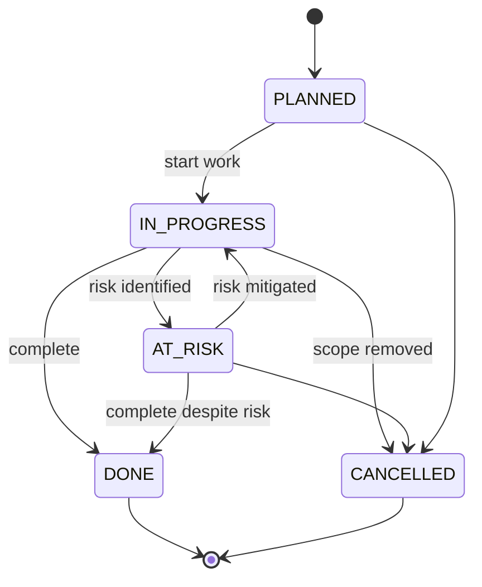

**Portal notification trigger**: setiap transisi ke `DONE` / `AT_RISK` /
`CANCELLED` insert row di `portal_notifications` untuk semua active
`client_users` client tersebut.

---

## Project Issue

Modul: [`projects.md#project-issues`](../modules/projects.md#project-issues).

Kode helper: `src/lib/issues/state.ts` + `src/lib/issues/sla.ts`.

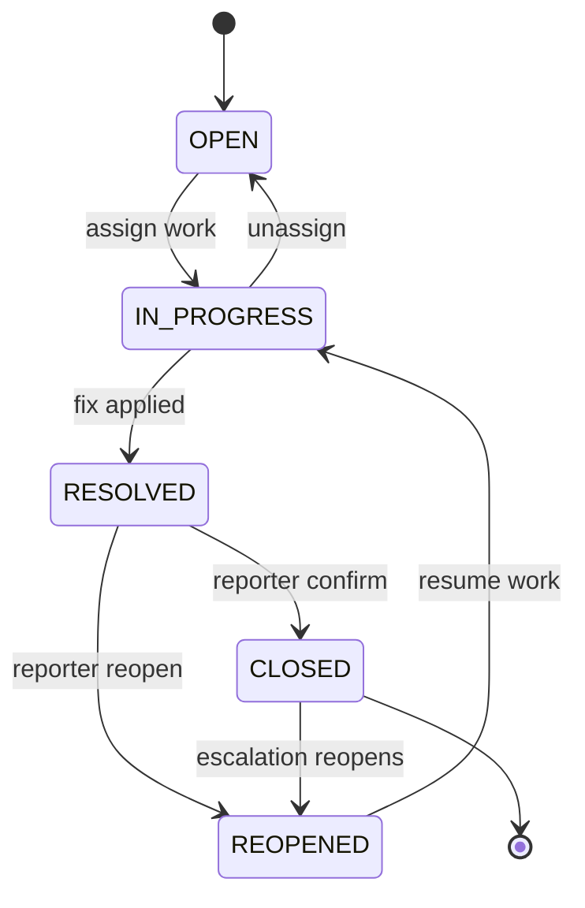

**SLA + escalation** (separate from state, driven by cron 15-min sweep):

- SLA target dihitung dari `openedAt` + severity + business hours.
- Kalau past SLA + belum resolved/closed → escalate ke level next di
  ladder: Supervisor (1) → PM (2) → OM (3) → Director (4).
- Reset saat status → `RESOLVED`.

---

## PM Handover

Modul: [`projects.md#pm-handover`](../modules/projects.md#pm-handover).

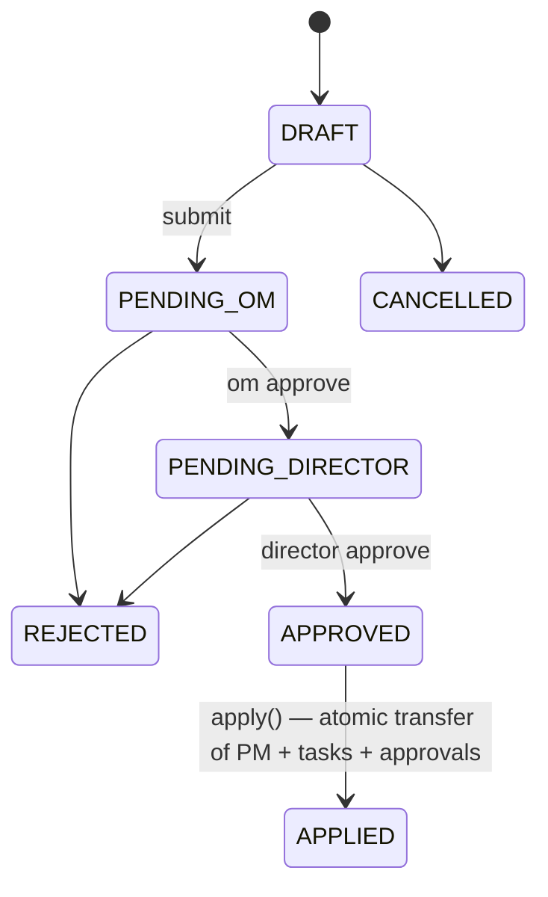

**Terminal `APPLIED`**: transaksi DB yang atomic:

1. Update `project_pm_assignments` (out → INACTIVE, in → ACTIVE PRIMARY).
2. Reassign pending approvals (expense, CA, budget request) yang
   assigned to outgoing PM.
3. Reassign active milestones yang owner outgoing PM.
4. Notification ke incoming PM.
5. Insert audit log dengan `HANDOVER_APPLIED`.

---

## Petty Cash Voucher

Modul: [`finance.md#petty-cash-vouchers-transaksi-keluar`](../modules/finance.md#petty-cash-vouchers-transaksi-keluar).

**Decision** (bukan state machine) di submit time:

```
amount < Rp 100rb              → AUTO_APPROVED → POSTED
Rp 100rb ≤ amount < Rp 200rb   → AUTO_APPROVED (requires receipt) → POSTED
Rp 200rb ≤ amount ≤ Rp 2M      → PENDING_FINANCE → (approve) → POSTED
amount > Rp 2M                 → ABOVE_CEILING (reject, redirect ke expense flow)
```

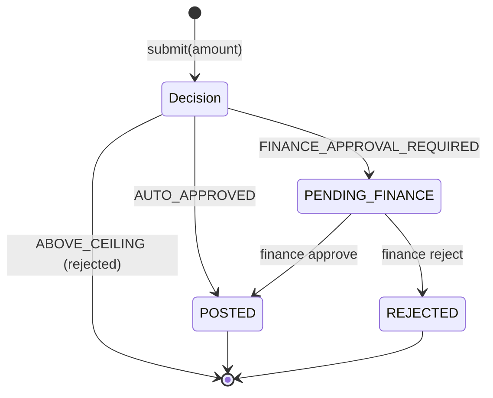

---

## Petty Cash Replenishment

Modul: [`finance.md#petty-cash-replenishments-isi-ulang`](../modules/finance.md#petty-cash-replenishments-isi-ulang).

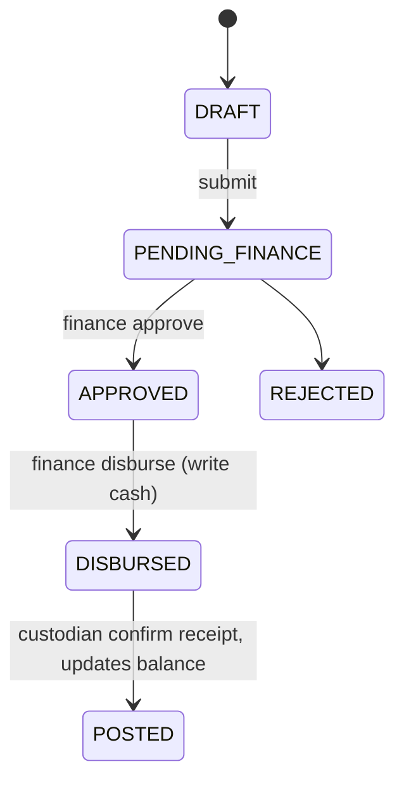

Terminal `POSTED` → `petty_cash_funds.current_balance` reset ke
`imprest_amount`.

---

## Timesheet (daily)

Modul: [`hris-and-payroll.md#daily-timesheet`](../modules/hris-and-payroll.md#daily-timesheet).

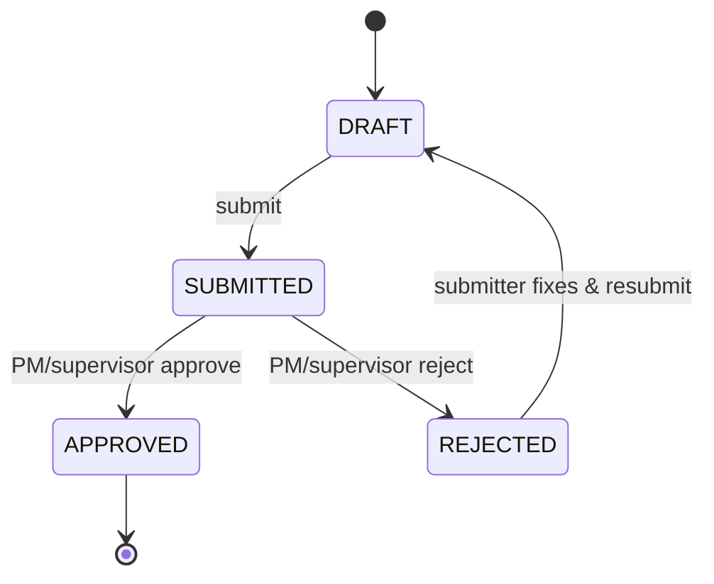

---

## Timesheet Weekly Packet

Modul: [`hris-and-payroll.md#weekly-timesheet-packet`](../modules/hris-and-payroll.md#weekly-timesheet-packet).

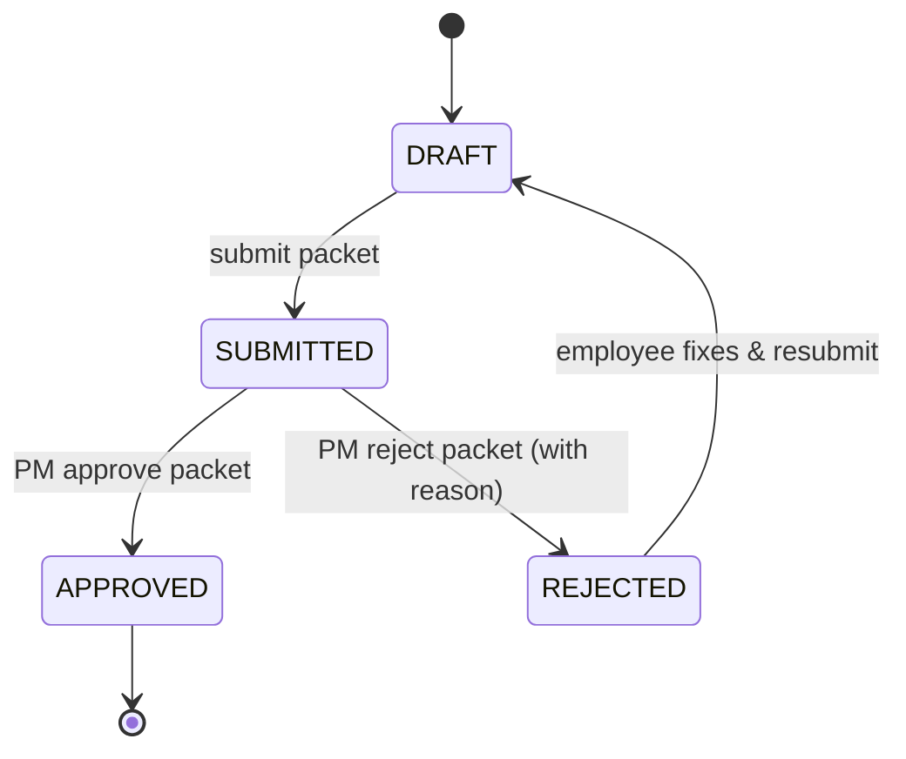

**Cascade**: state packet propagates ke semua `timesheets.status` yang
`week_id = packet.id`.

---

## Payroll Period

Modul: [`hris-and-payroll.md#payroll-periods`](../modules/hris-and-payroll.md#payroll-periods).

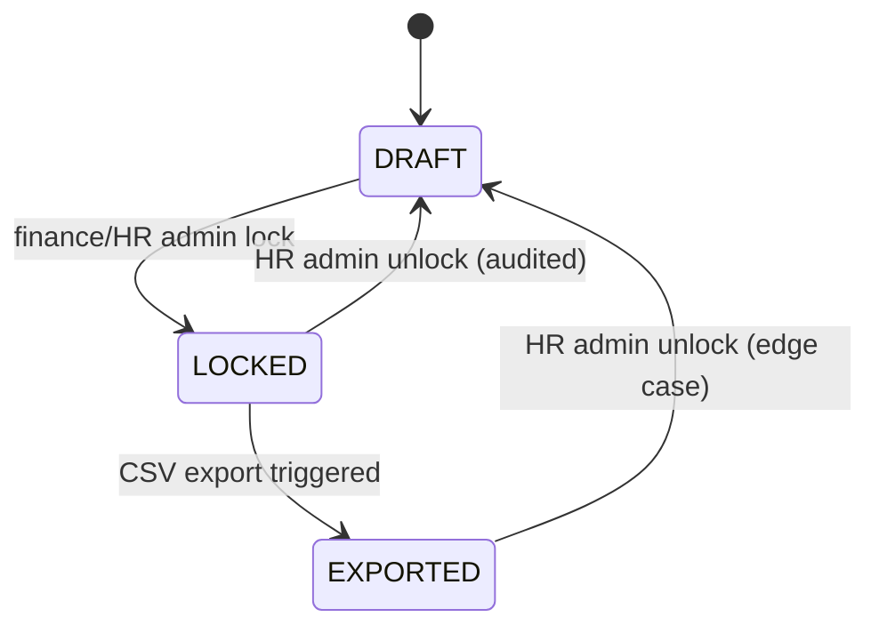

Setelah `LOCKED`, timesheet dan HR requests di rentang period **tidak
bisa diedit**. Unlock hanya oleh HR Admin dengan audit trail wajib.

---

## Client Portal User

Modul: [`clients-and-portal.md#tables`](../modules/clients-and-portal.md#tables).

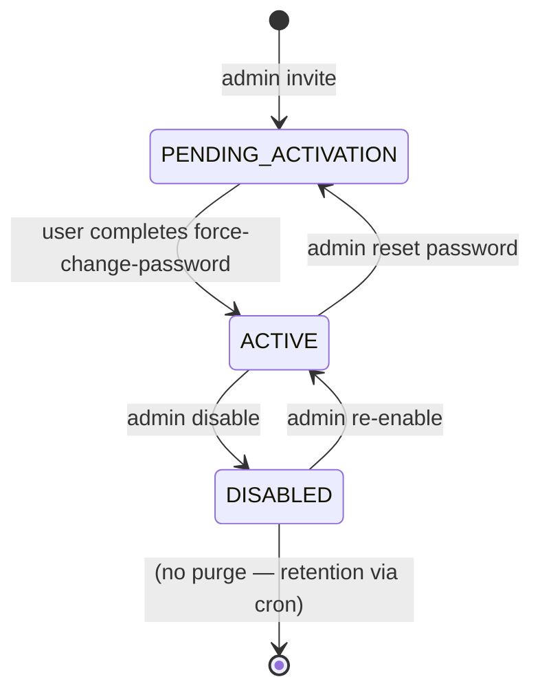

**Force-change-password** ditegakkan di `requirePortalSession()`
guard — user `PENDING_ACTIVATION` diredirect ke `/portal/change-password`
sampai mereka set password sendiri.

---

## Where to look next

- Approval chain thresholds untuk masing-masing: [`../product/approval-workflows.md`](../product/approval-workflows.md).
- Detail per modul: [`../modules/`](../modules/).
- Kode helper state machine: `src/lib/{module}/state.ts` + `*.test.ts`.
