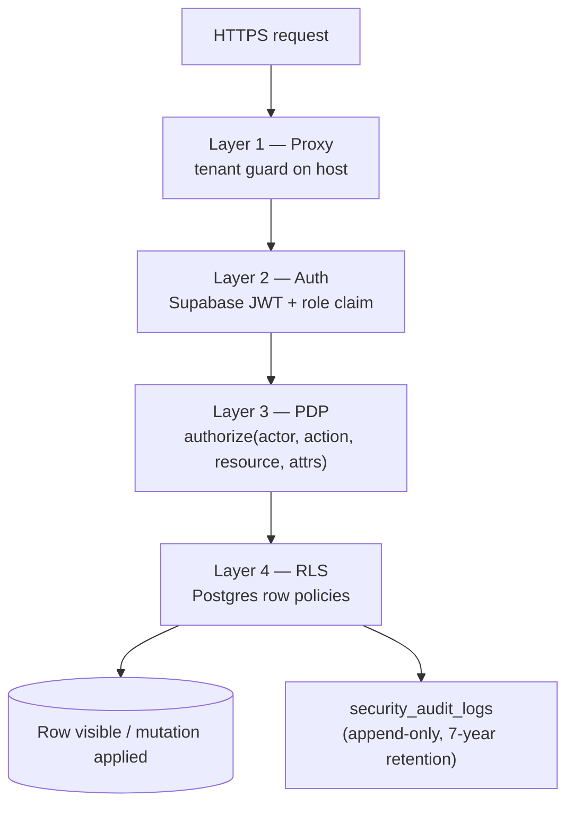
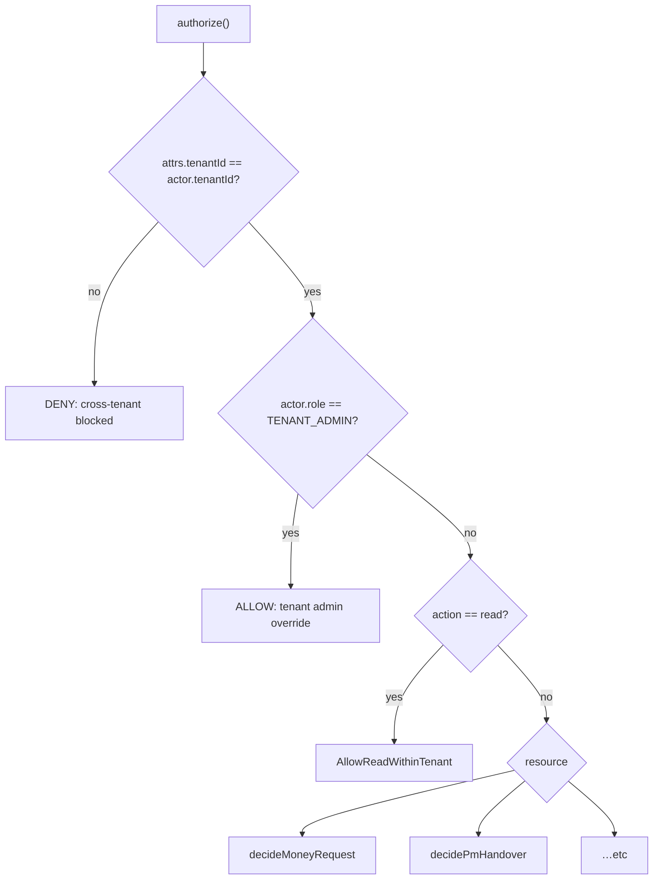

# Security model

ControlDesk enforces access control at **four independent layers**.
A regression in one layer must not expose data if the others hold.



## Layer 1 — Proxy tenant guard

Source: [`proxy.ts`](../proxy.ts).

- Resolves `{tenant_slug}` from the host header.
- If the request carries a Supabase session, verifies the JWT
  `tenant_slug` claim matches the host. Mismatch → session cleared,
  redirect to `/login`.
- Generates or preserves `x-request-id` for downstream trace
  correlation.
- Ops endpoints (`/api/health`, `/api/ready`, `/api/version`,
  `/api/observability/report`) bypass the tenant check.

Anti-abuse: this layer is the ONLY place that trusts the host header
value. Every downstream check reads from the JWT + database, not the
host.

## Layer 2 — Authentication

Source: `supabase/migrations/0002_tenants_and_auth.sql`,
`0003_rls_helpers.sql`.

- Every user is provisioned via Supabase Auth (email + password by
  default; magic-link routes exist).
- A custom access-token hook enriches the JWT with `tenant_id`,
  `tenant_slug`, `role`, `employee_id` — pulled from
  `public.employees` at token-issue time.
- RSC + Server Actions read the current employee via
  `requireCurrentEmployee()` (`src/lib/auth/session.ts`).

## Layer 3 — Policy Decision Point (PDP)

Source: [`src/lib/security/pdp.ts`](../src/lib/security/pdp.ts).

`authorize({ actor, action, resource, attributes })` returns
`ALLOW | DENY` with a `reason` string. Pure function — no I/O, so
every decision is unit-testable.

Contract:

```ts
type ActionVerb =
  | "create" | "read" | "update" | "delete"
  | "submit" | "approve" | "reject" | "cancel"
  | "disburse" | "settle" | "export";

type ResourceType =
  | "expense" | "cash_advance" | "cash_advance_settlement"
  | "petty_cash_fund" | "petty_cash_voucher" | "petty_cash_replenishment"
  | "hr_request" | "hr_request_sick"
  | "client" | "bpo_contract" | "project"
  | "project_pm_assignment" | "project_employee_assignment" | "project_budget"
  | "pm_handover" | "ai_insight"
  | "work_shift" | "roster_entry" | "timesheet" | "payroll_period"
  | "employee" | "audit_log"
  | "data_archive" | "secret_rotation";
```

Decision flow:



Never introduce a new resource type without also adding a `decide*`
function and unit tests in `src/lib/security/pdp.test.ts`.

## Layer 4 — Row-Level Security (RLS)

Every tenant-scoped table has RLS enabled with policies that reference
`public.current_tenant_id()` (a SECURITY DEFINER function that reads
`tenant_id` from `auth.jwt()`).

Pattern:

```sql
alter table public.expenses enable row level security;

create policy expenses_tenant_isolation
  on public.expenses
  for all
  using  (tenant_id = public.current_tenant_id())
  with check (tenant_id = public.current_tenant_id());
```

Additional policies can layer on role checks (e.g. `finance_only`,
`hr_admin_write`). See individual migration files.

Global infrastructure tables (`secret_rotations`, `cron_run_log`,
`data_archives`, `email_outbox`) do not have `tenant_id` — their RLS
policies scope on role instead, or restrict entirely to `service_role`.

## Audit trail

Source: `supabase/migrations/0004_security_audit.sql`.

- Table `security_audit_logs` — INSERT-only. A BEFORE UPDATE / DELETE
  trigger raises `42501`. Truly append-only.
- Retention: 7 years (rules §22 — Indonesian PPh / PPN audit
  requirement).
- Written via `recordAudit()` (`src/lib/security/audit.ts`), which
  calls the `record_audit_log()` RPC.
- Sensitive keys (`password`, `salary`, `bank_account_number`,
  `api_key`, `token`, `secret`, …) are auto-redacted before insert
  through a fixed allow-list.

For the rare purge case (10-year+ audit rows), see the
`purge_archived_audit_logs()` SECURITY DEFINER helper in
`0017_data_archives.sql`. It temporarily bypasses the immutability
trigger with `session_replication_role = replica`, and is only invoked
by the retention worker after the batch is confirmed archived.

## Server Action wrapper — the single-line contract

Every mutation follows the same pattern:

```ts
"use server";

import { withSecureAction } from "@/lib/security/action-wrapper";
import { fooSchema } from "@/lib/validation/foo";

export const createFooAction = withSecureAction({
  schema: fooSchema,
  resource: "foo",              // must exist in pdp.ts
  action: "create",
  auditAction: "CREATE",        // must exist in AuditActionType
  auditResourceName: "foos",    // table name
  resolveAttributes: async (input, ctx) => ({
    tenantId: ctx.actor.tenantId,
    projectId: input.project_id,
  }),
  handler: async (input, ctx) => {
    // ... your mutation ...
    return {
      result: { id: inserted.id, status: inserted.status },
      auditResourceId: inserted.id,
      auditOldValues: null,     // create → no old snapshot
      auditNewValues: { project_id: input.project_id, status: "PENDING_L1" },
    };
  },
});
```

Guarantees the wrapper provides:

1. **Auth** — `requireCurrentEmployee()` runs first. Unauthenticated
   caller → `{ ok: false, code: "UNAUTHENTICATED" }`.
2. **Validation** — Zod schema. Failure →
   `{ ok: false, code: "VALIDATION" }`.
3. **Authorization** — PDP `authorize()`. Deny →
   `{ ok: false, code: "FORBIDDEN", reason }`.
4. **Audit** — `security_audit_logs` row written after mutation.
   Audit-write failure hard-fails the action (`AUDIT_FAILED`) — a
   silently-lost audit trail is unacceptable per rules §3.

Never write a mutation Server Action outside this wrapper.

## Rate limiting

Source: [`src/lib/security/rate-limit.ts`](../src/lib/security/rate-limit.ts).

Fixed-window limiter over Redis with in-memory fallback. Preset windows:

| Preset            | Window | Purpose                                     |
| ----------------- | ------ | ------------------------------------------- |
| `auth-login`      | 60 s   | Password attempts per IP + email.           |
| `auth-reset`      | 15 min | Password reset requests.                    |
| `ai-insights`     | 60 min | AI generation calls per tenant.             |
| `obs-report`      | 5 min  | Client crash reports per IP.                |
| `cron`            | n/a    | CRON_SECRET-bearer only, no rate limit.     |

## At-rest encryption

Source: [`src/lib/security/crypto.ts`](../src/lib/security/crypto.ts).

- HRIS PII columns (`salary`, `ktp`, `npwp`, `bank_account_number`)
  are encrypted with `pgcrypto` under `APP_ENCRYPTION_KEY`.
- SQL fragment builders: `encryptedInsert()`, `decryptedSelect()`.
- UI masking: `maskSensitive()` + `canReadSensitive(role)` for anyone
  outside HR + finance + admin.
- Rotation runbook: [`ops/secret-rotation.md`](ops/secret-rotation.md).

## PII redaction (AI + observability)

Rules §15 / §21 require PII to be scrubbed **before** it leaves the
application boundary.

- **AI prompts** — `src/lib/ai/redact.ts` replaces names → hashes,
  salaries → range buckets, bank accounts → last-4, KTP → dropped.
- **Observability events** — `src/lib/observability/sink.ts`
  `redactPayload()` scrubs sensitive keys + long hex/base64 tokens
  recursively before dispatch.

Both flows are unit-tested with adversarial payloads.

## Secret rotation

Every long-lived secret is tracked in `public.secret_rotations`
(seeded by migration `0018`). The 90-day rotation window is enforced
by:

- `secret_rotation_status()` SQL function returns computed severity.
- `/api/cron/rotation-check` (weekly Monday 09:00 WIB) dispatches
  `SYSTEM` notifications to every `TENANT_ADMIN` for anything WARN /
  OVERDUE.
- `/settings/secrets` ops UI shows the registry + a mark-rotated
  dialog (TENANT_ADMIN only, writes an `UPDATE` audit log).

Full runbook: [`ops/secret-rotation.md`](ops/secret-rotation.md).

## Threat model — quick reference

| Threat                                         | Mitigation                                          |
| ---------------------------------------------- | --------------------------------------------------- |
| Cross-tenant read via manipulated JWT          | RLS + `current_tenant_id()` (Layer 4)               |
| Cross-tenant read via manipulated host header  | Proxy tenant guard (Layer 1)                        |
| Privilege escalation via role tampering        | JWT re-signed on every session; role claim from DB  |
| Audit trail tampering                          | INSERT-only trigger (`0004_security_audit.sql`)     |
| PII exposure in logs                           | Sink `redactPayload()` + structured logger scoping  |
| PII exposure in AI prompts                     | `scrubPrompt()` before `generateObject`             |
| Signed URL replay                              | 300s TTL + short-lived; audited as `EXPORT`         |
| Compromised secret                             | 90-day rotation cron + runbook (`ops/secret-rotation.md`) |
| Cold-archive tampering                         | `data_archives.checksum_sha256` + verify UI         |
| Data-at-rest exposure (HRIS PII)               | pgcrypto + `APP_ENCRYPTION_KEY`                     |
| Rate-limit exhaustion / abuse                  | Redis limiter with tight windows per action         |
