# ControlDesk User Guide — Alur Kerja per Role

**Visual companion** untuk program training. Doc ini menjawab pertanyaan
"apa yang saya lakukan setiap hari?" dan "bagaimana dokumen saya sampai
approved?" dalam bentuk **diagram alur (workflow)** — bukan sekedar
step-by-step teks.

Baca [`README.md`](README.md) untuk konteks program training, dan
[`hands-on-labs.md`](hands-on-labs.md) untuk latihan hands-on. Doc ini
di antara keduanya: **konsep + narative + diagram**, tanpa harus login.

## Cara pakai doc ini

- **Peserta training** — baca sesi role Anda + cross-role scenario yang
  melibatkan Anda. Bookmark untuk quick reference setelah training.
- **Trainer** — pakai diagram sebagai slide di sesi kelas
  ([`curriculum.md`](curriculum.md)). Screen-share bagian yang relevan.
- **Tenant Admin** — kirim ke user baru sebagai first-read sebelum
  onboarding.
- **Developer / QA** — cross-check bahwa implementasi UI = alur di doc
  ini. Kalau beda, patch salah satu di PR yang sama.

Semua diagram pakai **Mermaid** (rendered otomatis di GitHub + banyak
markdown viewer + IDE modern). Kalau viewer Anda tidak render Mermaid,
diagram tetap bisa dibaca sebagai teks.

## Table of contents

- [Persona reminder](#persona-reminder)
- [Universal — semua role](#universal--semua-role)
  - [Login & first-steps workflow](#login--first-steps-workflow)
  - [Notification bell workflow](#notification-bell-workflow)
- [Alur harian per role](#alur-harian-per-role)
  - [Employee (`EMPLOYEE`)](#employee-employee)
  - [Supervisor (`SUPERVISOR`)](#supervisor-supervisor)
  - [Project Manager (`PM`)](#project-manager-pm)
  - [Operations Manager (`OM`)](#operations-manager-om)
  - [Finance (`FINANCE`)](#finance-finance)
  - [Director (`DIRECTOR`)](#director-director)
  - [Admin (`ADMIN` / Tenant Admin)](#admin-admin--tenant-admin)
  - [Client Portal user (`CLIENT`)](#client-portal-user-client)
- [Cross-role scenarios (end-to-end)](#cross-role-scenarios-end-to-end)
  - [Scenario 1 — Expense kecil (< 5 juta)](#scenario-1--expense-kecil--5-juta)
  - [Scenario 2 — Expense sedang (5–50 juta)](#scenario-2--expense-sedang-550-juta)
  - [Scenario 3 — Expense besar (≥ 50 juta)](#scenario-3--expense-besar--50-juta)
  - [Scenario 4 — Cash Advance General + settlement](#scenario-4--cash-advance-general--settlement)
  - [Scenario 5 — Cash Advance Field Ops (Supervisor rung 0)](#scenario-5--cash-advance-field-ops-supervisor-rung-0)
  - [Scenario 6 — Petty Cash spend + reconciliation](#scenario-6--petty-cash-spend--reconciliation)
  - [Scenario 7 — WBS task lifecycle (TODO → DONE)](#scenario-7--wbs-task-lifecycle-todo--done)
  - [Scenario 8 — Gantt drag-to-reschedule](#scenario-8--gantt-drag-to-reschedule)
  - [Scenario 9 — Weekly timesheet + approval](#scenario-9--weekly-timesheet--approval)
  - [Scenario 10 — HR leave request (Employee → Supervisor → PM)](#scenario-10--hr-leave-request-employee--supervisor--pm)
  - [Scenario 11 — Budget request (Increase / Decrease / Transfer)](#scenario-11--budget-request-increase--decrease--transfer)
  - [Scenario 12 — Client Portal milestone notification](#scenario-12--client-portal-milestone-notification)
- [Decision trees](#decision-trees)
  - ["Approver saya siapa?"](#approver-saya-siapa)
  - ["Milestone atau WBS Task?"](#milestone-atau-wbs-task)
  - ["Saya lihat 'Access denied' — kenapa?"](#saya-lihat-access-denied--kenapa)
- [Where to look next](#where-to-look-next)

## Persona reminder

Semua contoh di doc ini pakai persona seed dari sandbox training
(catalog lengkap: [`../qa/e2e-roleplay.md#cast`](../qa/e2e-roleplay.md#cast--11-persona-internal--3-portal)).

| Persona          | Role canonical | Email                              |
| ---------------- | -------------- | ---------------------------------- |
| Ayu Admin        | `ADMIN`        | `admin@demo.controldesk.app`       |
| Gita General     | `DIRECTOR`     | `gm@demo.controldesk.app`          |
| Omar Operations  | `OM`           | `om@demo.controldesk.app`          |
| Putri PM         | `PM`           | `pm@demo.controldesk.app`          |
| Sinta Supervisor | `SUPERVISOR`   | `supervisor@demo.controldesk.app`  |
| Eko Employee     | `EMPLOYEE`     | `employee@demo.controldesk.app`    |
| Fajar Finance    | `FINANCE`      | `finance@demo.controldesk.app`     |
| Pandu Petty      | `FINANCE`      | `pettycash@demo.controldesk.app`   |

Password sandbox universal: **`ControlDesk#2026`**.

---

## Universal — semua role

### Login & first-steps workflow

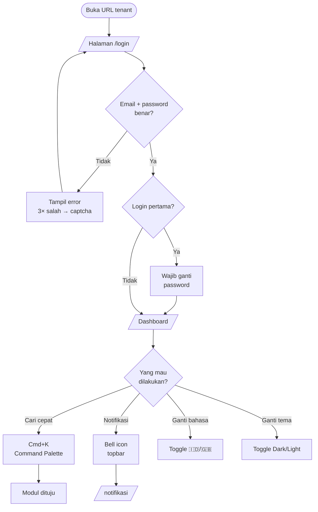

**Poin penting**:

- Password universal training tidak berlaku di production — user baru
  di production terima invitation via email.
- Kalau tenant enable 2FA, setelah password ada satu step lagi untuk
  input TOTP.
- Session default 8 jam idle timeout. Lewat itu → auto-logout.

### Notification bell workflow

Setiap event yang butuh perhatian user diberi notifikasi in-app +
(opsional) email + WhatsApp + Telegram sesuai preferensi.

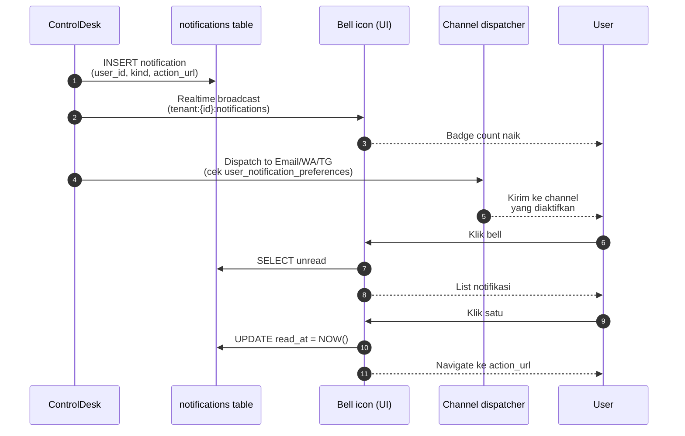

**Fail-open**: kalau email/WA/TG gagal (SMTP down, WA rate limit),
notifikasi in-app tetap ada. Sistem log kegagalan ke
`notification_dispatch_logs` tapi tidak block Server Action.

---

## Alur harian per role

### Employee (`EMPLOYEE`)

**Persona**: Eko Employee. Kompetensi: individual contributor —
mengeksekusi task project + submit dokumen (timesheet, expense, CA,
HR request).

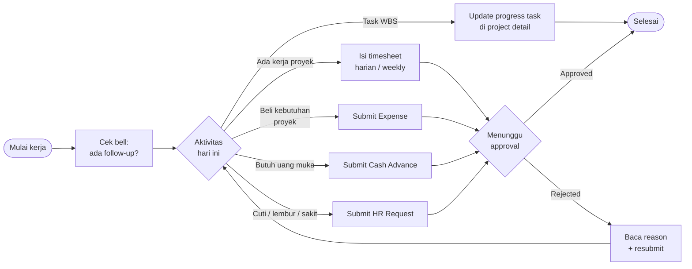

**Access matrix**:

| Bisa                                          | Tidak bisa                                     |
| --------------------------------------------- | ---------------------------------------------- |
| View project yang di-assign                   | View project yang tidak di-assign              |
| Submit Expense / CA / Timesheet / HR request  | Approve dokumen orang lain                     |
| Update progress task WBS yang owner = dia     | Create / edit / delete WBS task                |
| Update profile diri sendiri                   | Edit master data karyawan lain                 |
| View bell + notifikasi ke diri sendiri        | View audit log tenant                          |

**Rujukan doc**: [`../user-guides/internal-users.md#employee`](../user-guides/internal-users.md#employee).

### Supervisor (`SUPERVISOR`)

**Persona**: Sinta Supervisor. Kompetensi: team lead / on-site
supervisor. Approver level 1 untuk dokumen tim + selalu rung 0 untuk
Cash Advance Field Ops.

```mermaid
flowchart LR
    Morning([Mulai kerja]) --> Bell[Cek bell:<br/>pending approvals?]
    Bell --> Inbox[/approvals inbox/]
    Inbox --> Filter{Filter apa yang<br/>butuh saya?}
    Filter -->|Field Ops CA| CAFO[Review RAB<br/>+ justifikasi]
    Filter -->|HR request L1| HR[Review cuti/lembur<br/>tim]
    Filter -->|Timesheet<br/>(opsional)| TS[Review packet<br/>anggota tim]
    Filter -->|Expense L1<br/>(kalau ada)| EXP[Review dokumen<br/>+ receipt]
    CAFO --> Decide{Approve /<br/>Reject / Klarifikasi}
    HR --> Decide
    TS --> Decide
    EXP --> Decide
    Decide -->|Approve| Forward[Chain lanjut<br/>ke rung berikutnya]
    Decide -->|Reject| Reason[Isi reason<br/>≥ 20 char]
    Decide -->|Klarifikasi| Comment[Comment +<br/>tag submitter]
    Forward --> Done([Selesai])
    Reason --> Done
    Comment --> Done
```

**Access matrix**:

| Bisa                                            | Tidak bisa                                       |
| ----------------------------------------------- | ------------------------------------------------ |
| Approve HR request level 1 anggota tim          | Approve HR level 2 (itu PM)                      |
| Approve Field Ops CA rung 0 (selalu)            | Approve expense di atas threshold Finance sendiri |
| Approve Expense L1 kalau di chain (di bawah PM) | Approve budget request (itu PM+Finance)          |
| Create + edit WBS task (SUPERVISOR+)            | Delete WBS task (butuh PM+)                      |
| View project di mana dia terlibat               | View project di luar tim-nya                     |

**Rujukan doc**: [`../user-guides/internal-users.md#supervisor`](../user-guides/internal-users.md#supervisor).

### Project Manager (`PM`)

**Persona**: Putri PM. Kompetensi: penanggung jawab proyek. Approver
level 2 untuk dokumen finansial. Kelola WBS + Gantt + assignment.

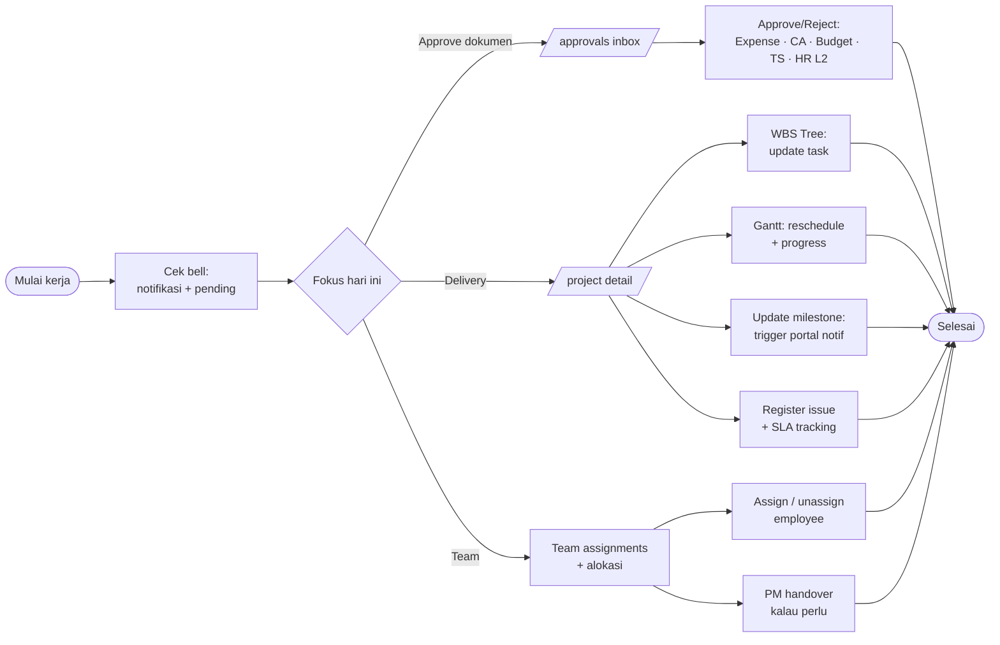

**PM approval chain matrix** (ambang PM harus approve):

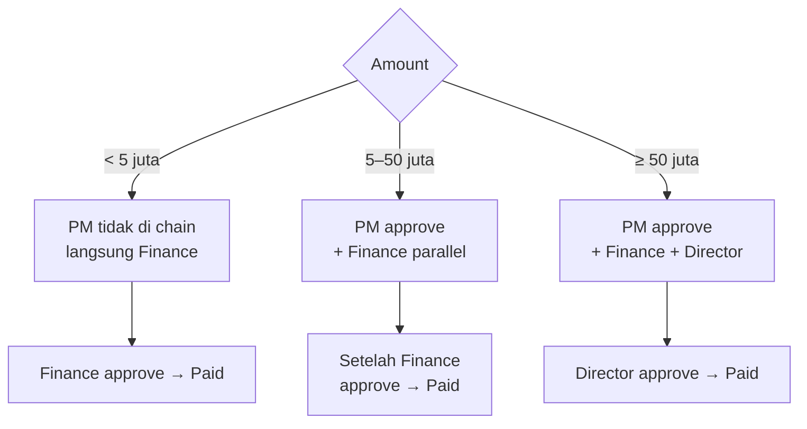

**Access matrix**:

| Bisa                                            | Tidak bisa                                       |
| ----------------------------------------------- | ------------------------------------------------ |
| Approve dokumen finansial rung 5-50M            | Approve > 50M (butuh Director)                   |
| Full CRUD WBS + milestone di proyek dia         | CRUD di proyek yang bukan dia PM                 |
| Assign/unassign employee ke project             | Assign PM (itu OM)                               |
| Trigger PM handover (dengan approval OM)        | Skip approval chain                              |

**Rujukan doc**: [`../modules/projects.md`](../modules/projects.md),
[`../user-guides/internal-users.md#project-manager`](../user-guides/internal-users.md#project-manager).

### Operations Manager (`OM`)

**Persona**: Omar Operations. Kompetensi: membawahi > 1 PM. Cross-project
decisions + Field Ops CA rung mid + PM handover approver.

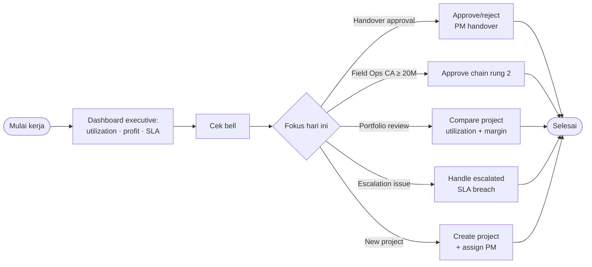

**Access matrix**:

| Bisa                                            | Tidak bisa                                       |
| ----------------------------------------------- | ------------------------------------------------ |
| View + edit semua project di portfolio          | Skip approval Director untuk ≥ 50M               |
| Assign / unassign PM ke project                 | Configure tenant-level threshold (itu Admin)     |
| Approve Field Ops CA rung 2 (≥ 20M)             | Approve HR request (itu PM/Supervisor + HR)      |
| Approve PM handover (rung 1)                    | Rotate tenant secrets                            |

### Finance (`FINANCE`)

**Persona**: Fajar Finance. Kompetensi: gatekeeper cashflow. **Selalu**
di chain approval finansial (bukan level, tapi parallel gate). Owner
petty cash + disbursement + settlement.

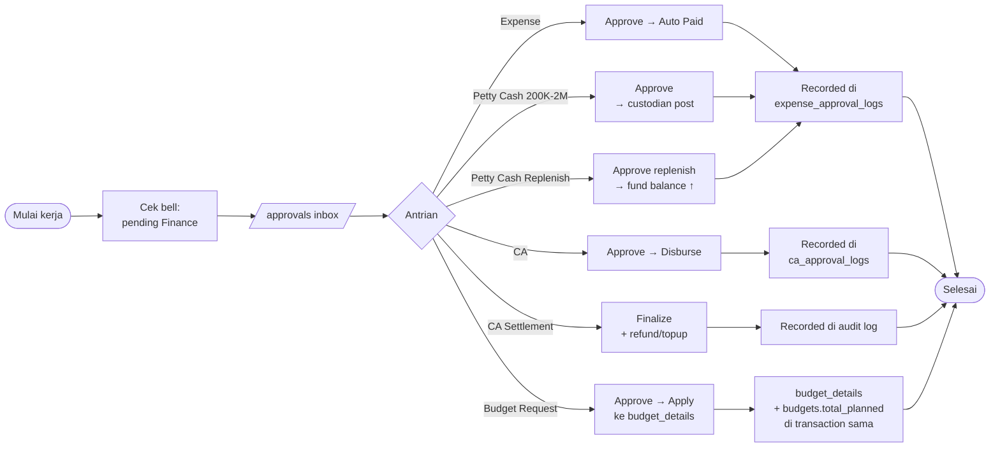

**Kunci finance**:

- Semua kolom uang di database `numeric(18,2)` IDR. Format display
  otomatis `Intl.NumberFormat("id-ID", { currency: "IDR" })`.
- Verify receipt attach + amount cocok sebelum approve.
- Disburse bukan approve — beda tombol, beda audit action.

### Director (`DIRECTOR`)

**Persona**: Gita General. Kompetensi: executive tier. Approver
terminal untuk dokumen di atas Director threshold. Read-all access.

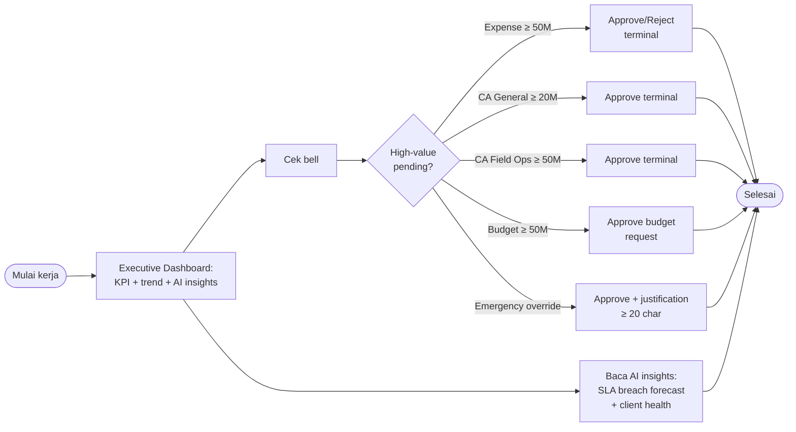

**Emergency override**: Director bisa short-circuit chain di bawahnya
kalau perlu — tapi wajib isi justification ≥ 20 karakter yang masuk
audit trail permanent.

### Admin (`ADMIN` / Tenant Admin)

**Persona**: Ayu Admin. Kompetensi: super-admin tenant. Manage user,
role, master data, threshold, integration, audit.

```mermaid
flowchart LR
    Morning([Mulai kerja]) --> Adm{Admin task hari ini}
    Adm -->|User baru| Invite[Invite via email<br/>+ role assignment]
    Adm -->|Client portal| Portal[Invite client user<br/>+ trigger reset]
    Adm -->|Tune threshold| Threshold[/settings/approval-thresholds/]
    Adm -->|Setup integrasi| Int[SMTP · WA · TG ·<br/>AI · Calendar]
    Adm -->|Rotate secret| Secret[Rotate encryption<br/>+ API keys]
    Adm -->|Audit review| Audit[/settings/audit-log/<br/>filter · export]
    Adm -->|Emergency override| Ovr[Approve step manapun<br/>+ justification]
    Invite --> Done([Selesai])
    Portal --> Done
    Threshold --> Done
    Int --> Done
    Secret --> Done
    Audit --> Done
    Ovr --> Done
```

**Governance rules**:

- Semua aksi Admin ter-record di `security_audit_logs` — immutable.
- Threshold override tidak boleh melanggar constraint
  `approval_thresholds_ordered_ck` (finance ≤ pm ≤ director).
- Rotate secret minimum 90 hari — cron reminder otomatis.

### Client Portal user (`CLIENT`)

**Persona**: PT Nusa Digital client user. External user, read-only ke
proyek klien mereka sendiri.

```mermaid
flowchart LR
    Portal([Buka /portal/login]) --> Auth[Login]
    Auth --> Home[/portal/]
    Home --> View{Lihat apa?}
    View -->|Progress proyek| Proj["/portal/projects/:id<br/>timeline + milestone"]
    View -->|Notifikasi| Notif[/portal/notifications/]
    View -->|Dokumen| Docs[Download signed URL<br/>(TTL 300s)]
    Proj --> Read((Read-only))
    Notif --> Read
    Docs --> Read
```

**Isolation**:

- Client user hanya lihat data client_id mereka. Cross-tenant / cross-client
  akses = 403 dari middleware + RLS.
- Tidak bisa submit / edit apapun — hanya read.
- Rate-limit login lebih ketat (`5 attempts / 15 menit`).

**Rujukan doc**: [`../user-guides/client-portal-users.md`](../user-guides/client-portal-users.md).

---

## Cross-role scenarios (end-to-end)

Setiap scenario menampilkan **siapa melakukan apa, di layar mana, kapan**.
Sequence diagram dibaca top-to-bottom sebagai timeline.

### Scenario 1 — Expense kecil (< 5 juta)

Chain: **Finance only**.

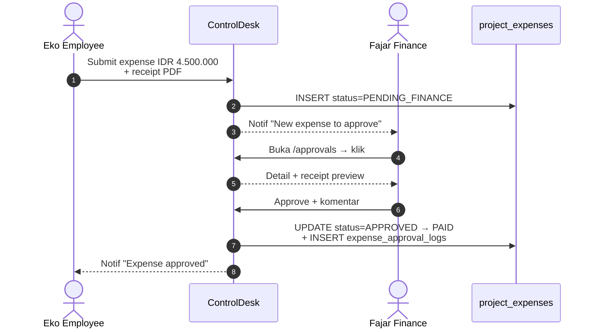

**Kunci**: PM tidak di chain karena amount < 5M. Approval Finance saja
sudah cukup, langsung transisi ke `PAID`.

### Scenario 2 — Expense sedang (5–50 juta)

Chain: **PM + Finance** (Finance = parallel gate).

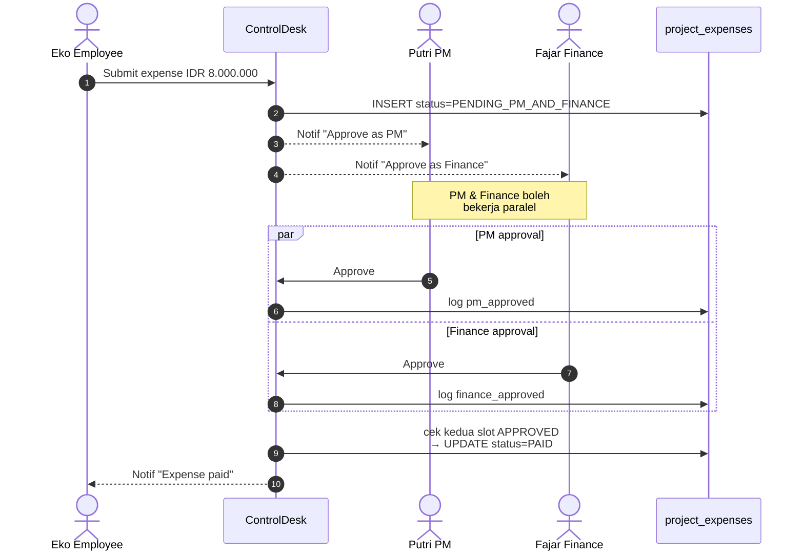

**Kunci**: Finance tidak harus menunggu PM. UI menampilkan sebagai
timeline dengan slot paralel.

### Scenario 3 — Expense besar (≥ 50 juta)

Chain: **PM + Finance + Director** (Director sequential setelah dua di
atasnya).

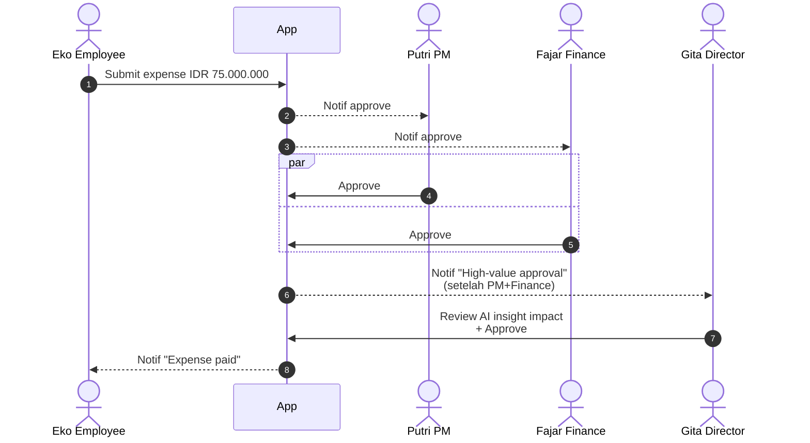

**Kunci**: Director hanya notified setelah PM + Finance dua-duanya
approved. Kalau salah satu reject di rung bawah, Director tidak dilibatkan.

### Scenario 4 — Cash Advance General + settlement

CA workflow terdiri dari **dua fase**: pre-disbursement (approval) dan
post-disbursement (settlement).

**Phase 1: approval + disburse**

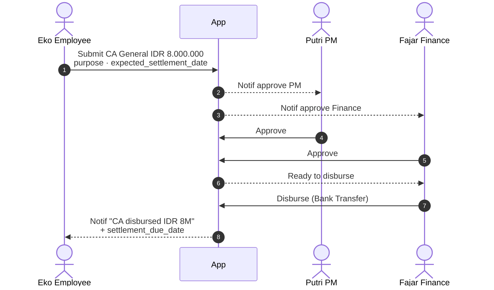

**Phase 2: settlement**

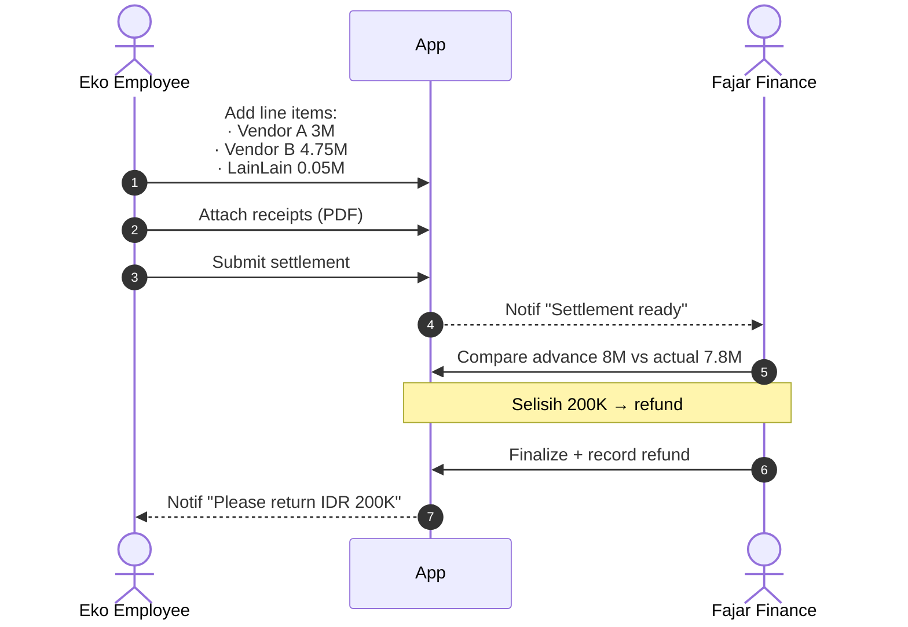

**Kunci**: kalau `actual > advance`, Finance top-up reimbursement (bukan
refund). Semua ter-record di `ca_approval_logs` + `security_audit_logs`.

### Scenario 5 — Cash Advance Field Ops (Supervisor rung 0)

Field Ops CA punya **chain berbeda** karena butuh validasi lapangan.

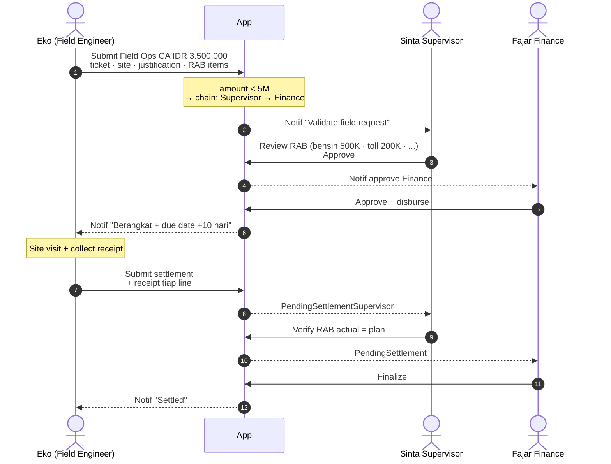

**Threshold chain Field Ops**:

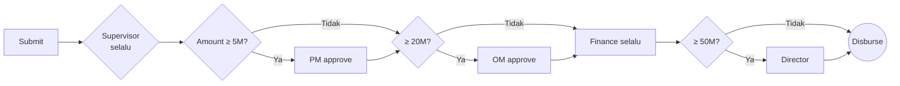

### Scenario 6 — Petty Cash spend + reconciliation

Petty cash pakai **imprest fund system** — 1 fund per lokasi/cabang,
custodian bertanggung jawab.

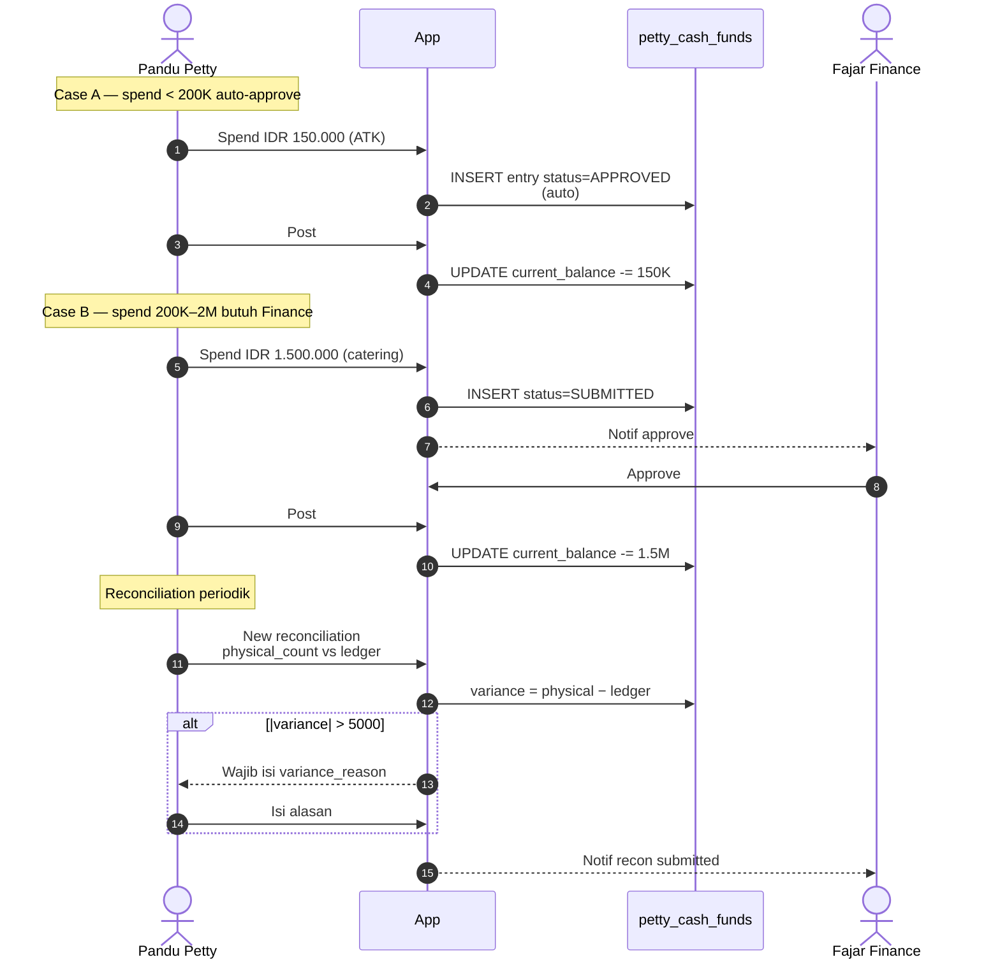

**Batas**: spend > 2M **dilarang** di petty cash — harus lewat Expense
flow full approval.

### Scenario 7 — WBS task lifecycle (TODO → DONE)

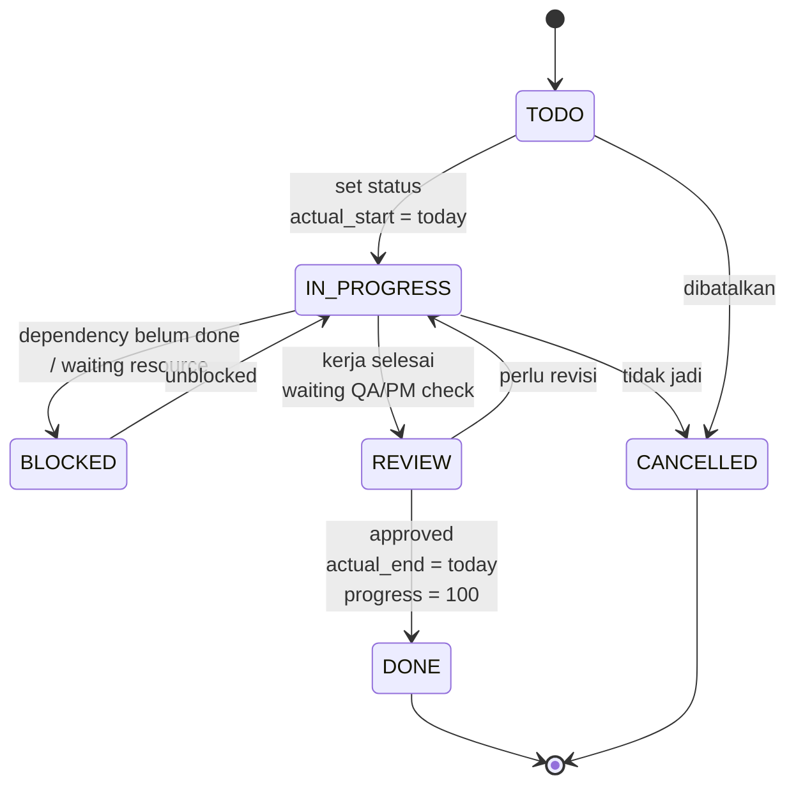

**Auto-effect saat transisi**:

- `→ IN_PROGRESS` — `actual_start_date = today` (kalau null).
- `→ DONE` — `actual_end_date = today` + `progress_pct = 100`.
- `→ CANCELLED` — `progress_pct` beku di nilai terakhir.

**Progress rollup on-read** — parent tidak edit sendiri; dihitung dari
weighted average descendants di `buildTaskTree()`.

### Scenario 8 — Gantt drag-to-reschedule

```mermaid
sequenceDiagram
    autonumber
    actor Putri as Putri PM
    participant Gantt as Gantt UI (frappe-gantt)
    participant App
    participant DB as project_tasks

    Putri->>Gantt: Drag bar task 1.1<br/>ke kanan 3 hari
    Gantt->>App: setTaskDatesAction<br/>(id, new_start, new_end)
    App->>DB: UPDATE planned_start_date<br/>+ planned_end_date
    App-->>Gantt: OK
    Gantt-->>Putri: Bar update visual

    Putri->>Gantt: Drag progress handle<br/>50% → 100%
    Gantt->>App: setTaskProgressAction(id, 100)
    App-->>Putri: Konfirmasi "Auto-set status DONE?"
    Putri->>App: Ya
    App->>DB: UPDATE progress_pct=100<br/>+ status=DONE<br/>+ actual_end=today
    App-->>Gantt: OK
    Gantt-->>Putri: Bar hijau + progress 100%
```

### Scenario 9 — Weekly timesheet + approval

```mermaid
sequenceDiagram
    autonumber
    actor Eko as Eko Employee
    participant App
    actor Putri as Putri PM

    Note over Eko: Jumat 14:30 WIB
    Eko->>App: Buka /hr/timesheets/weekly<br/>pilih minggu lalu
    Eko->>App: Isi Senin-Jumat 8 jam/hari<br/>project KIRA-DA
    Eko->>App: Submit packet (5 entry)
    App-->>Putri: Notif "Timesheet 40h to approve"
    Putri->>App: Buka packet, review entries
    Putri->>App: Approve
    App-->>Eko: Notif "Timesheet approved"
    Note over App: Optional auto-lock<br/>setelah N hari → LOCKED
```

**Overtime derived**: `sum(entries.hours per week) − 40`. Tidak ada
request OT formal di Fase 0.

### Scenario 10 — HR leave request (Employee → Supervisor → PM)

```mermaid
sequenceDiagram
    autonumber
    actor Eko as Eko Employee
    participant App
    actor Sinta as Sinta Supervisor
    actor Putri as Putri PM

    Eko->>App: New request LEAVE Annual<br/>H+7 sampai H+9 (3 hari)
    App-->>Sinta: Notif PendingL1
    Sinta->>App: Approve
    App-->>Putri: Notif PendingL2
    Putri->>App: Approve
    App-->>Eko: Notif "Cuti approved"
    App->>App: Update leave calendar<br/>Eko blocked H+7..H+9
```

**Untuk SICK**: sama chain, tapi Zod schema block submit tanpa upload
surat dokter (PDF/JPG/PNG, max 10 MB).

### Scenario 11 — Budget request (Increase / Decrease / Transfer)

```mermaid
flowchart TD
    Start([PM: butuh adjust budget]) --> Type{Type request}
    Type -->|Increase| Inc[Total planned +X<br/>ambil dari reserve]
    Type -->|Decrease| Dec[Total planned -X<br/>release ke reserve]
    Type -->|Transfer| Tr[Move dari line A<br/>ke line B, sum sama]
    Inc --> Amt{Amount}
    Dec --> Amt
    Tr --> Amt
    Amt -->|< 50M| Fin[Finance only]
    Amt -->|≥ 50M| FinDir[Finance + Director]
    Fin --> Apply[APPROVED → APPLIED<br/>mutate budget_details<br/>+ budgets.total_planned<br/>di transaction sama]
    FinDir --> Apply
    Apply --> Done([Selesai])
```

### Scenario 12 — Client Portal milestone notification

```mermaid
sequenceDiagram
    autonumber
    actor Putri as Putri PM
    participant App
    participant Trig as DB trigger
    participant Portal as Client Portal
    actor Client as PT Nusa client user

    Putri->>App: Update milestone "UAT"<br/>status → DONE
    App->>Trig: UPDATE project_milestones
    Trig->>App: enqueue_portal_notification<br/>(client_id, milestone_id)
    App->>Portal: INSERT portal_notifications
    Portal-->>Client: Bell badge naik
    Client->>Portal: Login /portal/login
    Client->>Portal: Klik bell → read notif
    Portal-->>Client: Navigate ke<br/>/portal/projects/:id
    Note over Client: Read-only view<br/>+ download signed URL<br/>untuk dokumen deliverable
```

---

## Decision trees

### "Approver saya siapa?"

```mermaid
flowchart TD
    Q([Saya submit dokumen apa?]) --> Type{Type}
    Type -->|Expense| E{Amount?}
    E -->|< 5M| E1[Finance only]
    E -->|5-50M| E2[PM + Finance]
    E -->|≥ 50M| E3[PM + Finance + Director]
    Type -->|CA General| G{Amount?}
    G -->|< 2M| G1[Finance only]
    G -->|2-20M| G2[PM + Finance]
    G -->|≥ 20M| G3[PM + Finance + Director]
    Type -->|CA Field Ops| F{Amount?}
    F -->|semua| F0[Supervisor + Finance]
    F -->|+ ≥ 5M| F1[+ PM]
    F -->|+ ≥ 20M| F2[+ OM]
    F -->|+ ≥ 50M| F3[+ Director]
    Type -->|Petty Cash| P{Amount?}
    P -->|< 200K| P1[Auto-approve]
    P -->|200K-2M| P2[Finance only]
    P -->|> 2M| P3[❌ pakai Expense]
    Type -->|Budget Request| B{Amount?}
    B -->|< 50M| B1[Finance only]
    B -->|≥ 50M| B2[Finance + Director]
    Type -->|HR request| H[Supervisor L1 → PM L2]
    Type -->|Timesheet| T[PM atau Supervisor<br/>single-step]
```

Untuk **konfigurasi per-tenant** — threshold di atas bisa di-tune Admin
di `/settings/approval-thresholds`. Constraint DB `approval_thresholds_ordered_ck`
tetap mencegah threshold nyeleneh (finance > pm > director).

### "Milestone atau WBS Task?"

```mermaid
flowchart TD
    Q([Saya mau add pekerjaan]) --> Type{Karakteristik}
    Type -->|Titik kalender penting<br/>Kickoff · UAT · GoLive| M[Milestone]
    Type -->|Notifikasi ke Client Portal<br/>saat status berubah| M
    Type -->|Pekerjaan hierarkis<br/>parent → sub → sub-sub| T[WBS Task]
    Type -->|Progress rollup otomatis<br/>dari anak ke induk| T
    Type -->|Owner per pekerjaan detail| T
    Type -->|Perlu drag-to-reschedule<br/>di Gantt| T
    Type -->|Dependency<br/>finish-to-start| T
    M --> Done([project_milestones])
    T --> Done2([project_tasks<br/>+ anchor ke milestone])
```

**Rekomendasi**: Milestone = **kickoff / UAT / go-live** (fase gate);
Task = **semua pekerjaan di antaranya**, di-anchor lewat `milestone_id`.

### "Saya lihat 'Access denied' — kenapa?"

```mermaid
flowchart TD
    Denied([403 / Access denied]) --> C1{Login sukses?}
    C1 -- Tidak --> Login[Login ulang]
    C1 -- Ya --> C2{Route yang saya buka<br/>ada di sidebar saya?}
    C2 -- Tidak --> Role[Role Anda tidak punya izin.<br/>Cek roles-and-permissions.md]
    C2 -- Ya --> C3{Resource yang saya akses<br/>di tenant / project saya?}
    C3 -- Tidak --> Tenant[Cross-tenant / cross-project access<br/>RLS block. Confirm ke Admin]
    C3 -- Ya --> C4{Saya assigned ke resource?}
    C4 -- Tidak --> Assign[Minta PM assign Anda ke project]
    C4 -- Ya --> C5{PDP action verb match?}
    C5 -- Tidak --> Verb[Verb tidak match — misal<br/>coba delete tapi role hanya update.<br/>Cek pdp-canonical.ts]
    C5 -- Ya --> Bug[Kemungkinan bug — report<br/>via bug-reporting.md]
```

---

## Where to look next

- Text-based user guide lengkap (bukan diagram):
  [`../user-guides/internal-users.md`](../user-guides/internal-users.md).
- Client portal user guide:
  [`../user-guides/client-portal-users.md`](../user-guides/client-portal-users.md).
- Ambang / threshold approval kanonik:
  [`../product/approval-workflows.md`](../product/approval-workflows.md).
- Persona role + capability matrix:
  [`../product/roles-and-permissions.md`](../product/roles-and-permissions.md).
- State machine tiap modul:
  [`../reference/state-machines.md`](../reference/state-machines.md).
- Praktik hands-on setiap workflow:
  [`hands-on-labs.md`](hands-on-labs.md).
- E2E persona-driven roleplay scripts (untuk QA):
  [`../qa/e2e-roleplay.md`](../qa/e2e-roleplay.md).
